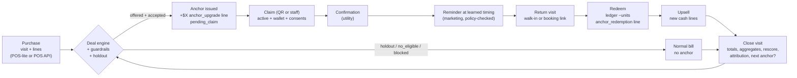
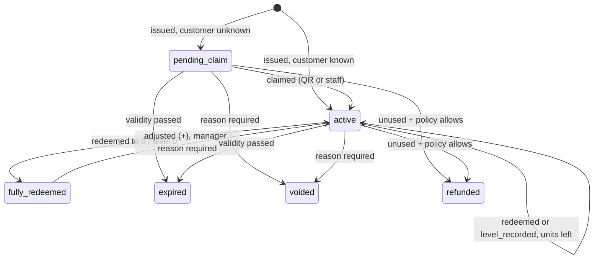
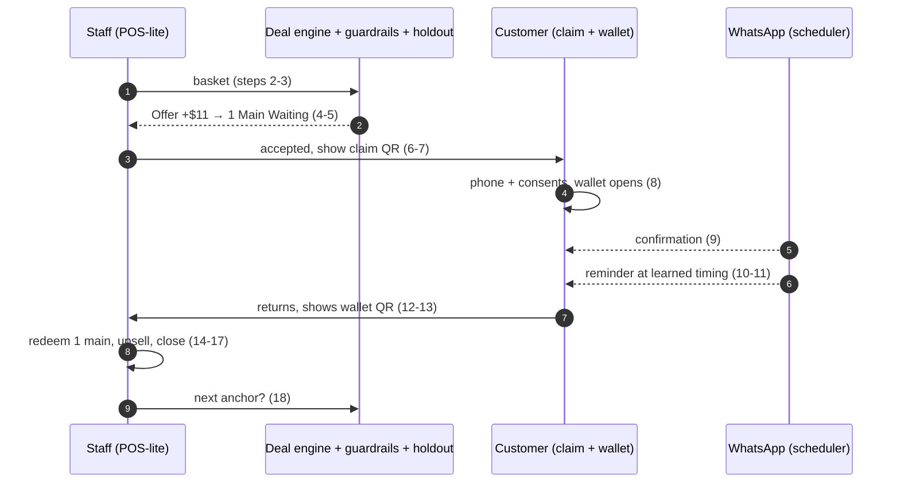

# Return Anchor: Product Specification

> **Deliverable 1** (full product specification) and **Deliverable 23** (MVP scope) from
> [`00-brief.md`](00-brief.md) §18. Phase 2 and Phase 3 (deliverables 24 and 25) are in
> [`roadmap.md`](roadmap.md). Engineering contract: [`../architecture/blueprint.md`](../architecture/blueprint.md).
>
> Brief coverage: §1, §2, §3, §4, §14, §16, §17, §18 items 1 and 23.

## How to read this document

Every capability carries one of these status labels:

| Label | Meaning |
|---|---|
| **Built** | Pure engine, schema or repository exists in `src/` and is unit-tested (`*.test.ts`). |
| **Designed** | Specified in the blueprint (§3 `app/*`, §6 `src/flows/*`) and being built now. Described as designed. |
| **Not yet built** | Needed or requested by the brief, but neither code nor blueprint provides it. |
| **Proposed** | A design decision this document recommends that is not yet in code or blueprint. |

Numbers in worked examples come from running the real engines (`src/modules/*`) against
the real vertical presets (`src/verticals/*`) and default settings (`src/config/defaults.ts`).
Merchant baselines (average visit spend and gross profit) are assumptions, stated next to
each example. Money is SGD, formatted `$` like the brief. Code stores integer cents.

### Necessity verdicts used in the feature inventory

The MVP hypothesis is: **"Does deliberately creating a Return Anchor increase profitable
repeat visits?"** Every feature gets one of these verdicts against that hypothesis:

| Verdict | Meaning |
|---|---|
| **Core** | Without it the hypothesis cannot be tested at all. |
| **Measure** | Needed to know whether the hypothesis is true (causal or financial measurement). |
| **Safety** | Needed so the test does not lose money, break customer trust or break the law. |
| **Helpful** | Improves adoption or statistical power, but the hypothesis is testable without it. First to cut. |
| **Not needed** | Does not help prove the hypothesis. Deferred to Phase 2 or 3. |

### Traceability to the brief

| Brief section | Where answered |
|---|---|
| §1 Core product concept (bars, beer) | §2, §4.6, §6 |
| §2 Restaurant Return-Anchor model | §2, §3.3, §4.5 |
| §3 Dynamic deal engine | §4 |
| §4 Discount and offer engine | §5 |
| §14 Service business version | §6.4 |
| §16 Business principle and core loop | §1, §3 |
| §17 MVP flow (18 steps) | §11 |
| §18 item 1 (full product specification) | whole document |
| §18 item 23 (MVP scope) | §11 |
| §18 items 24, 25 (Phase 2, Phase 3) | [`roadmap.md`](roadmap.md) |
| §19 Devil's advocate | "Challenge" blocks throughout, §10 |

---

## Contents

1. [Positioning](#1-positioning)
2. [The Return Anchor](#2-the-return-anchor)
3. [The core loop](#3-the-core-loop)
4. [Dynamic deal engine](#4-dynamic-deal-engine)
5. [Offer engine and guardrails](#5-offer-engine-and-guardrails)
6. [Vertical model](#6-vertical-model)
7. [Feature inventory](#7-feature-inventory)
8. [Functional requirements by surface](#8-functional-requirements-by-surface)
9. [Non-functional requirements](#9-non-functional-requirements)
10. [MVP hypothesis and success metrics](#10-mvp-hypothesis-and-success-metrics)
11. [MVP scope (deliverable 23)](#11-mvp-scope-deliverable-23)
12. [Open issues for the reconciliation pass](#12-open-issues-for-the-reconciliation-pass)
13. [Glossary](#13-glossary)

---

## 1. Positioning

### 1.1 What it is

> **A retention operating system built around unfinished customer value.** (brief §16)

A merchant uses Return Anchor to deliberately leave each customer holding something they
already own but have not finished: *1 Main Waiting*, *2 Pints Remaining*,
*Macallan 12 · 42% remaining*, *2 Massages Remaining*. The product then reminds the
customer, turns the return visit into new spending, and proves against a randomised
holdout whether the whole thing made the customer more valuable than they would otherwise
have been.

Four jobs, one loop:

| Job | What the merchant gets | Engine (code) |
|---|---|---|
| **Create** the anchor at checkout | "Offer +$11 → 1 Main Waiting" on the staff screen, priced for profit | `deals/engine.ts` `evaluateDeals()` |
| **Keep** the customer aware | WhatsApp reminder at the right moment, a wallet that shows what they own | `messaging/timing.ts`, `messaging/templates.ts`, `anchors/labels.ts` |
| **Monetise** the return | Upsell suggestions ranked by complement and gross profit | `upsell/recommend.ts` `recommendUpsell()` |
| **Prove** it | Holdout lift on contribution per customer, plus attributed revenue | `analytics/lift.ts` `estimateLift()`, `analytics/attribution.ts` |

### 1.2 What it is NOT

| It is not | Why that matters | How the product and code enforce it |
|---|---|---|
| **A loyalty points app** | Points are an abstract currency that trains customers to count, not to come back for something specific. They are also sunk cost the merchant pays on every visit, including visits that would have happened anyway. | No points, no earn rates, no tiers. An entitlement is a whole countable unit of a real product (`quantity_initial >= 1`, integer). Labels come from `entitlementLabel()`: "1 Main Waiting", never "120 pts". |
| **A discount platform** | Discounts teach customers to wait and subsidise people who would have come anyway (brief §5). | The anchor upgrade is a *paid* purchase today (`anchor_upgrade` offer kind: `isDiscount() = false`, `promoCostCents() = 0`). Real discounts are classified by each offer kind's `isDiscount()` and capped by guardrails: `discount-frequency` (60-day gap), `regulars-no-discount`, `price-sensitive-frequency` (2 per 90 days), `no-inactivity-escalation`, `promo-cost-cap` ($15 per 90 days). Selection policy `prefer-non-discount` (`offers/select.ts`) ranks perks above discounts. |
| **A prepaid credit wallet** | Money balances read as "credit", invite cash-out disputes, and in many markets drift towards stored-value or e-money regulation. | Customers see items, not dollars (brief §2: "should NOT see '$22 credit'"). The wallet's "Paid" line shows what was paid, for transparency only. There is no top-up of money, no cash-out, no cross-merchant balance. Liability is capped per merchant (`liability-cap`, $15,000 retail by default). Economics never count breakage: the stored item's cost is charged in full (`ΔE` counts `C` entirely). |

### 1.3 Who it is for, and who it is not for

**For** (vertical presets exist for each, see §6): restaurants and casual dining, bars and
lounges, beer pubs, cafés, salons, spas, fitness studios, car care. The common shape is a
repeatable purchase, a product that can be meaningfully "kept" (a main, a pint, a bottle,
a session), gross margin high enough to fund the kept unit, and a return visit where
complementary items can be sold.

**Not for** (Proposed qualification rules for sales and onboarding):

- Venues with mostly one-off customers (airport, tourist-only). No return visit to anchor.
- Businesses whose anchorable item has thin margin (cost above ~50% of price). `minTodayMarginRate`
  (45%) and the `minExpectedContributionCents` floor ($3) will block almost every offer.
- Merchants who want a coupon blaster. The guardrails will frustrate them by design.

> **Challenge: the positioning itself**
> - **MVP-necessary?** Yes. The positioning is what stops the product sliding into a discount tool that cannot pass the profit test.
> - **Customer may reject:** "Pay more now for something later" reads like an upsell trick if the item is not clearly theirs. Mitigation: item-denominated labels, full terms on the wallet, refund rules.
> - **Merchant may reject:** Expects "a loyalty app". A product without points and with few discounts needs a demo that shows money made (attribution report and holdout lift).
> - **Margin risk:** Low by construction. Every anchor must clear `minExpectedContributionCents` and `minTodayMarginRate`.
> - **Regulatory risk:** Item-denominated, single-merchant, time-limited entitlements are designed to stay clear of stored-value and e-money regimes, but this must be confirmed by counsel in each market before launch. Never add money balances or cross-merchant redemption without that review.
> - **Prove it:** The holdout lift (§10) is the only acceptable proof that the positioning works.

---

## 2. The Return Anchor

### 2.1 Definition

A **Return Anchor** is an entitlement a customer owns at one merchant, denominated in units
of a real product, deliberately left unfinished so that it causes the next visit. In code
it is a row in `entitlements` (status, units, coverage, terms) with an append-only ledger
in `entitlement_events`.

| Concept | Table / type | Example |
|---|---|---|
| **Anchor program**: the merchant's rule for what can be kept and on what terms | `anchor_programs` / `AnchorProgram` | "3-Main Set — keep 1 main" (restaurant preset) |
| **Entitlement**: one customer's anchor | `entitlements` / `Entitlement` | "1 Main Waiting at ABC Kitchen", covers any main up to $24, expires 8 Dec 2026 |
| **Ledger event**: every change, append-only | `entitlement_events` / `EntitlementEvent` | `issued +1`, `claimed 0`, `redeemed −1` |
| **Terms snapshot**: frozen at issue; later program edits never change what was bought | `entitlements.terms_snapshot` / `TermsSnapshot` | coverage text, expiry, redemption rules, refund policy, price paid |

**Anchor program fields** (all Built, `src/modules/anchors/types.ts`):

| Field | Values | Purpose |
|---|---|---|
| `issueMode` | `upgrade_offer` / `stored_purchase` | Created by the deal engine at checkout ("+$11 → keep 1 main") vs something already bought and partly left over (bottle keep, beer bucket, prepaid package) |
| `unitType` | `item` / `percent` / `session` | Countable things (mains, pints), bottle level 0–100, services (massages, classes, washes) |
| `unitLabel`, `unitLabelPlural` | e.g. "Main"/"Mains" | Customer-facing noun |
| `unitsGranted` | integer ≥ 1 (100 for `percent`) | Units the customer keeps |
| `coverage` | `{kind:'category', category, maxCoveredPriceCents?}` or `{kind:'items', itemIds}` | What one unit can be exchanged for ("any main up to $24", "60-min Massage") |
| `trigger` | `minBasketCents?`, `requiredCategoryCounts?`, `requiredItemIds?`, `minPartySize?` | When the deal engine may consider the program ("at least 2 mains ordered") |
| `pricing` | `{minPriceRate, maxPriceRate}` | Upgrade price bounds as a share of covered retail value |
| `validityDays` | integer | Expiry from issue |
| `redemption` | `allowedWeekdays?`, `offPeakOnly?`, `requiresNewPurchase?`, `minNewSpendCents?` | Redemption restrictions |
| `transferable` | boolean | Can it be given to someone else |
| `refundPolicy` | `none` / `unused_within_14_days` / `unused_any_time` | Refund rule shown on the wallet |
| `upgradeAllowed` | boolean | Put it towards a pricier item and pay the difference |
| `terms` | text | Plain-language terms on the wallet |

### 2.2 The principle and the numeric rule

> **"Leave enough behind to cause the next visit, but leave room for incremental spending
> when the customer returns."** (brief §2)

The code turns this sentence into four concrete rules.

**Rule 1: leave room (hard cap).** The retail value covered by the anchor must stay below a
share of what the customer is expected to spend next time:

```
coveredRetail  ≤  anchorValueCapRate × expectedNextVisitSpend          (default anchorValueCapRate = 0.6)

expectedNextVisitSpend = customer.avgVisitSpendCents                    if customer.visitCount ≥ 2
                       = max(baseline.avgVisitSpendCents, today's basket revenue)   otherwise
```

- Enforced as a hard constraint inside `evaluateDeals()` (failure reason
  "Anchor would cover too much of the next visit") **and** re-checked by the guardrail
  `anchor-value-cap` (non-critical). Disabling the guardrail does not remove the engine
  constraint; to loosen it a manager must change `guardrails.anchorValueCapRate`
  (schema allows 0.05–2).
- With the default 0.6, at least 40% of the expected next visit has to be new cash.

| Case (engine run, default settings) | Covered retail | Expected next-visit spend | Cap (×0.6) | Result |
|---|---|---|---|---|
| Restaurant, new customer, 2 mains + 2 sides = $59 (baseline spend $58) | 1 main up to $24 → $24 | max($58, $59) = $59 | $35.40 | **Pass** |
| Restaurant, known solo diner, avg spend $35 | $24 | $35 | $21.00 | **Blocked** |
| Spa, 60-min massage + aromatherapy = $145 | $120 | $145 | $87.00 | **Blocked** |
| Spa, 60-min massage + facial = $230 | $120 | $230 | $138.00 | **Pass** |

**Rule 2: leave enough (structural floor).** There is no minimum dollar value in code.
"Enough" is structural and economic:

- Units are whole and recognisable (`quantity >= 1`; a bottle starts at 100%). The customer
  always owns *a main*, never "$3.40".
- The anchor must move behaviour enough to pay for itself: expected incremental contribution
  `ΔE ≥ minExpectedContributionCents` ($3.00) using the uplift model in §4.
- The Return Score treats owned value as a reason to return
  (`anchorValueLog` weight 0.6 on `ln(1 + value/$10)`): a $24 anchor lifts a first-time
  customer's modelled return probability from 28.1% to 44.9% (engine run, §4.8).

**Rule 3: room is used.** The redemption visit is designed to carry new spend:

- `requiresNewPurchase` (restaurant presets set it) means the anchor can only be used with
  at least one new purchase on the bill (checked when the visit closes).
- `upgradeAllowed` lets the customer put the anchor towards a pricier item and pay the
  difference ("your stored main covers dishes up to $24, upgrade to ribeye for the difference").
- The deal engine discounts the next visit for cannibalisation:
  `Gnew = G − substitutionRate × (coveredRetail − C) + upsellGpPriorCents`
  (`substitutionRate` 0.35, `upsellGpPriorCents` $5.00).
- The upsell engine ranks complements at redemption (§8.2).

**Rule 4: no breakage.** The full cost of the stored unit (`C`) is charged in the economics,
as if every anchor is redeemed. The product actively encourages redemption (expiry warnings,
reminders, visible balances). A merchant whose profit depends on customers forgetting is
outside the design (blueprint §1.8).

### 2.3 Customer-facing language

The customer sees what they own, never a monetary credit. All wording is produced by
`anchors/labels.ts`:

| Unit type | Label (`entitlementLabel`) | Wallet headline (`entitlementHeadline`) |
|---|---|---|
| `item`, 1 left | "1 Main Waiting" | "1 Main" / "waiting for you" |
| `item`, 2+ left | "2 Pints Remaining" | "2 Pints" / "remaining" |
| `session` | "2 Massages Remaining" | "2 Massages" / "remaining" |
| `percent` | "Macallan 12 · 42% remaining" | "Macallan 12" / "42% remaining" |

Coverage is plain language (`coverageText`): "any main up to $24", "60-min Massage",
"any pint up to $14". The wallet renders `transparencyLines()` (Covers, Paid, Expires,
When, Upgrades, Sharing, Refunds, Terms) from the frozen terms snapshot.

> **Challenge: deliberately leaving value behind**
> - **MVP-necessary?** Core. It is the hypothesis.
> - **Customer may reject:** Does not want to commit to a return ("I'm not sure I'll be back"), or reads "+$11" as an upsell. The offer must be clearly cheaper than buying the main later (default `maxImpliedDiscountRate` 70% ensures it is never absurdly cheap; the ladder starts at 25% of retail).
> - **Merchant may reject:** Fears giving away food. Answer: the stored unit's full cost is charged, today's bill must still clear 45% margin, and every anchor must clear $3 expected contribution.
> - **Margin risk:** Cost of the kept unit is incurred on a later visit that may have happened anyway. Covered by `p0 × G` in `ΔE` and by `substitutionRate`.
> - **Cannibalisation:** The anchored main replaces a main the customer would have bought next time. Modelled by `substitutionRate` 0.35; real substitution is unknown until measured.
> - **Fraud:** Staff issuing anchors without the upgrade payment (fraud rule `voided-upgrade`), or redeeming their own issues (`rapid-redemption`, 30 minutes).
> - **Trust / regulatory:** Expiry and refund terms must be visible before purchase and on the wallet. Expiry rules for prepaid items vary by market. Counsel to confirm minimum validity rules where sold.
> - **Would they return anyway?** Many would. That is why `ΔE` credits only `p1 × Gnew − p0 × G`, the *change* in expected next-visit profit, not the whole visit.
> - **Prove lift:** Randomised holdout at the checkout opportunity (§10). Nothing else counts.

---

## 3. The core loop

### 3.1 Loop and owning flows

Brief §16: PURCHASE → CREATE RETURN ANCHOR → CUSTOMER LEAVES WITH UNFINISHED VALUE →
REMINDER → RETURN VISIT → REDEMPTION → INCREMENTAL PURCHASES → CREATE NEW RETURN ANCHOR → REPEAT.



| Loop stage | Flow (blueprint §6) | Pure logic it calls (Built) |
|---|---|---|
| Purchase | `pos-ingest.ts` or staff POS-lite (`visits` repo) | `visits/totals.ts` `computeTotals()` |
| Create anchor | `checkout-offer.ts` `evaluateCheckoutOffer()` then `issue-anchor.ts` `acceptOffer()` / `keepStoredPurchase()` | `deals/engine.ts`, `guardrails/evaluate.ts`, `experiments/assign.ts`, `anchors/terms.ts` |
| Leaves with value | `claim-anchor.ts` `claimByToken()` / `claimByStaff()` | `anchors/labels.ts`, `anchors/terms.ts` |
| Reminder | `scheduler.ts` `runSchedulerTick()` | `messaging/timing.ts`, guardrail message rules, `offers/select.ts` |
| Return + redemption | `redemption.ts` `lookupByRedeemCode()`, `redeemEntitlement()`, `recordBottleLevel()` | `anchors/ledger.ts` `applyRedeem()`, `applyLevel()`, `checkRedemptionRules()` |
| Incremental purchase | `redemption.ts` `getUpsellForVisit()`, `addUpsellItem()` | `upsell/recommend.ts` |
| New anchor | `close-visit.ts` `closeVisit()` | `customers/aggregates.ts`, `scoring/score.ts`, deal engine again |

### 3.2 Entitlement lifecycle

Built in `anchors/ledger.ts` (pure rules) and `anchors/service.ts` (the only writer;
row lock + `version` optimistic lock + `audit_log`).



Ledger invariants: `quantity_after = previous + delta`; `0 ≤ quantity_remaining ≤ quantity_initial`
(DB check constraint `entitlements_quantity_nonneg`); bottle levels can only go down
(corrections use `adjusted` with a mandatory note); only fully unused anchors are refundable
(`refundAllowed()`).

### 3.3 One loop, end to end (restaurant, engine numbers)

ABC Kitchen (restaurant preset). Merchant baseline assumed: average visit spend $58,
average visit gross profit $35. New, anonymous customer, party of 2.

| Step | What happens | Numbers |
|---|---|---|
| Order | Roast Chicken $22, Mushroom Risotto $20, Truffle Fries $9, Garden Salad $8 | Basket $59.00, cost $16.50 |
| Offer | Program "3-Main Set — keep 1 main" triggers (needs 2 mains) | Staff sees **"Offer +$11 → 1 Main Waiting"** |
| Economics | `ΔE` = $8.01, `pAccept` = 20.5%, today margin 65.0% | Expected value per offer shown $1.64 |
| Accept | Bill becomes $70.00 (+$11 `anchor_upgrade` line) | Origin visit GP $53.50 (new cash GP $42.50 + $11) |
| Claim | Customer scans QR, enters phone, consents | Wallet: "1 Main" / "waiting for you", expires Tue 8 Dec 2026 |
| Confirmation | WhatsApp utility template `anchor_confirmation` | Immediately on claim |
| Reminder | `firstReminderAt()`: no history → 21-day gap × 0.6 = 13 days | Thu 22 Oct 2026, 17:00 SGT (issued Fri 9 Oct, 20:30) |
| Expiry warning | 7 days before expiry | Tue 1 Dec 2026, 17:00 SGT |
| Return visit | Redeems 1 main (Prawn Linguine), friend orders Wagyu Burger, Iced Lemon Tea, Craft Soda, Tiramisu | Redeemed retail $24, redemption cost $8; new cash $48.00, new cash GP $35.20 |
| Attribution (attributed, not causal) | `summariseAttribution()` over both visits, message cost $0.10 | Attributable revenue $59.00, attributed contribution **$38.10** |
| Causal view | Engine assumed this customer had a 25% chance to return anyway (`p0`) | Ex-ante incremental contribution was only **$8.01**. The holdout decides which is closer to the truth. |

The gap between $38.10 "attributed" and $8.01 "expected incremental" is the reason the
product treats the holdout as the primary metric and labels every attribution figure
"attributed, not causal" (blueprint §7.7).

---

## 4. Dynamic deal engine

Brief §3: *"What small additional amount could this customer pay today that creates
meaningful unfinished value for their next visit?"* Implemented in
`src/modules/deals/engine.ts` (`evaluateDeals`, policy version `deal-engine/1.0`). **Built.**

### 4.1 Brief formula vs code formula

Brief:

```
Incremental payment today + Expected gross profit from next visit − Cost of the stored entitlement − Discount cost
= Expected incremental contribution
```

Code (stricter):

```
ΔE = U − C + p1 × Gnew − p0 × G − perkCost
```

| Brief term | Code term | How it is stricter |
|---|---|---|
| Incremental payment today | `U`, the upgrade price, from a rounded price ladder | Only prices within the program's `[minPriceRate, maxPriceRate]` and the ladder `priceLadderRates` |
| Expected gross profit from next visit | `p1 × Gnew − p0 × G` | Credits only the **change** in expected next-visit profit. `p0` = return probability without the anchor, `p1` = with it. `Gnew` subtracts cannibalised margin. |
| Cost of the stored entitlement | `C` = units × conservative unit cost | Charged in full (no breakage credit). Category coverage uses the **highest** cost among eligible items. |
| Discount cost | `perkCost` | Any perk bundled with the offer |

### 4.2 Algorithm and defaults

| Step | Rule | Default (`DEFAULT_SETTINGS.dealEngine` / `.guardrails`) |
|---|---|---|
| 1 Covered unit | `items`: max price and max cost of listed active items. `category`: retail = `min(maxCoveredPriceCents, max price in category)`, cost = highest cost among items at or below the cap | — |
| 2 Price ladder | `U = roundUp(coveredRetail × rate, roundingCents)` for each rate within program bounds; drop duplicates and prices ≥ covered retail | `priceLadderRates` [0.25, 0.3, 0.35, 0.4, 0.45, 0.5, 0.6], `roundingCents` 100 |
| 3 Return probability | `p0` from Return Score with anchors removed (`baselineFeatures()`), unknown customer → `newCustomerReturnPrior`. `uplift = maxUplift × 4 × p0 × (1 − p0)`, `p1 = min(maxReturnProbability, p0 + uplift)`. Replaced by measured holdout lift when trusted | `newCustomerReturnPrior` 0.25, `maxUplift` 0.2, `maxReturnProbability` 0.97, `useMeasuredLift` true, `minMeasuredSamplesPerArm` 30 |
| 4 Next-visit GP | `G` = customer average GP if ≥ 2 visits, else merchant baseline. `Gnew = G − s × (coveredRetail − C) + upsellGpPrior` | `substitutionRate` 0.35, `upsellGpPriorCents` 500 |
| 5 Contribution | `ΔE = U − C + p1·Gnew − p0·G − perkCost` | — |
| 6 Acceptance | `pAccept = baseAcceptance[segment] × sigmoid((depth − d0)/k)`, `depth = 1 − U/coveredRetail` | `baseAcceptance` high_value 0.30, likely_regular 0.30, price_sensitive 0.50, at_risk 0.35, persuadable 0.40, new 0.35, occasional 0.35; `acceptanceMidpointDepth` 0.5; `acceptanceSteepness` 0.12 |
| 7 Hard constraints | `ΔE ≥ min`; today margin `(basketRev + U − basketCost − C)/(basketRev + U) ≥ min`; `depth ≤ max`; anchor value cap (§2.2) | `minExpectedContributionCents` 300, `minTodayMarginRate` 0.45, `maxImpliedDiscountRate` 0.7, `anchorValueCapRate` 0.6 |
| 8 Choice | Best price point maximises `pAccept × ΔE`; programs ranked by that value; every candidate returned with reasons | — |

Uplift prior by baseline probability (computed): `p0` 0.10 → +0.072; 0.25 → +0.150;
0.45 → +0.198; 0.50 → +0.200; 0.82 → +0.118; 0.95 → +0.038. Persuadables in the middle
gain most.

### 4.3 Brief inputs: what the engine actually uses

| Brief §3 input | Used as | Code | Status |
|---|---|---|---|
| Current basket | Trigger match, today margin, next-visit spend floor | `Basket.lines` (regular lines only), `triggerFailures()` | Built |
| Menu prices | Covered unit retail, price ladder | `CatalogItem.priceCents`, `coveredUnit()` | Built |
| Food cost | `C` (conservative), today margin | `CatalogItem.costCents` | Built |
| Gross margin | Derived: `G`, `Gnew`, today margin ≥ 45% | `minTodayMarginRate` | Built |
| Customer history | `G` and next-visit spend from own averages after 2 visits | `DealCustomer.visitCount`, `avgVisitGpCents`, `avgVisitSpendCents` | Built |
| Likelihood of returning | `p0` | `computeReturnScore(baselineFeatures(...))` | Built |
| Average spend | Expected next-visit spend → anchor value cap | `avgVisitSpendCents` | Built |
| Party size | Program trigger `minPartySize`; upsell companion boost | `AnchorTrigger.minPartySize`, `recommendUpsell()` | Built (not inside `ΔE`) |
| Expected next-visit incremental spend | `upsellGpPriorCents` in `Gnew` | `dealEngine.upsellGpPriorCents` | Built (fixed prior; learning is Phase 2) |
| Customer lifetime value | Not an input. `ΔE` looks one visit ahead only | — | **Not yet built** (multi-visit horizon, roadmap P2-16) |
| Existing promotions | Blocks stacking on the same bill | guardrail `no-stacking` (`visit.hasOtherPromo`) | Built (guardrail) |
| Time / day | Blackout dates block offers; off-peak windows used in redemption rules and perks, not in pricing | `business.blackouts`, `business.offPeak` | Partial |
| Merchant capacity | — | — | **Not yet built** (roadmap P2-17) |
| Customer response history | Segment (price-sensitive if ≥ 50% of visits used a promo), base acceptance per segment, message response rate in Return Score | `SEGMENT_RULES.priceSensitivePromoShare`, `baseAcceptance` | Partial (no per-customer acceptance model; roadmap P2-03) |

### 4.4 One decision per visit

The checkout flow persists exactly one `offer_decisions` row per visit
(`unique(visit_id)`), with outcome `offered | holdout | no_eligible | blocked`, every
candidate with its reasons, the context snapshot (basket, segment, `p0`, guardrail results)
and `policy_version`. Reloading the screen or splitting the bill never re-rolls the offer or
the holdout arm (`assignArm()` is a deterministic hash of `salt:unitType:unitId`).

### 4.5 Worked example: restaurant (brief §2)

Same basket and baseline as §3.3 (2 mains + 2 sides = $59.00, cost $16.50; baseline visit
GP $35, spend $58; anonymous new customer). Covered unit: any main up to $24 → unit retail
$24.00; unit cost $8.00 (Prawn Linguine, the highest-cost main at or below $24).
`p0` 0.25, `p1` 0.40, `G` $35.00, `Gnew` = 35.00 − 0.35 × 16.00 + 5.00 = $34.40.
So `ΔE = U − $8.00 + $13.76 − $8.75 = U − $2.99`.

| Ladder rate | `U` | Depth | `ΔE` | `pAccept` | `pAccept × ΔE` | Today margin | Verdict |
|---|---|---|---|---|---|---|---|
| 0.25 | $6 | 75.0% | — | — | — | — | Blocked: implied discount too deep (> 70%) |
| 0.30 | **$8** (brief's example) | 66.7% | $5.01 | 28.0% | $1.40 | 63.4% | Eligible |
| 0.35 | $9 | 62.5% | $6.01 | 25.9% | $1.55 | 64.0% | Eligible |
| 0.40 | $10 | 58.3% | $7.01 | 23.3% | $1.64 | 64.5% | Eligible |
| 0.45 | **$11** | 54.2% | $8.01 | 20.5% | **$1.64** | 65.0% | **Chosen** (marginally highest) |
| 0.50 | $12 | 50.0% | $9.01 | 17.5% | $1.58 | 65.5% | Eligible (program max) |
| 0.60 | $15 | — | — | — | — | — | Outside program range (max 0.5) |

Staff screen: **"Offer +$11 → 1 Main Waiting"**. Script (`pitch.script`): *"For another
$11, enjoy everything tonight and we'll keep 1 main for your next visit — it'll show as
"1 Main Waiting" on your phone."*

The brief's "+$8" is on the ladder and profitable, but the engine prefers +$11 because
fewer customers accept at a higher price yet each acceptance is worth more. A merchant who
wants the brief's exact pitch sets the program's `pricing.maxPriceRate` to 0.30.

### 4.6 Worked example: beer pub (brief §1)

Brief: *4 beers + wings = $60 → 6 beers + wings = $70; 2 beers remain.* With the beer pub
preset (baseline visit GP $38, spend $52 assumed; anonymous customer):

| | Value |
|---|---|
| Basket | 4 × House Lager $12 + Buffalo Wings $16 = $64.00 (cost $16.50) |
| Program | "Beer locker — keep 2 pints", any pint up to $14, price range 30–60% |
| Covered | $28.00 retail, $8.00 cost (2 × $4) |
| Chosen | **"Offer +$12 → 2 Pints Remaining"** |
| `ΔE` / `pAccept` / today margin | $8.90 / 22.6% / 67.8% |
| Next-visit offer | Preset offer "Burger + fries for $16" (`food_drink_attach`): *"You still have 2 Pints Remaining. Add pub burger + fries for $16."* |

The $16 bundle is classified as a **discount** by its offer kind (full price $30, promo cost
$14), so playbooks only allow it for `persuadable` and `price_sensitive` customers. New
customers, regulars and at-risk customers get the reminder without it (§5.3).

### 4.7 Same basket, different customers

Restaurant basket from §4.5. Known customers use their own averages (`visitCount ≥ 2`).

| Customer | `p0` | Uplift | `p1` | `G` | Engine result | `ΔE` | `pAccept` | `pAccept × ΔE` |
|---|---|---|---|---|---|---|---|---|
| New / anonymous | 0.25 | 0.150 | 0.400 | $35 (baseline) | +$11 → 1 Main Waiting | $8.01 | 20.5% | $1.64 |
| Persuadable (3 visits, avg spend $62, GP $43) | 0.45 | 0.198 | 0.648 | $43 | +$10 → 1 Main Waiting | $10.13 | 26.7% | $2.70 |
| Likely regular (9 visits, same averages) | 0.82 | 0.118 | 0.938 | $43 | +$11 → 1 Main Waiting | $7.51 | 17.6% | $1.32 |
| At risk (4 visits, avg spend $60, GP $40) | 0.15 | 0.102 | 0.252 | $40 | +$11 → 1 Main Waiting | $6.93 | 20.5% | $1.42 |
| Solo diner, 2 mains only, avg spend $35 | 0.40 | 0.192 | 0.592 | $23 | **No offer** | — | — | — |

The solo diner is blocked by the anchor value cap ($24 > 0.6 × $35 = $21) at every price
point, plus contribution and depth failures at the low rungs.

### 4.8 Return Score inputs to the engine (engine runs)

| Customer | Return probability | Band | Segment |
|---|---|---|---|
| First visit today, no anchor | 28.1% | `at_risk` (< 0.30) | `new` |
| Same customer holding a $24 anchor (60 days to expiry) | 44.9% | `medium` | — (top factor "Has something waiting here", +0.73 logit) |
| 12 visits, 5 in 90 days, last 6 days ago, usual gap 10, spend percentile 0.65, answers 50% of reminders | 75.9% | `high` | `likely_regular` |
| 3 visits, last 40 days ago, usual gap 14, holds a $24 anchor | 8.2% (4.1% without the anchor) | `at_risk` | `at_risk` |

The deal engine always uses the **anchor-free** probability as `p0`, so an existing anchor
cannot justify a second one.

> **Challenge: checkout anchor upgrade (deal engine)**
> - **MVP-necessary?** Core. MVP steps 3–5.
> - **Customer may reject:** Feels pressured at the till; does not plan to return within 60 days. Engine expects only ~18–27% acceptance, which is fine: declines cost nothing.
> - **Merchant may reject:** "+$11 for a $24 main looks like a 54% discount." Show the economics line (`ΔE`, today margin) to managers; the cost of the main is already charged in full.
> - **Margin risk:** Priors (`maxUplift` 0.2, `substitutionRate` 0.35, `upsellGpPriorCents` $5) are guesses until measured. Example: if a regular's true uplift is 0, their `ΔE` falls from $7.51 to $2.51 and the offer would be blocked. Until measured lift exists, regulars may be over-offered. **Proposed:** pilot option to exclude `likely_regular` from upgrade offers, or a lower `maxUplift` for them, until per-segment lift is measured (roadmap P2-01).
> - **Cannibalisation:** The anchored main displaces a future paid main. Partly modelled; real rate measured only through the holdout.
> - **Fraud:** Staff could accept offers and void the upgrade line later (fraud rule `voided-upgrade`, severity high).
> - **Ops complexity:** One button and one sentence for staff. Decision is precomputed; staff never do maths.
> - **Trust / regulatory:** Implied discount is capped at 70%; the price is a real purchase with written terms and a refund policy.
> - **Would they return anyway?** `p0` captures it; holdout measures it.
> - **Prove lift:** 20% of eligible opportunities are held out (`experiment.holdoutRate` 0.2); contribution per identified customer over 60 days, treatment vs holdout (§10).

---

## 5. Offer engine and guardrails

### 5.1 Offer types (brief §4)

Ten offer kinds are registered in `src/modules/offers/kinds/` (Built). `anchor_upgrade` is
engine-made; the other nine are configured by merchants in the offer builder.

| Brief offer type | Code key | Discount? (`isDiscount()`) | Merchant cost per use (`promoCostCents()`) | Brief example |
|---|---|---|---|---|
| Immediate upgrade | `anchor_upgrade` | No | 0 (customer pays) | "For another $8, ... we'll keep one main" |
| Stored item + add-on | `stored_addon` | Yes if bundle price < sum of item prices | Full price − bundle price | "You still have one main waiting. Add 2 drinks + fries for $15." |
| Food + drink attachment | `food_drink_attach` | Same as above | Same | "You have 2 beers remaining. Add wings + fries for $18." |
| Bring-a-friend | `bring_a_friend` | Yes | Average active price in category × `discountRate` (5–50%) | "Use your stored main and bring a friend. Their main is 15% off." |
| New menu trigger | `new_menu` | No | 0 | "Our new seafood menu launches Friday." |
| Off-peak trigger | `off_peak_perk` | No | Perk item cost | "Use your stored main Monday–Thursday and receive a complimentary side." |
| Premium upgrade | `premium_upgrade` | No | 0 (customer pays the difference) | "Your stored main covers dishes up to $24. Upgrade to our ribeye for +$8." |
| Near-completion trigger | `renewal_bonus` | No | Perk item cost | "Renew your dining package today and receive a bonus side." |
| Win-back offer | `win_back_perk` | No (never a discount) | Perk item cost | "Your main is still waiting. Return this week and we'll add a complimentary drink." |
| (brief §5 perks: priority booking, reserved seating) | `priority_booking` | No | 0 | "Your usual Saturday evening table is available." |

### 5.2 Selection policy

`selectOffer()` (`offers/select.ts`, Built) considers only active definitions that the
customer's segment playbook allows (`PLAYBOOKS[segment].allowedOfferTypes`) and that pass
every guardrail, then sorts: **non-discount first**, then not the same type as the
customer's last offer, then cheapest. Every candidate is returned with its reasons.

### 5.3 Who can receive which preset offer (computed from playbooks)

| Preset offer | Discount | Cost per use | Segments that can receive it |
|---|---|---|---|
| Restaurant "2 drinks + fries for $15" | Yes | $7.00 | price_sensitive, persuadable |
| Restaurant "Bring a friend: their main 15% off" | Yes | $3.81 | persuadable |
| Restaurant "Weekday afternoon: complimentary side" | No | $2.00 | price_sensitive, at_risk, occasional |
| Restaurant "Comeback: complimentary iced lemon tea" | No | $0.80 | at_risk |
| Restaurant "Upgrade to the ribeye" | No | $0 | high_value |
| Restaurant "New seafood menu" | No | $0 | high_value, likely_regular, persuadable, occasional |
| Restaurant "Priority booking" | No | $0 | high_value, likely_regular |
| Beer pub "Burger + fries for $16" | Yes | $14.00 | price_sensitive, persuadable |
| Beer pub "Comeback: free fries" | No | $1.50 | at_risk |
| Bar "Mixer jug + truffle fries for $24" | Yes | $4.00 | price_sensitive, persuadable |
| Bar "Next bottle: complimentary mixer jug" | No | $1.50 | high_value, likely_regular |

### 5.4 Guardrails (summary)

`evaluateGuardrails(input, settings)` runs every rule registered in
`guardrails/rules/index.ts` (21 rules, Built). Critical rules cannot be disabled; others can
be switched off per merchant via `guardrails.disabledRules`. Full logic is deliverable 14.

| Rule key | Applies to | Critical | Default |
|---|---|---|---|
| `no-stacking` | checkout, message offer | Yes | One promotion per bill; at most one unused promotion held |
| `min-contribution` | checkout | Yes | `ΔE ≥ $3.00` |
| `min-today-margin` | checkout | Yes | ≥ 45% after full cost of the kept unit |
| `max-discount-depth` | checkout | No | Implied discount ≤ 70% |
| `anchor-value-cap` | checkout | No | Covered retail ≤ 0.6 × expected next-visit spend |
| `cooldown-after-offer` | checkout, message offer | No | No new *promotion* within 14 days of the last (paid anchors are not promotions) |
| `promo-cost-cap` | checkout, message offer | No | ≤ $15.00 promo cost per customer per 90 days |
| `discount-frequency` | checkout, message offer | No | One discount-type offer per 60 days |
| `regulars-no-discount` | checkout, message offer | No | No discounts for `likely_regular`, `high_value` |
| `price-sensitive-frequency` | checkout, message offer | No | ≤ 2 offers per 90 days for `price_sensitive` |
| `no-inactivity-escalation` | message offer | No | Win-backs never discounts, never worth more than the last promotion |
| `win-back-limit` | message offer | No | 1 win-back per 90 days |
| `vary-offer-type` | message offer | No | Not the same offer type as the previous one within 60 days |
| `max-active-anchors` | checkout | No | ≤ 2 open anchors per customer |
| `liability-cap` | checkout | Yes | Outstanding retail value of open anchors ≤ $15,000 |
| `blackout-period` | checkout, message offer | No | No new offers on blackout dates |
| `consent-required` | message | Yes | Service vs marketing consent; opt-out wins |
| `quiet-hours` | message | Yes | 21:00–09:00 local, deferred not dropped |
| `message-frequency-cap` | message | No | Marketing ≤ 1 per 7 days, ≤ 3 per 30 days |
| `recently-visited` | message | No | Skip reminders within 3 days of a visit |
| `entitlement-still-active` | message | Yes | Drop messages about used, expired or voided anchors |

Note: because the paid anchor upgrade is not a promotion, a customer can be offered a new
anchor on every visit. The brakes are `max-active-anchors` (2), `liability-cap` and the
economics, not the cooldown.

> **Challenge: merchant offers and guardrails**
> - **MVP-necessary?** Guardrails: Safety (critical rules at least). Merchant-defined offers: Helpful; reminders work with "reminder only" (`campaigns/suggest.ts` falls back to it).
> - **Customer may reject:** Perks feel small; that is intended. High perceived value, low cost (brief §5).
> - **Merchant may reject:** "Why can't I send my regulars 20% off?" `regulars-no-discount` blocks it unless disabled. The console must explain each block in plain words (rule `reason`).
> - **Margin risk:** Preset bundles are deep (beer pub $16 bundle = $14 off $30). The promo cost cap ($15 per 90 days) allows one per customer per quarter. Review preset bundle prices before go-live.
> - **Cannibalisation:** Bundles sold to customers who would have bought the items at full price. Measure through campaign holdouts (`campaigns.holdout_bp`).
> - **Fraud:** Staff applying bundles without a qualifying anchor. Exposures are logged (`offer_exposures`) with the anchor reference.
> - **Ops complexity:** 21 rules is a lot to explain. Show only the blocking reason, never the full list, on staff screens.
> - **Trust:** No escalation for inactivity is a fairness promise; keep it critical in spirit even though the rule is technically disableable. **Proposed:** make `no-inactivity-escalation` critical.
> - **Would they return anyway?** That is what `regulars-no-discount` and the playbooks encode.
> - **Prove lift:** Campaign holdouts per launch; checkout holdout for the anchor itself.

---

## 6. Vertical model

### 6.1 Unit types and issue modes

| | `upgrade_offer` (deal engine at checkout) | `stored_purchase` (already bought, partly left) |
|---|---|---|
| `item` | Restaurant "keep 1 main", beer "keep 2 pints", bar "keep 2 cocktails", café "keep 2 coffees" | Beer "Bucket remainder" (5 beers) |
| `percent` | — | Bar "Bottle keep" (100% → levels recorded) |
| `session` | Spa "keep 1 massage", salon "keep 1 treatment", fitness "keep 3 classes", car care "keep 1 wash" | Spa "Massage package" (3 sessions) |

Economics differ by mode: for `stored_purchase` the item was sold and expensed on the
origin visit, so redemption cost is 0 (`redemptionCostCents()`), and the sale counts as a
new package sold in attribution. For a `percent` anchor issued as an upgrade, consumption
cost is `unitCostCents × percent consumed / 100`.

Brief §1 beer formats map as: stored pints and beer locker → item `upgrade_offer`; beer
balance → any item anchor's remaining units; remaining bucket beers → item
`stored_purchase`; **keg allocation → Not yet built** as a preset (modelable today as a
`stored_purchase` item program in pints, e.g. "20 Pints Remaining").

### 6.2 Presets (Built, `src/verticals/*`)

| Vertical (`Vertical`) | Preset label | Anchor programs | Unit / mode | Coverage | Trigger | Price range | Validity | Refund / transfer | Messaging overrides |
|---|---|---|---|---|---|---|---|---|---|
| `restaurant` (also casual dining) | Restaurant | 3-Main Set — keep 1 main; Group feast — keep 2 mains | item / upgrade | any main ≤ $24 | ≥ 2 mains; group: ≥ 4 mains and party ≥ 4 | 25–50%; 25–45% | 60 d | 14-day refund; group transferable | none |
| `bar` | Bar | Bottle keep; Next round — keep 2 cocktails | percent / stored; item / upgrade | any spirit bottle; any cocktail ≤ $22 | — ; ≥ 3 cocktails | — ; 30–50% | 90 d; 45 d | non-refundable; 14-day | `winBackAfterDays` 35, `sendHour` 18 |
| `beer_pub` | Beer pub | Beer locker — keep 2 pints; Bucket remainder | item / upgrade; item / stored | any pint ≤ $14; Bucket of 5 | ≥ 4 beers; — | 30–60%; — | 45 d; 30 d | 14-day; none | `reminderMinDays` 3, `sendHour` 16 |
| `cafe` | Café | Coffee card — keep 2 coffees | item / upgrade | any coffee ≤ $6.50 | ≥ 2 coffees | 40–70% | 30 d | none; transferable | `reminderMinDays` 2, `reminderMaxDays` 7, `sendHour` 8, `quietHoursEnd` 07:30 |
| `salon` | Salon | Colour care — keep 1 treatment | session / upgrade | Bond repair treatment | ≥ 1 colour | 35–60% | 75 d | 14-day | `reminderFraction` 0.8, `reminderMaxDays` 28 |
| `spa` | Spa | Next session — keep 1 massage; Massage package | session / upgrade; session / stored | 60-min Massage | ≥ 1 massage; — | 40–65%; — | 90 d; 180 d | 14-day, transferable; any time, transferable | `reminderFraction` 0.7, `reminderMaxDays` 21, `sendHour` 11 |
| `fitness` | Fitness | Starter pack — keep 3 classes | session / upgrade | Drop-in class | ≥ 1 class | 50–75% | 45 d | 14-day | `reminderMinDays` 3, `reminderMaxDays` 7, `sendHour` 7, `quietHoursEnd` 06:30 |
| `car_care` | Car care | Detail + keep 1 wash | session / upgrade | Express wash | ≥ 1 detail | 40–60% | 60 d | none; transferable | `reminderFraction` 0.8, `reminderMaxDays` 28 |

Each preset also ships categories with unit nouns, a sample catalog with price and cost,
merchant offers, and an upsell complement map (e.g. bar `spirit_bottle → mixer 1.0,
finger_food 0.8, table_package 0.5`; beer `beer → food 0.9, side 0.85`). The demo seeds
four merchants: ABC Kitchen (restaurant), The Copper Still (bar), Hop & Barrel (beer pub),
Serenity Spa (spa).

### 6.3 Engine verdict per vertical at default settings

Engine runs with each preset's catalog and settings. Merchant baselines are assumptions.
Anonymous new customer in every case.

| Vertical | Basket | Baseline GP / spend | Result | `ΔE` | `pAccept` |
|---|---|---|---|---|---|
| Restaurant | 2 mains + 2 sides, $59 | $35 / $58 | **+$11 → 1 Main Waiting** | $8.01 | 20.5% |
| Beer pub | 4 lagers + wings, $64 | $38 / $52 | **+$12 → 2 Pints Remaining** | $8.90 | 22.6% |
| Bar | 2 Negroni + Old Fashioned + wings, $84 | $60 / $85 | **+$20 → 2 Cocktails Remaining** | $15.38 | 20.8% |
| Salon | Cut + full colour, $208 | $90 / $150 | **+$27 → 1 Treatment Waiting** | $22.06 | 21.1% |
| Car care | Full detail + spray wax, $210 | $90 / $120 | **+$10 → 1 Car Wash Waiting** | $15.98 | 24.4% |
| Spa | 60-min massage + facial, $230 | $90 / $145 | **+$60 → 1 Massage Waiting** | $20.00 | 17.5% |
| Spa | 60-min massage + aromatherapy, $145 | $90 / $145 | No offer: anchor value cap ($120 > $87) | — | — |
| Café | 2 flat whites + croissant, $17 | $12 / $16 | No offer: anchor value cap ($13 > $10.20) | — | — |
| Fitness | Drop-in + shake, $44 | $28 / $40 | No offer: anchor value cap ($105 > $26.40) | — | — |

**Finding:** at default settings the café, fitness and single-session spa programs are
dormant, because the kept value is most or all of the next visit. That is the rule working
as written (§2.2, "leave room"), but it means those presets do not demonstrate the loop out
of the box. See open issue OI-1 in §12 for the recommended fix.

### 6.4 Service businesses (brief §14)

Brief workflow: **entitlement → reminder → booking → add-on → redemption → renewal.**

| Brief step | Product behaviour | Code |
|---|---|---|
| Entitlement | Salon "1 Treatment Waiting" (+$27 on a colour visit); spa package "3 Massages Remaining" (stored purchase) → "2 Massages Remaining" after one session; car care "1 Car Wash Waiting"; fitness "3 Classes Remaining" | presets in §6.2 |
| Reminder | Session verticals remind later in the cycle (`reminderFraction` 0.7–0.8, max 21–28 days); fitness and café remind within a week | `firstReminderAt()` |
| Booking | Reminder buttons open the merchant's booking page when `business.bookingUrl` is set, otherwise the wallet | `buildButtons()` |
| Add-on | Upsell ranks add-ons: spa `massage → addon 1.0` (aromatherapy $25, hot stones $30, foot scrub $35); car care `wash → addon 0.9` (spray wax $30); salon `treatment → haircut 0.9, retail 0.6` | `recommendUpsell()` |
| Redemption | Staff redeem 1 session; ledger records it; receipt message | `applyRedeem()`, `redemption_receipt` |
| Renewal | With one unit left, `anchor_renewal` nudge and `renewal_bonus` perk (spa: complimentary hot stones; fitness: free protein shake) | templates, `campaigns/suggest.ts` "Renew before it runs out" |

> **Challenge: vertical presets and service businesses**
> - **MVP-necessary?** Helpful. The hypothesis can be proven in one vertical. Pilot restaurant plus bar or beer pub first; service verticals follow.
> - **Customer may reject:** Session anchors expire (45–90 days); a missed spa session feels like lost money. Expiry warnings 7 days ahead and visible expiry dates are mandatory.
> - **Merchant may reject:** Service capacity is the constraint. A "free" session on a full Saturday displaces a paying booking. Redemption rules `allowedWeekdays` and `offPeakOnly` exist for this; capacity-aware offers do not (roadmap P2-17).
> - **Margin risk:** Session cost is mostly labour (spa unit cost $45 of $120). If staff are idle off-peak the true marginal cost is lower; the engine conservatively uses full cost.
> - **Cannibalisation:** High in fitness and spa: the anchor *is* the next visit. Profit comes from renewal and add-ons, which the one-visit `ΔE` does not see (OI-1).
> - **Fraud:** Staff redeeming sessions for friends; `rapid-redemption` and `staff-redemption-volume` (> 25 per day) flags.
> - **Regulatory:** Prepaid service packages attract consumer-protection scrutiny in several markets (spa and fitness packages especially). Refund policy is explicit per program; spa package is refundable any time while unused.
> - **Would they return anyway?** Package holders mostly would; the anchor's value is in renewal.
> - **Prove lift:** Same checkout holdout; renewal rate (second anchor within 60 days) as a secondary metric.

> **Challenge: stored purchase (bottle keep, bucket, package)**
> - **MVP-necessary?** Core for bars and beer pubs (the original mechanic); Helpful elsewhere.
> - **Customer may reject:** Distrust of levels ("my bottle was fuller"). Levels only go down, every change is a ledger event with time and staff id, and the wallet shows history.
> - **Merchant may reject:** Storage space and stock control. `storage_location` is recorded per anchor.
> - **Margin risk:** Low: the bottle was sold at full price. Risk is in the liability cap: kept bottles count towards the $15,000 default (`outstandingLiabilityCents()` sums all open anchors), so a busy bar can block its own upgrade offers (OI-3).
> - **Fraud:** Staff pouring from customer bottles; `positive-adjustment` flag on manual increases; level recorded at each pour.
> - **Regulatory:** Liquor licence conditions on storing customer-owned alcohol and on alcohol promotions must be checked per licence.
> - **Would they return anyway?** Bottle keepers are often regulars. Keeping is customer-initiated, so it cannot be randomly withheld. **Measure the reminders instead:** hold out a share of `bottle_low` and reminder messages (campaign holdout) to see if nudges change return timing.

---

## 7. Feature inventory

Phase column: **MVP** (this build), **P2** / **P3** (see [`roadmap.md`](roadmap.md)).

### A. Merchant setup and control

| ID | Feature | Purpose | Phase | Status | Necessary to prove the hypothesis? |
|---|---|---|---|---|---|
| A1 | Accounts, sessions, roles (owner / manager / staff) | Secure access; staff can sell and redeem, only managers change settings | MVP | Built (auth module); pages Designed | **Safety** |
| A2 | Vertical presets (8 verticals) | First offer on day one without configuration | MVP | Built | **Core**: no programs, no anchors |
| A3 | Catalog with price and cost | Cost drives every economic decision | MVP | Built repo; UI Designed | **Core** |
| A4 | Menu CSV import (`name, category, price, cost [, kind, anchorable, tags, sku, description]`) | Fast onboarding of real menus | MVP | Built parser | **Helpful** |
| A5 | Anchor program editor | Merchant controls what can be kept, price range, validity, rules | MVP | Built schema/repo; UI Designed | **Core** |
| A6 | Offer builder (9 configurable kinds) | Reminder add-ons, perks, bundles | MVP | Built registry; UI Designed | **Helpful**: reminders work without offers |
| A7 | Settings editor (deal engine, guardrails, experiment, messaging, business, anchors) | Merchant keeps control within validated bounds | MVP | Built (`validateSettingsPatch`, `parseSettings`) | **Safety** |
| A8 | Off-peak windows and blackout dates | Brief §13 boundaries | MVP | Built (`business.offPeak`, `business.blackouts`) | **Helpful** |
| A9 | Business hours | Brief §13 | — | **Not yet built** (no field in settings) | **Not needed** |
| A10 | Guardrail switches (non-critical only) | Merchant control without breaking safety | MVP | Built | **Safety** |
| A11 | POS API keys | Authenticate POS ingestion | MVP | Built schema/repo | **Helpful** |
| A12 | Multi-location | Chains | P2 | Schema exists (`locations`), one per merchant in MVP | **Not needed** |
| A13 | Demo mode (4 merchants, time travel, demo WhatsApp inbox) | Sales and onboarding without real customers | MVP | Built clock; Designed rest | **Helpful** (not for the hypothesis) |

### B. Checkout and issuing

| ID | Feature | Purpose | Phase | Status | Necessary? |
|---|---|---|---|---|---|
| B1 | Staff POS-lite visit (open, lines, party size, label, close) | Capture the basket where no POS integration exists | MVP | Built repo/totals; UI Designed | **Core** |
| B2 | Identify customer at the till (phone or wallet code) | Personal pricing; identified-at-assignment for measurement | MVP | Designed | **Measure** |
| B3 | Deal engine | Profitable anchor offer per basket | MVP | Built | **Core** |
| B4 | Checkout guardrails | Never lose money or trust on an offer | MVP | Built | **Safety** |
| B5 | Holdout assignment and one decision per visit | Causal measurement; no re-rolls | MVP | Built (`assignArm`, `unique(visit_id)`) | **Measure** |
| B6 | Staff offer card (price, label, script, coverage) | MVP step 5 | MVP | Designed (copy Built: `pitch`) | **Core** |
| B7 | Accept / decline → upgrade line + entitlement + exposure | MVP step 6 | MVP | Designed (`issue-anchor.ts`) on Built ledger | **Core** |
| B8 | Keep a stored purchase (bottle, bucket, package) with storage location | Bottle-keeping mechanic | MVP | Designed (`keepStoredPurchase`) | **Core** for bar/beer |
| B9 | Claim QR (72-hour window) | MVP step 7 | MVP | Built token + service; page Designed | **Core** |
| B10 | Staff claim by phone | Fallback when the customer will not scan | MVP | Designed (`claimByStaff`) | **Core** |
| B11 | POS order ingestion API (generic canonical JSON) | Alternative to POS-lite | MVP | Built schema/adapter; route Designed | **Helpful** |
| B12 | POS vendor adapters | No double entry | P2 | Seam exists (`PosAdapter`) | **Not needed** |
| B13 | Payments inside the product | Merchant collects money in their own POS | P2 | Not yet built | **Not needed** |

### C. Customer surfaces

| ID | Feature | Purpose | Phase | Status | Necessary? |
|---|---|---|---|---|---|
| C1 | Claim page (phone, consents, terms) | Customer takes ownership; consent captured | MVP | Designed | **Core** |
| C2 | Web wallet (headline, transparency lines, QR, history) | "I still have something there" | MVP | Built labels/terms; page Designed | **Core** |
| C3 | Transaction history from the ledger | Brief §15: what they used, what remains | MVP | Built (`entitlement_events`) | **Safety** |
| C4 | Apple / Google Wallet passes | Lock-screen presence | P2 | Stub (`WalletPassesNotEnabled`) | **Not needed** |
| C5 | Transfer to another person | Gifting, groups | P2 | Not yet built (flag and `transferred` event type exist) | **Not needed** |
| C6 | Manager refund / void with reason, policy-checked | Trust and consumer law | MVP | Built ledger (`applyRefund`, `refundAllowed`, `applyVoid`); UI Designed | **Safety** |
| C7 | Customer self-serve refund request | Convenience | P2 | Not yet built | **Not needed** |
| C8 | Opt-out and anonymise | Privacy law, trust | MVP | Built (`anonymiseCustomer`, `revokeWalletTokens`) | **Safety** |
| C9 | One customer account across merchants | Network effects | P3 | Not yet built | **Not needed** |

### D. Messaging (WhatsApp)

| ID | Feature | Purpose | Phase | Status | Necessary? |
|---|---|---|---|---|---|
| D1 | Provider interface (`demo`, `console`, `meta`) | Testable without Meta; swap providers | MVP | Built | **Core** |
| D2 | Confirmation on claim (utility) | MVP step 9 | MVP | Built template; scheduling Designed | **Core** |
| D3 | First reminder at learned timing (marketing) | MVP steps 10–11 | MVP | Built timing; Designed scheduling | **Core** |
| D4 | Expiry warning (utility) | Encourage redemption; no reliance on breakage | MVP | Built | **Safety** |
| D5 | Win-back (once, perk only) | Recover at-risk holders | MVP | Built rules/template | **Helpful** |
| D6 | Bottle-low nudge (≤ 25%) | Sell the next bottle | MVP | Built template/setting | **Helpful** |
| D7 | Renewal nudge (1 unit left) | Next package | MVP | Built template | **Helpful** |
| D8 | Redemption receipt (utility) | Trust: what was used, what remains | MVP | Built template | **Safety** |
| D9 | Inbound STOP / START / BALANCE / WALLET | Compliance and self-service | MVP | Designed (`inbound-message.ts`) | **Safety** |
| D10 | Send-time policy (consent, quiet hours, caps, recently visited, still active) | Never spam | MVP | Built rules | **Safety** |
| D11 | Campaigns (suggested per segment, launched with holdout) | Merchant-initiated pushes | MVP (thin) | Built suggestions; launch Designed | **Not needed** for the hypothesis; first cut if late |
| D12 | Conversational WhatsApp (book, reserve next bottle, buy) | Fewer steps to return | P2 | Not yet built | **Not needed** |
| D13 | SMS / email fallback | Customers without WhatsApp | P2 | Not yet built | **Not needed** |

### E. Redemption and upsell

| ID | Feature | Purpose | Phase | Status | Necessary? |
|---|---|---|---|---|---|
| E1 | Look up by redeem code (QR) or phone | MVP step 13 | MVP | Built repo; flow Designed | **Core** |
| E2 | Redeem units with row lock and ledger | MVP step 14; no double redemption | MVP | Built | **Core** |
| E3 | Record bottle level | Bottle mechanic | MVP | Built (`applyLevel`) | **Core** for bars |
| E4 | Redemption rules (weekdays, off-peak, new purchase) | Leave room for new spending; protect peaks | MVP | Built (`checkRedemptionRules`); new-purchase check at close Designed | **Safety** |
| E5 | Upsell recommendations with staff script | MVP step 15; profit of the return visit | MVP | Built | **Helpful** (new spend may happen anyway; measured by attach rate) |
| E6 | Premium upgrade (pay the difference) | Turn the anchor into a trade-up | MVP | Built (`premium_upgrade`, `upgradeAllowed`) | **Helpful** |
| E7 | Close visit: aggregates, rescore, attribution, next anchor | MVP steps 17–18 | MVP | Designed (`close-visit.ts`) on Built pure logic | **Core** + **Measure** |

### F. Intelligence

| ID | Feature | Purpose | Phase | Status | Necessary? |
|---|---|---|---|---|---|
| F1 | Return Score (logistic prior, 9 features, bands) | `p0` for economics; prioritisation | MVP | Built | **Core** |
| F2 | Segments and playbooks (7 segments) | Who may receive what | MVP | Built | **Safety** |
| F3 | Next recommended action | One clear action per customer | MVP | Built | **Helpful** |
| F4 | Measured lift replaces the uplift prior (shrunk by sample size) | Stop trusting guesses once data exists | MVP | Built (`measuredUplift`) | **Measure** / **Safety** |
| F5 | Per-merchant Return Score refit | Better `p0` | P2 | Not yet built | **Not needed** |
| F6 | Learned acceptance model | Better price choice | P2 | Not yet built | **Not needed** |
| F7 | Per-segment / per-program lift | Stop offering where it does not pay | P2 | Not yet built | **Not needed** for MVP; first P2 item |
| F8 | Uplift ML, contextual bandits | Scale optimisation | P3 | Not yet built | **Not needed** |

### G. Risk and control

| ID | Feature | Purpose | Phase | Status | Necessary? |
|---|---|---|---|---|---|
| G1 | Guardrail engine (21 rules) | Brief §5 | MVP | Built | **Safety** |
| G2 | Outstanding liability and cap | Bound exposure | MVP | Built (`outstandingLiabilityCents`, `liability-cap`) | **Safety** |
| G3 | Fraud rules (5) and flag review | Staff and customer abuse | MVP | Built rules/repo; review UI Designed | **Safety** |
| G4 | Audit log | Who changed what | MVP | Built (`writeAudit`) | **Safety** |

### H. Analytics and reporting

| ID | Feature | Purpose | Phase | Status | Necessary? |
|---|---|---|---|---|---|
| H1 | Today dashboard | Brief §12 "Today" | MVP | Designed | **Helpful** |
| H2 | Revenue opportunities | Bottle refill, food upsell, beer return, renewal | MVP | Designed | **Helpful** |
| H3 | Customer list (entitlements, last visit, avg spend, party size, Return Score, LTV, next action) | Brief §12 | MVP | Designed | **Helpful** |
| H4 | Offer performance (acceptance, redemption, incremental spend, profitability) | Brief §12 | MVP | Designed | **Measure** |
| H5 | Attribution summary ("attributed, not causal") | "This software generated money for me" | MVP | Built (`summariseAttribution`) | **Measure** |
| H6 | Holdout lift report with plain-language verdict | The hypothesis answer | MVP | Built (`estimateLift`, `VERDICT_TEXT`) | **Measure** (primary) |
| H7 | Decision explorer ("why this offer / why no offer") | Trust and debugging | MVP | Data Built (`offer_decisions.candidates`); UI **Proposed** | **Helpful** |
| H8 | Liability and deferred-revenue exports | Accounting | P2 | Not yet built | **Not needed** |

### I. Platform

| ID | Feature | Purpose | Phase | Status | Necessary? |
|---|---|---|---|---|---|
| I1 | Scheduler tick (`/api/cron/tick`) | Expire, plan, dispatch, rescore, fraud scan | MVP | Designed | **Core** |
| I2 | Webhook ingestion with idempotency | WhatsApp status and inbound | MVP | Built schema (`webhook_events` unique) | **Safety** |
| I3 | Health endpoint | Ops | MVP | Designed | **Helpful** |
| I4 | Merchant billing | Charge for the product | P2 | **Not yet built**, not in brief (Proposed P2-18) | **Not needed** |

---

## 8. Functional requirements by surface

Requirement IDs are stable references for tests and the reconciliation pass.

### 8.1 Merchant console (`app/(console)/`, owner and manager)

| ID | Requirement | Source | Status |
|---|---|---|---|
| FR-C01 | **Onboarding:** pick a vertical; the preset loads categories, sample items (price and cost), anchor programs, offers, complement map and settings overrides; the merchant edits before going live. | brief §17.1, blueprint §4 | Designed |
| FR-C02 | **Catalog:** create, edit, deactivate items. Price and cost are mandatory (cost "approximate" is acceptable). CSV import reports errors per line ("Missing column \"cost\""). Mark items `anchorable`; tag them (`premium`, `companion`, `mixer`, `bottle`, `shareable`, `dessert`, `addon`, `new`). | brief §13, §17.1 | Built logic, UI Designed |
| FR-C03 | **Anchor programs:** edit every field in §2.1. Reject `unitsGranted < 1` and `minPriceRate > maxPriceRate`. Warn when coverage resolves to no active items (engine reason "No active items are covered by this program"). | brief §13 | Designed |
| FR-C04 | **Program preview** (Proposed): run the deal engine on a sample basket and show the staff card, `ΔE`, today margin and the blocking reasons, before activating. | brief §13 "merchant always maintains control" | Proposed |
| FR-C05 | **Offers:** create offer definitions of the 9 configurable kinds; `is_discount` and `est_cost_cents` are derived from the kind (`isDiscount()`, `promoCostCents()`), not typed by the merchant. | brief §4, §13 | Designed |
| FR-C06 | **Settings:** sections `dealEngine`, `guardrails`, `experiment`, `messaging`, `business`, `anchors`. Field errors by dotted path (`guardrails.minTodayMarginRate`). Critical guardrails shown locked. | blueprint §8 | Built validation, UI Designed |
| FR-C07 | **Today:** customers likely to return, customers with remaining entitlements, high-value opportunities, upcoming expiry. | brief §12 | Designed |
| FR-C08 | **Opportunities:** bottle refill (level ≤ `bottleLowPercent`), food upsell, beer return, package renewal (one unit left). | brief §12 | Designed |
| FR-C09 | **Customers:** list with name, remaining entitlement labels, last visit, average spend, party size, Return Score (0–100) and band, lifetime spend and GP, segment, next recommended action. Detail: score factors (top 5), ledger history, messages, consents; actions void / adjust / refund (reason required), anonymise. | brief §12, §15 | Designed |
| FR-C10 | **Campaigns:** show suggestions (`suggestCampaigns()`: audience, offer, expected cost, expected return); launch with a holdout; report treatment vs holdout. | brief §12 | Built suggestions, launch Designed |
| FR-C11 | **Offers performance:** per offer type: exposures, acceptance rate, redemption rate, incremental spend, promo cost, profitability. | brief §12 | Designed |
| FR-C12 | **Reports:** attribution summary (9 metrics of `AttributionSummary`) always labelled "attributed, not causal"; lift card with treatment/holdout means, difference, 90% CI, return rates and `VERDICT_TEXT`. | brief §11, blueprint §7.7 | Built logic, UI Designed |
| FR-C13 | **Messages:** outbox and inbox with status and suppress reason. | blueprint §3 | Designed |
| FR-C14 | **Team and API keys:** invite staff and managers; create and revoke POS API keys (only the hash is stored). | blueprint §5 | Designed |
| FR-C15 | **Fraud flags:** list open flags (rule, severity, entity, detail); dismiss or confirm. Flags never auto-punish. | blueprint §4 | Designed |
| FR-C16 | **Liability:** outstanding retail value of open anchors vs `liabilityCapCents`. | brief §15, guardrail | Designed |

> **Challenge: Return Score, segments and the customer list**
> - **MVP-necessary?** Return Score is Core because `p0` feeds `ΔE`. The list view is Helpful.
> - **Customer may reject:** Customers never see scores. No risk unless leaked.
> - **Merchant may reject:** "Why is my regular 'at risk'?" Show the top factors in words ("Last visit 40 days ago (usual gap 14)").
> - **Margin risk:** A miscalibrated prior inflates uplift for some customers. Hand-set weights (intercept −1.6, anchor value 0.6, ...) until refit (roadmap P2-04).
> - **Cannibalisation / fraud:** None directly.
> - **Ops complexity:** Rescore runs on the tick for customers older than 20 hours (`RESCORE_AFTER_HOURS`).
> - **Trust / regulatory:** Features use visit facts only, no location or demographic data. Brief §10 mentions distance "where legally appropriate": deliberately not built (roadmap "what not to build").
> - **Prove it:** Calibration (predicted vs observed return within 60 days) by band, as a P2 gate.

> **Challenge: attribution dashboard**
> - **MVP-necessary?** Measure. Merchants will not stay without "this made me money"; we will not believe it without the holdout.
> - **Customer impact:** None directly; customers never see it.
> - **Merchant may reject:** Attributed numbers can look small (few redemptions early) or suspiciously large. Showing attributed and causal side by side sets expectations.
> - **Margin / cannibalisation:** Attribution counts all new cash on redemption visits, including spend that would have happened anyway (§3.3: $38.10 attributed vs $8.01 expected incremental). Never use it to tune prices.
> - **Fraud:** Inflated by fake redemptions; fraud flags and the ledger make every redemption traceable to a staff member.
> - **Ops complexity:** Pure function over visit totals; no extra data entry.
> - **Trust / regulatory:** Over-claiming to merchants is the biggest long-term risk. Never present attributed revenue as "ROI" without the lift card beside it.
> - **Prove it:** The lift card is the proof; attribution is the explanation.

> **Challenge: campaigns**
> - **MVP-necessary?** Not needed. Automated reminders already test the hypothesis. Included because suggestions are pure and every launch keeps a holdout.
> - **Customer may reject:** Extra marketing messages. Same caps apply (1 per 7 days, 3 per 30 days), marketing consent required.
> - **Merchant may reject:** Wants free-form blasts to everyone. Only recipe audiences exist (win-back, bring a friend, new menu, VIP, renewal).
> - **Margin risk:** Expected cost and return shown before launch (`responseLift` priors 3–8%); discount offers only for segments whose playbook allows them.
> - **Cannibalisation:** Messages to customers already due to return; campaign holdout measures it.
> - **Fraud / ops:** Low; launches are audited.
> - **Would they return anyway?** Campaign holdout answers it per launch.
> - **Cut-line:** first feature to cut if the MVP slips.

> **Challenge: fraud flags**
> - **MVP-necessary?** Safety. Staff are the main fraud vector in hospitality.
> - **Customer may reject:** A legitimate heavy user flagged by `many-claims`. Flags are internal and never block the customer.
> - **Merchant may reject:** False positives against staff. Thresholds are deliberately conservative (redemption within 30 minutes of issue by the same staff member; more than 25 redemptions by one staff member in a day; more than 5 claims by one customer in 7 days).
> - **Margin risk:** Undetected self-dealing gives away kept units at full cost; `voided-upgrade` catches the most expensive pattern (anchor kept, payment voided).
> - **Ops complexity:** Review queue only; no automatic blocks; the scan runs on the scheduler tick.
> - **Trust / regulatory:** Flags name staff members; restrict to owners and managers.
> - **Prove it:** Confirmed flags per 100 redemptions over time; gate for advanced fraud work (roadmap P2-20).

### 8.2 Staff POS-lite (`app/(staff)/staff/`, tablet and phone first)

| ID | Requirement | Source | Status |
|---|---|---|---|
| FR-S01 | Open a visit with label (table "T12" or "Walk-in") and party size; add catalog items by category in one tap each; void lines (voided lines are ignored in all totals). | brief §17.2 | Designed |
| FR-S02 | Identify the customer by phone (normalised to E.164 with the merchant's country) or by the 8-character wallet code; show their open anchors and next recommended action. | brief §17.13 | Designed |
| FR-S03 | **Get offer** before payment: one decision per visit. Show `pitch.staff` ("Offer +$11 → 1 Main Waiting"), `pitch.script`, coverage and validity. | brief §17.3–5 | Designed |
| FR-S04 | When there is no offer, show the same neutral "No offer for this bill" for `holdout`, `no_eligible` and `blocked`, so staff cannot treat holdout customers differently. | experiment integrity | **Proposed** |
| FR-S05 | **Accept** adds the `anchor_upgrade` line and issues the anchor; show the claim QR full screen with "claim by phone" as a fallback. **Decline** records the exposure as declined. | brief §17.6–7 | Designed |
| FR-S06 | **Keep** a stored purchase: choose the bottle, bucket or package on the bill, record storage location (e.g. "Shelf B3"), issue the anchor (100% or N units). | brief §1 | Designed |
| FR-S07 | **Redeem:** list redeemable anchors with restrictions; redeem N units or record a new bottle level; show ledger errors verbatim ("Only 1 left on this anchor.", "This anchor has expired.", "Redeemable during off-peak hours only."). | brief §17.14 | Designed on Built rules |
| FR-S08 | **Upsell panel** after redemption: top 4 (max 2 per category) with script and price; one tap adds a regular line and records a `staff_upsell` exposure. | brief §9, §17.15–16 | Designed on Built engine |
| FR-S09 | **Close visit:** if a redeemed anchor requires a new purchase and the bill has none, block closing with the reason; on close, show the visit summary and any next-anchor suggestion. | brief §17.17–18 | Designed |
| FR-S10 | Manager-only "why this offer" drawer: `ΔE`, today margin, `pAccept`, rejected programs and reasons. | trust | **Proposed** |

Staff offer card (layout intent; full wireframes are deliverable 10):

```
┌────────────────────────────────────────────┐
│ T12 · party of 2 · bill $59.00             │
├────────────────────────────────────────────┤
│  OFFER   +$11  →  1 Main Waiting           │
│  any main up to $24 · valid 60 days        │
│                                            │
│  Say: "For another $11, enjoy everything   │
│  tonight and we'll keep 1 main for your    │
│  next visit — it'll show as '1 Main        │
│  Waiting' on your phone."                  │
│                                            │
│  [ Accepted ]              [ Declined ]    │
│  Why this offer ▸   (managers only)        │
└────────────────────────────────────────────┘
```

Restaurant upsell panel at redemption (engine run: anchor category `main`, party of 2,
Prawn Linguine already on the bill, purchase affinity drink 0.4 and dessert 0.2):

| Rank | Suggestion | Script | Expected GP |
|---|---|---|---|
| 1 | Ribeye Steak $38 | "Add a Ribeye Steak for your guest? (+$38)" | $6.65 |
| 2 | Wagyu Burger $23 | "Add a Wagyu Burger for your guest? (+$23)" | $4.48 |
| 3 | House Wine (glass) $14 | "Pair it with House Wine (glass)? (+$14)" | $3.26 |
| 4 | Craft Soda $7 | "Pair it with Craft Soda? (+$7)" | $1.79 |

> **Challenge: staff POS-lite**
> - **MVP-necessary?** Core where no POS integration exists (most pilots).
> - **Merchant may reject:** Double entry: staff ring the bill in the real POS *and* in POS-lite. Mitigation for the pilot: enter only anchor-relevant lines (the trigger categories) or use the POS API; real fix is vendor adapters (roadmap P2-06). This is the biggest adoption risk.
> - **Customer may reject:** Slower service at the till. Target: offer shown in under a second after "Get offer".
> - **Margin / cannibalisation:** None directly; partial baskets understate revenue and make the anchor value cap stricter.
> - **Fraud:** Staff control both issue and redeem. Fraud rules plus the audit log.
> - **Ops complexity:** Training on one screen and one sentence. Measure acceptance by staff member (roadmap P2-21).
> - **Prove lift:** Not itself measured; it is the instrument.

> **Challenge: upsell at redemption**
> - **MVP-necessary?** Helpful. Profit of the return visit depends on new spend, but customers may buy it unprompted.
> - **Customer may reject:** Pushy selling right after "your main is covered". Max 4 suggestions; staff choose whether to say them.
> - **Margin risk:** None: full-price items ranked by GP.
> - **Would they buy anyway?** Unknown. **Proposed:** hide the panel on a random 20% of redemption visits for one month to measure attach-rate lift.

### 8.3 Customer claim page and wallet (`app/c/[token]`, `app/w/[token]`, public by token)

| ID | Requirement | Source | Status |
|---|---|---|---|
| FR-W01 | Claim page shows merchant, the label ("1 Main Waiting"), coverage, price paid, expiry, redemption rules, refund and transfer rules **before** the customer submits. | brief §15 | Designed |
| FR-W02 | Inputs: phone (normalised to E.164), optional name; consents recorded separately for `terms`, `service_messages`, `marketing_messages`, each with `notice_version` (`CONSENT_NOTICE_VERSION` = "2026-10-01") and `source = claim_page`. Marketing consent is never pre-ticked. | PDPA-style consent | Designed (unticked default **Proposed**) |
| FR-W03 | Claim link is single-use (token hash cleared on claim) and valid for `claimWindowHours` (72). Staff can reopen the window or claim by phone at the next visit. | blueprint §6 | Built |
| FR-W04 | Successful claim opens the wallet and schedules the confirmation message (if service consent). | brief §17.8–9 | Designed |
| FR-W05 | Wallet shows each open anchor with headline ("1 Main" / "waiting for you"), the transparency lines (Covers, Paid, Expires, When, Upgrades, Sharing, Refunds, Terms), and the full ledger history including expired and used anchors. | brief §7, §15 | Built copy, page Designed |
| FR-W06 | Wallet shows the customer's QR (encodes the 8-character redeem code from an unambiguous alphabet, no 0/O/1/I/L) and the code in text. | brief §17.13 | Built code generation, page Designed |
| FR-W07 | Never present value as money credit. "Paid" is shown for transparency only. | brief §2 | Built (labels) |
| FR-W08 | Buttons from WhatsApp land on the wallet with `?action=` (`redeem`, `reserve`, `add_food`, `bring_friends`, `top_up`, `renew`); `reserve` goes to `business.bookingUrl` when set. | brief §8 | Built (`buildButtons`) |
| FR-W09 | Customer can opt out of marketing from the wallet; balances stay visible after opt-out ("Your balance is safe in your wallet"). | brief §15 | Designed |

Wallet card (layout intent; full UX is deliverable 11):

```
┌───────────────────────────────────┐
│  ABC Kitchen                      │
│                                   │
│     1 Main                        │
│     waiting for you               │
│                                   │
│  Covers    any main up to $24     │
│  Paid      $11.00                 │
│  Expires   8 Dec 2026             │
│  When      Redeem with any new    │
│            purchase               │
│  Upgrades  Put it towards a       │
│            pricier item and pay   │
│            the difference         │
│  Sharing   For you only           │
│  Refunds   Refundable in full if  │
│            unused within 14 days  │
│                                   │
│        ▓▓▓▓▓▓▓▓▓▓  (QR)            │
│        code K7MQ2XPA              │
│                                   │
│  History ▸   Reserve a table ▸    │
└───────────────────────────────────┘
```

> **Challenge: QR claim with phone identity**
> - **MVP-necessary?** Core. Without a claim there is no owner, no reminder and no measurement.
> - **Customer may reject:** Does not want to give a phone number. Staff claim by phone at the next visit is the fallback; an unclaimed anchor stays `pending_claim` and is still redeemable after a staff claim.
> - **Merchant may reject:** Extra 30 seconds at the table. Show the QR while the card machine runs.
> - **Fraud:** One phone claiming many anchors (`many-claims`: > 5 in 7 days).
> - **Trust / regulatory:** Consent purposes separate; notice versioned; opt-out wins (`consent-required`, critical).
> - **Measure:** Claim rate is the first funnel metric; a low claim rate kills the reminder arm.

> **Challenge: web wallet instead of Apple / Google Wallet**
> - **MVP-necessary?** Core (web). Native passes are Not needed for the hypothesis.
> - **Customer may reject:** A link in WhatsApp is easier to lose than a lock-screen pass. Every WhatsApp message carries the wallet link again, and staff can find the customer by phone.
> - **Merchant may reject:** Expects a "real" wallet card. The web wallet carries their brand colour and works on every phone without an install.
> - **Margin / cannibalisation:** None.
> - **Fraud:** Wallet links are bearer tokens; stored hashed, revocable, and the redeem code alone does not redeem anything without staff action.
> - **Ops complexity:** None for the merchant; native passes would add certificates, signing and pass-update services.
> - **Trust / regulatory:** Shows every term and the full history (brief §15).
> - **Deviation from brief §17 step 8:** the brief lists web, Apple and Google wallets; MVP ships web only. To be recorded in `decisions.md`. Evidence gate for native passes in [`roadmap.md`](roadmap.md) (P2-05).
> - **Prove it:** If claim rate and reminder-driven returns are healthy on the web wallet, native passes are not the bottleneck.

> **Challenge: refunds, voids and transfers**
> - **MVP-necessary?** Refund and void: Safety (consumer trust). Transfer: Not needed.
> - **Customer may reject:** No refund on non-refundable programs (bar bottle keep, café coffee card, car care wash). The terms say so before purchase.
> - **Merchant may reject:** Refunds reverse revenue. Policy is per program and shown before purchase; only fully unused anchors are refundable.
> - **Margin risk:** A refunded upgrade returns `U` but the original bill margin stays; no loss beyond the refunded amount.
> - **Fraud:** Voids require a reason and are audited; `voided-upgrade` catches anchors whose payment line was voided; transfers (when built) would let one phone farm anchors, hence P2 with fraud review.
> - **Ops complexity:** Manager-only action with a reason field.
> - **Regulatory:** Refund terms must meet local consumer law; `unused_any_time` for prepaid packages is the safest default.
> - **Prove it:** Refund and void rate as a counter-metric (§10.5).

### 8.4 WhatsApp

Templates (Built, `messaging/templates.ts`). Business-initiated messages use approved Meta
templates (`metaName`, ordered `variables`); free-form text only as a reply within 24 hours
of the customer's last message.

| Template key | Category (consent needed) | Trigger and timing (Built rules) | Example (rendered copy) |
|---|---|---|---|
| `anchor_confirmation` | utility (service) | Immediately on claim | "You have 1 Main Waiting at ABC Kitchen. Show your wallet QR when you're back and we'll have it ready. Valid until 8 Dec 2026." |
| `anchor_reminder` | **marketing** (marketing) | `clamp(typicalGap × reminderFraction, reminderMinDays, reminderMaxDays)` days after issue (defaults 0.6, 4, 14; no history → 21-day gap), moved to the day before the preferred weekday, at `sendHour` (17:00) | "You still have 1 Main Waiting at ABC Kitchen." + optional personal line + optional offer line |
| `anchor_expiry_warning` | utility (service) | `expiryWarningDays` (7) before expiry at `sendHour` | "Heads up: your 1 Main Waiting at ABC Kitchen is valid until 8 Dec 2026. We'd love to see you before then." |
| `anchor_win_back` | marketing | Once after `winBackAfterDays` (30; bar 35) without a visit while an anchor is active; perk only | "Your 1 Main Waiting is still waiting at ABC Kitchen. Return this week and we'll add a complimentary iced lemon tea." |
| `bottle_low` | marketing | Bottle level ≤ `bottleLowPercent` (25) | "Your Macallan 12 at The Copper Still is almost finished (20% left). Want us to have your next bottle ready?" |
| `anchor_renewal` | marketing | One unit left | "You have 1 Massage Waiting at Serenity Spa. Renew your package on your next visit and receive a bonus hot stones." |
| `redemption_receipt` | utility (service) | On redemption | "Enjoy! You used 1 main at ABC Kitchen. Remaining: ..." |
| `balance_reply` | service reply | Inbound BALANCE / WALLET | "Here's what you have at ABC Kitchen: ..." |
| `opt_out_ack` / `opt_in_ack` | service reply | Inbound STOP / START | "Done — you won't get offers from ABC Kitchen any more. Your balance is safe in your wallet. Reply START to opt back in." |
| `campaign_offer` | marketing | Campaign launch | "ABC Kitchen: {headline}" |

| ID | Requirement | Status |
|---|---|---|
| FR-M01 | Every outbound message passes the send-time policy at dispatch (`consent-required`, `quiet-hours` 21:00–09:00 deferred, `message-frequency-cap` 1/7 days and 3/30 days for marketing, `recently-visited` 3 days for reminders, `entitlement-still-active`). Suppressed messages keep the reason. | Built rules, dispatch Designed |
| FR-M02 | Scheduled messages for an anchor are cancelled when it is fully used, expired or voided (`cancelScheduledForEntitlement`). | Built repo |
| FR-M03 | Duplicate scheduling is prevented by `dedupe_key` (unique per merchant). | Built schema |
| FR-M04 | Inbound webhook verifies `X-Hub-Signature-256` with the app secret; events are stored once (`webhook_events` unique `source, external_id`); delivery and read statuses update `messages.status`. | Built verification, route Designed |
| FR-M05 | Inbound STOP opts out of marketing immediately and acknowledges; START opts back in; BALANCE or WALLET replies with balances and the wallet link. | Designed |
| FR-M06 | Message cost is estimated per message (utility $0.02, marketing $0.08, configurable) and counted as promotional cost in attribution. | Built config |

Important consequence: the **first reminder is a marketing template**. A customer who gives
only service consent gets the confirmation, expiry warning and receipts, but no reminder.
Marketing opt-in rate at claim is therefore a key funnel metric (§10.5).

> **Challenge: WhatsApp reminders and win-back**
> - **MVP-necessary?** Core (reminder). Win-back: Helpful.
> - **Customer may reject:** Feels like spam. Hard caps, quiet hours, recently-visited suppression, one win-back per 90 days, STOP honoured.
> - **Merchant may reject:** Wants more messages. Caps are configurable; consent rules are critical and are not.
> - **Margin risk:** Win-back perk costs ($0.80–$1.50 in presets) and never escalate (`no-inactivity-escalation`).
> - **Cannibalisation:** Reminders to people already planning to come. Timing is set to ~60% of their usual gap, before they would naturally return.
> - **Trust / regulatory:** WhatsApp Business policy requires opt-in and approved templates; local commercial-messaging and privacy rules (e.g. Singapore PDPA and its Do Not Call provisions) must be checked by counsel for template use.
> - **Would they return anyway?** That is exactly the question. Reminders are part of the treatment bundle measured by the checkout holdout; isolate them later with message-level holdouts.
> - **Prove lift:** Checkout holdout (anchor + reminders together); Phase 2: randomise reminder timing.

### 8.5 APIs

| ID | Endpoint | Auth | Behaviour | Status |
|---|---|---|---|---|
| FR-A01 | `POST /api/v1/pos/orders` | `Authorization: Bearer <api key>` (hash lookup in `api_keys`, revocable) | Body = canonical order (`externalRef`, `status` open/closed/voided, `partySize`, `label`, `customer {phone?, redeemCode?}`, `lines[] {sku?, name, category?, quantity, unitPriceCents, unitCostCents?}`, `evaluateOffer` default true). Idempotent by `externalRef` (re-sending updates the visit). Lines match the catalog by SKU, then name. Returns the checkout offer when evaluated. Invalid payload → 400. | Built schema and generic adapter; route Designed |
| FR-A02 | `GET /api/webhooks/whatsapp` | `hub.verify_token` = `WHATSAPP_VERIFY_TOKEN` | Meta verification handshake | Designed |
| FR-A03 | `POST /api/webhooks/whatsapp` | `X-Hub-Signature-256` (HMAC with `WHATSAPP_APP_SECRET`) | Status updates and inbound messages, idempotent | Built verification; route Designed |
| FR-A04 | `POST /api/cron/tick` | `Authorization: Bearer <CRON_SECRET>` | `runSchedulerTick(now)`: expire anchors, plan reminder / expiry / win-back / bottle-low / renewal messages, dispatch due messages through the send-time policy, rescore stale customers, run the fraud scan | Designed |
| FR-A05 | `GET /api/health` | none | Liveness | Designed |

> **Challenge: POS ingestion API**
> - **MVP-necessary?** Helpful. It removes double entry for merchants who can post JSON (or via a middleware), but no pilot depends on it.
> - **Customer impact:** None, except the offer arriving at the POS instead of a separate tablet.
> - **Merchant may reject:** No developer to integrate. Vendor adapters (P2-06) are the real answer.
> - **Margin risk:** POS lines without `unitCostCents` fall back to catalog cost, or 0 for unknown items, which overstates margin. Unknown items should be reviewed in the catalog.
> - **Fraud:** API keys are per merchant, hashed and revocable; `last_used_at` recorded.
> - **Ops complexity:** Idempotency by `externalRef` makes retries safe; voided orders void the visit.
> - **Prove it:** Share of visits with `source = pos` vs `staff`; acceptance rate by source.

---

## 9. Non-functional requirements

| ID | Area | Requirement | How met / status |
|---|---|---|---|
| NFR-01 | Money correctness | All money is integer cents; no floats stored; rates are fractions named `...Rate`. | Built (`core/money.ts`, `_cents` columns) |
| NFR-02 | Ledger integrity | Append-only `entitlement_events`; `quantity_after = previous + delta`; DB check `0 ≤ remaining ≤ initial`; changes run in a transaction with `FOR UPDATE` row lock plus `version` optimistic lock; conflict → "This anchor changed while you were working. Please refresh." | Built (`anchors/service.ts`) |
| NFR-03 | Idempotency | POS `externalRef` unique per merchant; `webhook_events` unique `(source, external_id)`; `messages.dedupe_key` unique per merchant; one `offer_decisions` row per visit. | Built (schema) |
| NFR-04 | Experiment integrity | Deterministic assignment `hash(salt:unitType:unitId) < holdoutRate`; no re-roll; assignment stored once per unit. | Built |
| NFR-05 | Multi-tenancy | Every business table carries `merchant_id`; every repo function scopes by it; customers are per merchant in the MVP. | Built (schema/repos) |
| NFR-06 | Authentication | scrypt password hashing (N 16384, r 8, p 1, 64-byte key); session tokens stored as hashes; sessions last 14 days; login limited to 10 attempts per 15 minutes per email and 30 per client; unknown emails take as long as wrong passwords. | Built (`auth/service.ts`, `server/crypto.ts`) |
| NFR-07 | Authorisation | Every action, query and route calls `requireAuth(minRole)` or verifies a token / API key itself; layouts are not a security boundary. Roles ranked staff < manager < owner. | Designed (blueprint §9); `hasRole` Built |
| NFR-08 | Customer tokens | Claim and wallet tokens stored only as SHA-256 hashes; claim token derived from `APP_SECRET`; claim window 72 hours; wallet tokens revocable. `APP_SECRET` (32+ chars) mandatory in production. | Built |
| NFR-09 | Privacy | Collect phone and optional name only. Consents append-only with purpose, source and notice version. Marketing and service consent separate; opt-out always wins. Anonymise on request (status `anonymised`, wallet tokens revoked). Score features contain no PII. | Built (repos, rules) |
| NFR-10 | Auditability | Every change to entitlements, settings, consents, API keys and campaigns writes `audit_log` (actor type and id). Every offer decision stores candidates, reasons, guardrail results, context and `policy_version` (`deal-engine/1.0`). | Built (service, schema) |
| NFR-11 | Configurability without downtime | All thresholds in config; merchant overrides validated by Zod; an invalid stored section is ignored and logged, never taking the merchant offline. | Built (`parseSettings`) |
| NFR-12 | Graceful degradation | If offer evaluation fails, the bill proceeds with no offer; staff never wait on the engine. Quiet hours defer messages, never drop them. Provider failure marks the message `failed` with the error. | Proposed (first clause); Built (quiet hours); Designed (failure status) |
| NFR-13 | Performance | Target p95 under 300 ms server time for offer evaluation with ≤ 500 catalog items and ≤ 10 programs; staff screens interactive in under 2 s on a mid-range tablet over 4G. | Target, not yet measured |
| NFR-14 | Time and locale | Pure logic takes `now`; merchant timezone default `Asia/Singapore`, currency `SGD`, locale `en-SG`, country `SG`; phone normalisation for 15 calling codes (SG, MY, ID, TH, PH, VN, HK, AU, NZ, GB, IE, US, CA, IN, AE). Demo clock for time travel. | Built |
| NFR-15 | Accessibility | Customer pages meet WCAG 2.1 AA (contrast with merchant brand colour, tap targets, readable without zoom). | Target |
| NFR-16 | No app install | Customer flows work in any modern phone browser from a WhatsApp link or QR. | Designed |
| NFR-17 | Testability | Pure modules unit-tested next to the code; flows integration-tested against in-memory PGlite with real migrations. | Built (unit), Designed (integration) |
| NFR-18 | Deployability | One Next.js deployable; Postgres in production, PGlite for dev and tests; env validated at start (`env()`). | Built |
| NFR-19 | Cost visibility | Message cost estimates (utility $0.02, marketing $0.08) counted in promotional cost. | Built (config) |
| NFR-20 | Data retention | Retention periods for messages, consents and audit log per market. | **Not yet built** (Proposed: define with counsel before production) |

---

## 10. MVP hypothesis and success metrics

### 10.1 Hypothesis

> **H1:** Deliberately creating a Return Anchor at checkout increases profitable repeat
> visits: customers *offered* an anchor generate more contribution over the following 60
> days than comparable customers who were not offered one.
>
> **H0:** No difference, or the offered group is less valuable.

The unit of comparison is the **offer opportunity**, not the acceptance (intention to
treat). Accepters are self-selected; comparing accepters with non-accepters would
over-claim.

Sub-hypotheses that explain a result (diagnostic, not proof):

| ID | Statement | Metric |
|---|---|---|
| H1a | Enough customers accept | Acceptance rate of shown anchor offers |
| H1b | Accepted anchors get owners | Claim rate within 72 hours; marketing opt-in at claim |
| H1c | Owners come back sooner | Return rate within 60 days, treatment vs holdout (`returnRateLift`) |
| H1d | Return visits carry new cash | New cash per redemption visit; upsell attach rate |
| H1e | No margin erosion | Realised today margin on accepted offers; promo cost per assigned customer |

### 10.2 Primary metric (Built, `analytics/lift.ts`)

**Incremental contribution per assigned customer vs holdout.**

- **Population:** customers identified at assignment (`offer_decisions.identified_at_assignment`), assigned at least `horizonDays` (60) ago (matured).
- **Outcome per customer:** contribution over the horizon = GP of their visits from the assignment visit onwards − promotional cost − cost of anchors still outstanding at the horizon.
- **Estimate:** difference in means (treatment − holdout), Welch standard error, 90% confidence interval (z = 1.6449).
- **Verdict:** `insufficient_data` if either arm has fewer than `minMeasuredSamplesPerArm` (30); `positive` if the CI's low end > 0; `negative` if its high end < 0; else `inconclusive`. Shown to merchants with `VERDICT_TEXT`.
- **Feedback into pricing:** when trusted, `measuredUplift = max(0, returnRateLift × n/(n + 30))` replaces the uplift prior in the deal engine.

Illustration with **synthetic** data (240 customers, 20% holdout), computed by `estimateLift()`:

| | Treatment | Holdout |
|---|---|---|
| Customers | 192 | 48 |
| Mean 60-day contribution | $25.55 | $11.00 |
| Return rate | 39.1% | 22.9% |
| Difference | **+$14.56** per customer (SE $3.56; 90% CI $8.71 to $20.40) | |
| Verdict | `positive` | |
| Measured uplift fed to the engine | 0.161 × 48/78 = **0.099** (vs prior 0.150 for a new customer) | |

### 10.3 Measurement caveat: who is in the experiment

Assignment uses the customer as the unit when they are identified at the till, otherwise the
visit. Anonymous holdout customers never become identifiable (no anchor, no claim), so their
later visits cannot be linked. **The primary metric therefore covers customers who were
identified before the offer**: returning wallet holders and customers whose phone was taken
at the till. First-visit, anonymous customers are offered anchors and generate attributed
results, but are outside the causal estimate.

**Proposed** mitigation for pilots: an "identify first" habit at the till (wallet code or
phone for the digital receipt, in both arms, before "Get offer"), so that new customers enter
the measured population. Track the identified share of decisions as a funnel metric.

### 10.4 Sample size planning (computed)

Customers needed for 80% power to detect a true contribution difference `δ` with a
one-sided 5% test (the 90% CI's low end above zero), given per-customer standard deviation
`σ` of 60-day contribution:

| σ \ δ | $4 | $8 | $12 |
|---|---|---|---|
| $25 | 1,510 (302 holdout) | 380 (76) | 170 (34) |
| $35 | 2,960 (592) | 740 (148) | 330 (66) |
| $50 | 6,040 (1,208) | 1,510 (302) | 675 (135) |

At the default 20% holdout. A 50/50 split needs about 36% fewer customers (σ $35, δ $8:
474 instead of 740), at the cost of withholding half the offers. A single small venue
(the demo restaurant simulates 9 visits a day) will often read `insufficient_data` or
`inconclusive` within one quarter.

**Proposed pilot settings:** `experiment.holdoutRate` 0.3 during the pilot; pool results
across pilot merchants in an offline analysis (per-merchant lift is what the product
computes; pooling is analyst work, not a product feature). Note the schema allows
`holdoutRate` 0, which switches measurement off. **Proposed:** a minimum of 0.1 while a
merchant is in pilot.

### 10.5 Secondary, funnel and counter-metrics

| Metric | Definition (data source) | Role | Planning target (Proposed) |
|---|---|---|---|
| Identified share | Decisions with `identified_at_assignment = true` / all decisions | Measurement coverage | ≥ 40% |
| Offer rate | `outcome = offered` / treatment decisions | Engine reach | Report only |
| Acceptance rate | `offer_exposures` (`anchor_upgrade`, channel `pos`) accepted / shown | H1a | ≥ 15% (engine predicts ~18–27%) |
| Claim rate | Anchors claimed / anchors issued `pending_claim` | H1b | ≥ 60% |
| Marketing opt-in at claim | `customer_consents` marketing granted / claims | Reminder reach | ≥ 40% |
| Return-rate lift | `returnRateLift` | H1c | > 0 with CI |
| New cash per redemption visit | Mean `newCashRevenueCents` on redemption visits | H1d | Report vs merchant average visit |
| Upsell attach rate | `staff_upsell` exposures accepted / shown | H1d | Report only |
| Realised today margin | Mean margin on visits with an accepted anchor | H1e | ≥ `minTodayMarginRate` (45%) |
| Promo cost per assigned customer | Perks + discounts + messages / assigned customers | H1e | ≤ $1.50 |
| Redemption before expiry | Units redeemed / units issued, matured anchors | Trust, no breakage | ≥ 70% |
| Expiry share | Anchors `expired` / matured anchors | **Counter-metric:** high is bad (looks like breakage) | ≤ 30% |
| Opt-out per reminder | STOP within 48 hours / reminders delivered | Counter-metric | ≤ 3% |
| Refund and void rate | Refunded + voided / issued | Counter-metric | ≤ 5% |
| Fraud flags | Open flags per 100 redemptions | Counter-metric | Review all high severity |
| Outstanding liability | Retail value of open anchors vs cap | Exposure | Below cap |

### 10.6 What does not count as success

Number of offers made, messages sent, anchors issued, redemptions, prepaid value
outstanding, or attributed revenue on its own. A merchant with many redemptions and a
`negative` verdict is a failure (brief §19).

### 10.7 Pilot decision rules (Proposed)

| Readout (after 60-day maturity) | Decision |
|---|---|
| `positive` at ≥ 2 pilot merchants, no merchant `negative`, counter-metrics within targets | Gate 0 passed: start Phase 2 per [`roadmap.md`](roadmap.md) |
| `inconclusive` with ≥ 150 matured customers per arm | Iterate one cycle: review price ladder, `anchorValueCapRate`, reminder timing; re-run |
| `insufficient_data` | Extend the pilot; raise holdout to 0.3–0.5; add merchants; push identify-first |
| `negative` at 2+ merchants | Stop scaling; diagnose with the funnel (H1a–H1e); do not build Phase 2 |

---

## 11. MVP scope (deliverable 23)

### 11.1 The 18 steps of brief §17, mapped 1:1

| # | Brief step | In MVP (what and where) | Out or deferred (why) | Done when |
|---|---|---|---|---|
| 1 | Merchant enters menu + prices + approximate food cost | Onboarding with vertical preset; catalog editor; CSV import (`parseMenuCsv`). Cost mandatory. | POS menu sync (P2-06): needs vendor adapters. Recipe costing: "approximate" is enough for the engine. | A merchant goes from signup to an active program with costed items in under 30 minutes. |
| 2 | Customer orders normally | Staff POS-lite visit and lines (`visits`, `visit_lines`), or `POST /api/v1/pos/orders` | Vendor POS adapters (P2-06) | Visit totals match the bill (`computeTotals`). |
| 3 | System analyses basket | `evaluateCheckoutOffer()` loads regular lines, catalog, programs, customer snapshot (`p0` from anchor-free Return Score), merchant baseline, settings | Capacity and CLV inputs (Not yet built) | Decision stored with context snapshot. |
| 4 | Identifies profitable package upgrade | `evaluateDeals()` → `evaluateGuardrails()` (`checkout_offer`) → `assignArm()` (20% holdout) → one `offer_decisions` row per visit | — | Outcome is one of `offered / holdout / no_eligible / blocked` with reasons; reload never re-rolls. |
| 5 | Staff sees "Offer customer +$8 → 1 Main Waiting" | Offer card with `pitch.staff`, `pitch.script`, coverage, validity; neutral "No offer" otherwise | Staff gamification (not built) | Card renders in under a second after "Get offer". |
| 6 | Customer accepts | `acceptOffer()`: `anchor_upgrade` line + entitlement (`pending_claim`, or `active` if known) + exposure `accepted`; `declineOffer()` | In-product payment (P2-08): the merchant charges in their own POS | Ledger has `issued`; bill includes +$X. |
| 7 | Customer scans QR | Claim QR → `/c/[token]`, valid 72 h; `claimByStaff()` fallback | NFC, SMS link | Claim converts `pending_claim → active`; link stops working. |
| 8 | Entitlement in web wallet / Apple Wallet / Google Wallet | **Web wallet** `/w/[token]` | Apple / Google passes (P2-05): stubs throw `WalletPassesNotEnabled`; gated on claim and reopen data. Deviation from the brief, to record in `decisions.md`. | Wallet shows label, terms, QR, history. |
| 9 | WhatsApp confirmation "You have 1 Main Waiting." | `anchor_confirmation` (utility) on claim, via provider interface | SMS / email fallback (P2-13) | Message `sent`/`delivered` or suppressed with reason (e.g. no consent). |
| 10 | System waits for appropriate return timing | `firstReminderAt()` (gap × 0.6, 4–14 days, day before preferred weekday, 17:00); expiry warning 7 days before; win-back after 30 days | Learned per-customer timing (P2) | Reminder scheduled with a `dedupe_key`. |
| 11 | WhatsApp sends personalised reminder | `anchor_reminder` (marketing) through the send-time policy; optional offer line from `selectOffer()` | Conversational replies (P2-14) | Delivered, deferred (quiet hours) or suppressed with reason. |
| 12 | Customer books or walks in | Walk-in; "Reserve" button → `business.bookingUrl` | Booking integration (P2-07) | Reserve click lands on the booking page or wallet. |
| 13 | Staff scans customer's QR | Lookup by 8-character redeem code (QR or typed) or phone (`lookupByRedeemCode`) | — | Customer and open anchors shown. |
| 14 | Stored entitlement is redeemed | `redeemEntitlement()` (row lock, ledger, `anchor_redemption` line at price 0 with real cost, receipt); `recordBottleLevel()`; weekday / off-peak rules | Transfers (P2-09) | Ledger `redeemed`; receipt message; no double redemption under concurrency. |
| 15 | System recommends relevant add-ons | `getUpsellForVisit()` → `recommendUpsell()` top 4 with scripts and bundles | Learned affinities beyond purchase shares (P2) | Panel shows complements of the anchor category. |
| 16 | Customer makes additional purchase | `addUpsellItem()` adds regular lines and a `staff_upsell` exposure | — | New cash recorded on the redemption visit. |
| 17 | System calculates incremental revenue | `closeVisit()` computes visit totals (new cash, GP, upgrade revenue, redemption cost, perks, discounts); reports show attributed summary and holdout lift | Pooled multi-merchant analysis (offline analyst work) | Visit summary on close; reports match ledger and lines. |
| 18 | System decides whether another Return Anchor should be created | `closeVisit()` suggests the next anchor (re-runs the checkout offer when the visit has no decision yet), subject to `max-active-anchors` (2), liability cap and economics | Multi-visit CLV economics (P2-16) | Decision recorded for the return visit; loop closes. |



### 11.2 Explicitly out of the MVP

| Out | Why | Where it goes |
|---|---|---|
| Apple / Google Wallet passes | Certificates, signing and update services before knowing claim friction | P2-05 |
| POS vendor adapters | Per-vendor work; POS-lite and the canonical API prove the loop | P2-06 |
| Payments, top-ups, buying packages online | Money movement adds regulatory and support load; the merchant's POS already charges | P2-08 |
| Booking engine | A link to the merchant's existing booking page is enough | P2-07 |
| Native app | Brief §7: no native app initially | "What not to build" |
| Multi-location | One location per merchant in the MVP | P2-11 |
| Transfers, self-serve refunds | Not needed to prove the hypothesis; manager refunds exist | P2-09, P2-10 |
| Learned models (score refit, acceptance, uplift ML) | Need data the MVP will produce | P2-01 to P2-04, P3 |
| Multi-language copy, SMS / email | English and WhatsApp first (Singapore) | P2-12, P2-13 |
| Capacity, time-of-day pricing, CLV horizon | Engine is single-visit by design until lift is proven | P2-16, P2-17 |
| Business hours setting | Off-peak windows and blackouts cover the MVP need | Not yet built |
| Merchant billing | Pilots are free | P2-18 |

### 11.3 Cut-line if the build slips

Cut in this order (first = least needed): campaigns (D11) → opportunities page (H2) →
bottle-low and renewal nudges (D6, D7) → CSV import (A4, presets suffice) → offer builder
(A6, use preset offers) → win-back (D5) → demo time travel (A13).

Never cut: deal engine (B3), critical guardrails (B4, G1), holdout and one decision per
visit (B5), claim (B9, B10, C1), wallet transparency and history (C2, C3), confirmation and
reminder (D2, D3), send-time policy (D10), redemption ledger (E1, E2), close-visit
attribution (E7) and the lift report (H6).

---

## 12. Open issues for the reconciliation pass

Found while grounding this spec in code. None blocks the MVP; each needs a decision.

| ID | Issue | Evidence | Recommendation |
|---|---|---|---|
| OI-1 | Café, fitness and single-session spa upgrade programs never fire at default settings (anchor value cap). | §6.3 engine runs | **Proposed:** café preset keeps 1 coffee ($6.50 passes the cap at a $17 basket); fitness sells the 3-class pack as `stored_purchase`; spa keeps its program (fires when add-ons or facials are on the bill). Longer term, judge session anchors against expected spend over the anchor's life (P2-16). |
| OI-2 | Uplift prior gives likely regulars +11.8 points, so they keep receiving upgrade offers until measured lift exists; measured lift is merchant-wide, not per segment. | §4.7 | Pilot option to exclude `likely_regular` from upgrade offers or cap their uplift; per-segment lift first in Phase 2 (P2-01). |
| OI-3 | Liability cap ($15,000) counts kept bottles (`stored_purchase`), so a busy bar can block its own upgrade offers. | `outstandingLiabilityCents()` sums all open anchors | **Proposed:** bar preset override of `liabilityCapCents`, or separate caps for paid upgrades and stored purchases. |
| OI-4 | `experiment.holdoutRate` accepts 0, which turns measurement off. | `merchantSettingsSchema` (`min(0)`) | **Proposed:** minimum 0.1 while a merchant is in pilot. |
| OI-5 | Causal estimate covers identified-at-assignment customers only. | `lift.ts`, blueprint §7.7 | Identify-first SOP at the till; report identified share (§10.3). |
| OI-6 | Spa preset win-back is named "complimentary foot scrub" but its perk item is aromatherapy oils. | `src/verticals/spa.ts` | Fix the preset (name or `perkItemKey`). |
| OI-7 | Salon off-peak perk gives a full retail repair mask (cost $14) as a "sample". | `src/verticals/others.ts` | Add a sample-size item or choose a cheaper perk. |
| OI-8 | Blueprint names (`priceLadderPct`, `minTodayMarginPct`, `anchorValueCapPct`, `pricing.minPricePct`, `holdout_pct`) differ from code (`priceLadderRates`, `minTodayMarginRate`, `anchorValueCapRate`, `minPriceRate`, `holdout_bp` columns / `holdoutRate` settings). | blueprint §5, §7.1 vs `src/config/defaults.ts`, `drizzle/0000_init.sql` | Update blueprint wording to the code names. |
| OI-9 | `no-inactivity-escalation` is disableable although it encodes a fairness promise. | `critical: false` | **Proposed:** make it critical. |
| OI-10 | Brief §13 "business hours" has no settings field. | `business` settings section | Add only if redemption rules need it; off-peak windows cover the MVP. |
| OI-11 | Brief §3 inputs not used in pricing: CLV, merchant capacity, time of day. | §4.3 | Leave out of MVP; roadmap P2-16, P2-17. |
| OI-12 | Web wallet only, while brief §17 step 8 names Apple and Google Wallet. | `integrations/wallet-passes` stubs | Record in `decisions.md`; gate in roadmap P2-05. |
| OI-13 | Win-back copy renders "Your 1 Main Waiting is still waiting at ABC Kitchen." (label already says "Waiting"). | `anchor_win_back` body + `entitlementLabel()` | Use `quantityText()` ("1 main") in that template, or reword the body. |

---

## 13. Glossary

| Term | Meaning |
|---|---|
| Return Anchor | A customer-owned, item-denominated, unfinished entitlement that causes the next visit (`entitlements` row). |
| Anchor program | Merchant rule for what can be kept and how (`anchor_programs`). |
| `U` | Upgrade price paid today. |
| `C` | Full cost of the kept units (no breakage credit). |
| `p0` / `p1` | Return probability without / with the anchor. |
| `G` / `Gnew` | Expected GP of a normal next visit / of the anchored next visit. |
| `ΔE` | Expected incremental contribution of the offer. |
| Depth | Implied discount `1 − U / covered retail`. |
| Holdout | Randomly selected opportunities that receive no offer, used to measure lift. |
| Matured | An assignment older than the 60-day horizon. |
| Attributed | Revenue linked to anchors by bookkeeping; not proof of causation. |
| New cash | Regular (non-anchor, non-perk, non-discount) lines on a visit. |
