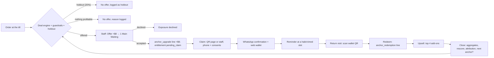
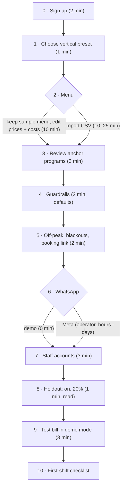

# 02 · Personas, customer journeys, merchant journey and onboarding

> **Deliverables:** 2 (user personas) · 3 (customer journeys) · 4 (merchant journey) · 27 (merchant onboarding flow).
> **Brief coverage:** §1 core concept, §2 restaurant model, §7 wallet, §8 WhatsApp, §14 service version, §17 exact MVP flow, plus the §18/§19 devil's-advocate rule.
> **Ground truth:** [`00-brief.md`](./00-brief.md), [`../architecture/blueprint.md`](../architecture/blueprint.md), and the code in `src/`. Every price, ΔE, score, date and message in this document was produced by running the real modules (Appendix A), except figures explicitly labelled *assumed* or *illustrative*. Code names win over prose: where the blueprint says `priceLadderPct`/`minTodayMarginPct`, the code says `priceLadderRates`/`minTodayMarginRate`, and this doc uses the code names.

**Status labels used throughout**

| Label | Meaning |
|---|---|
| **Built** | Pure engine, schema or repo exists in `src/modules/**` and is unit-tested. |
| **As designed** | `src/flows/*` and `app/*` per blueprint §3/§6. Being built now; described as the blueprint specifies. |
| **Not yet built** | The journey needs it and neither the code nor the blueprint has a home for it yet. |
| **Proposed** | A recommendation from this doc. Needs a decision before anyone builds it. |

**Inputs that are not in code (assumed, used only to run the engines)**

| Merchant (preset demo name) | Assumed avg visit spend | Assumed avg visit GP | Why |
|---|---|---|---|
| ABC Kitchen (`restaurant`) | $58 | $41 | The brief's 2 mains + 2 sides basket at preset costs ($58 − $16.70 cost) |
| Hop & Barrel (`beer_pub`) | $64 | $47 | 4 House Lagers + Buffalo Wings at preset costs |
| The Copper Still (`bar`) | $90 | $66 | Assumed cocktail + finger-food table |
| Serenity Spa (`spa`) | $140 (and $210) | $90 (and $135) | One massage; massage + add-ons |

In production these baselines come from the merchant's own closed visits (`MerchantBaseline` in `src/modules/deals/types.ts`).

---

## 1. Personas (deliverable 2)

### 1.1 At a glance

| # | Persona | Side | Role / engine segment | Main surface | What makes them quit |
|---|---|---|---|---|---|
| M1 | **Grace**, owner of ABC Kitchen | Merchant | `owner` | Console: Today, Reports, Settings | No proof of profit against the holdout within a quarter |
| M2 | **Marcus**, bar manager at The Copper Still | Merchant | `manager` | Staff Keep/Level screens, Console Customers | Disputes about bottle levels; a slower 1 a.m. close |
| M3 | **Aisha**, server | Merchant | `staff` | Staff POS-lite only | More than ~15 s per table, or awkward guests |
| M4 | **Ben**, owner of Hop & Barrel | Merchant | `owner` | Console Offers, Campaigns | It turns into a cheaper happy hour |
| M5 | **Priya**, owner of Serenity Spa | Merchant | `owner` | Console, Staff redeem | Package refund disputes; messages that say "Reserve a table" |
| C1 | **Rachel**, the regular | Customer | `likely_regular`, Return Score 79 (high) | WhatsApp, wallet | Being marketed to like a stranger |
| C2 | **Daniel**, persuadable first-timer | Customer | `new`, 28 → 45 with "1 Main Waiting" | Claim page, wallet | Feels like an upsell trick; asked for a phone number |
| C3 | **Mei**, price-sensitive | Customer | `price_sensitive`, 33 (medium) | WhatsApp offers | The deals stop coming (by design) |
| C4 | **Arjun**, high-value group host | Customer | `high_value`, 43 (medium) | Staff, priority booking | Offered a trinket instead of recognition |
| C5 | **Ken**, lapsed | Customer | `at_risk`, 10 (4 without his anchor) | Expiry warning, win-back | Nagging messages |

Customer scores come from `computeReturnScore` with `SCORE_WEIGHTS` (`src/modules/scoring/config.ts`) and `segmentFor` (`segments.ts`). Two things the numbers show:

- **Band and segment are different axes.** Daniel without an anchor scores 0.281, which is the `at_risk` *band* (< 0.30), yet his *segment* is `new` because he has one visit. Arjun is `high_value` with only a `medium` band. The console must show both.
- **The brief's "persuadable" covers two engine segments.** A one-visit customer is always `new`. `persuadable` needs ≥ 2 visits and a probability in [0.30, 0.60) (`SEGMENT_RULES`). Playbooks differ: `new` gets **no discounts**, `persuadable` may.

### 1.2 Merchant personas

#### M1 · Grace, restaurant owner (ABC Kitchen, casual dining)

| | |
|---|---|
| **Context** | 60 seats, lunch and dinner. Demo profile: ~9 bills/day, party sizes 1–6 (`restaurant.demo`). Menu priced $8–$38, food cost ~30%. |
| **Goals** | Turn first-timers into second visits without discounting. Fill the default off-peak window (Mon–Thu 14:00–18:00, `business.offPeak`). Be able to say "this software made me money" (brief §11). |
| **Pains today** | Discount apps train guests to wait. She cannot tell whether a promotion made or lost money. Food costs drift, so last year's margins are guesses. |
| **Needs from the product** | Menu with price **and** approximate cost (CSV). One or two anchor programs she can read in plain words, such as "3-Main Set — keep 1 main" (any main up to $24, 25–50% of $24, 60 days, with any new purchase). Guardrails she understands: expected contribution ≥ $3, today's margin ≥ 45%, implied discount ≤ 70%, outstanding liability ≤ $15,000. Reports that keep **attributed** and **causal** results apart. |
| **Why she might reject it** | (1) "I'm giving away a $24 main for $8." (2) "One in five eligible tables gets no offer on purpose?" (the 20% holdout). (3) Staff time at the till. (4) A growing balance of prepaid mains on her books. (5) WhatsApp Business setup. |
| **How the design answers** | (1) The engine charges the stored main's **full** cost ($8) against today's bill: today's margin is still 62.6% at +$8, and the guest must buy something new to redeem (`requiresNewPurchase`, enforced at `closeVisit`). (2) The holdout is how she gets a causal answer. The staff screen explains it: *"Holdout: no offer this time, so we can measure what anchors really add."* (3) One offer per bill, one sentence to read. (4) `liability-cap` is a critical rule, and outstanding value is reported at retail and at cost (`remainingRetailCents`/`remainingCostCents`). Accounting treatment (deferred revenue) is her accountant's call. (5) Run on the `demo` provider first. The claim page and web wallet work without WhatsApp. |

#### M2 · Marcus, bar manager (The Copper Still)

| | |
|---|---|
| **Context** | Bottle service plus cocktails. Preset bottles: Macallan 12 $280 (cost $95), Hennessy VSOP $220, Johnnie Walker Black $180, Grey Goose $200. Today he uses paper tags on a shelf. |
| **Goals** | Sell bottles and keep them coming back for mixers ($10–$12 jugs), finger food ($16–$20) and booths ($50 minimum spend). Keep the shelf honest. |
| **Pains today** | Lost or illegible tags. "There was more than that last time." Bottles abandoned for months. Staff pouring from kept bottles. |
| **Needs** | A **Keep** action on the bottle's bill line with level %, storage location and 90-day validity (`keepStoredPurchase`, program "Bottle keep"). Level recording that can only go **down** (`applyLevel`: *"The level cannot go up (currently 42%). Use an adjustment."*). Corrections by a manager only, with a mandatory reason (`applyAdjust`). An audit trail (`entitlement_events`, `audit_log`). Fraud flags: `positive-adjustment` (low), `staff-redemption-volume` (> 25/day, medium), `rapid-redemption` (< 30 min after issue by the same person, high). |
| **Why he might reject it** | Levels are judged by eye. It adds a tablet step at closing time. "Bottle almost finished" messages could go out at midnight. Expired bottles still sit on the shelf. |
| **How the design answers** | The ledger stores who recorded what and when, so a dispute becomes a lookup. Night-time nudges are deferred by the critical `quiet-hours` rule (21:00–09:00): a level recorded at 23:30 produces a 09:00 message the next day. The expiry warning goes out 7 days before (utility). **Gap:** there is no "extend expiry" action, and the preset terms do not say what happens to the physical bottle after 90 days (§5, gaps 4 and 19). |

#### M3 · Aisha, server

| | |
|---|---|
| **Goals** | Turn tables fast, earn tips, never argue with a guest. |
| **Pains** | Promotions with fine print. Codes that do not scan. Being blamed for till mistakes. |
| **Needs** | **One** offer per bill with a sentence to read: *"For another $8, enjoy everything tonight and we'll keep 1 main for your next visit — it'll show as "1 Main Waiting" on your phone."* (`DealPitch.script`). Claim in under 30 s (guest scans a QR, or she types the number: `claimByStaff`). Redeem by scanning the wallet QR. Up to four add-on suggestions with scripts, e.g. *"Add a Wagyu Burger for your guest? (+$23)"*. |
| **Why she might reject it** | "Why did table 7 get an offer and table 8 didn't?" (holdout or no profitable anchor). Guests who will not give a phone number. Wanting to re-roll the offer for a friendly guest. |
| **How the design answers** | Every no-offer bill shows a plain reason (holdout, guardrail, *"No profitable anchor: Needs 2 × main (has 1)"*). There is no re-roll: one decision per visit (`offer_decisions` unique on `visit_id`). Every ledger change records the actor, which protects her as much as it checks her. |

#### M4 · Ben, beer-pub owner (Hop & Barrel)

| | |
|---|---|
| **Goals** | Midweek trade. More food on beer bills (Pub Burger $22 at $7 cost beats a $12 pint at $3 cost). Groups. Get off happy hour. |
| **Pains** | Happy hours trained regulars to show up only at 5 p.m. Price wars with the pub next door. |
| **Needs** | "Beer locker — keep 2 pints" (any draught up to $14, 45 days). "Bucket remainder" (the rest of a 5-bottle bucket, 30 days). Food attachments on the reminder and at the till. |
| **Why he might reject it** | (1) "+$12 for 2 pints" reads as $6 pints (implied discount 57%). (2) The preset beer locker has **no** `requiresNewPurchase`, so a guest can drink the 2 pints and leave: that visit's GP is −$8. (3) The brief's flagship "burger + fries for $16" is a $30 list bundle, so $14 (47%) off. The offer selector, which prefers non-discounts and then the cheapest, almost never picks it (§2.3). (4) Reports count the bundle's items at list ($30 "new cash") and show the $14 under promotional cost, which can confuse a first read. |
| **How the design answers** | Depth is capped (`maxImpliedDiscountRate` 0.7) and the anchor is costed in full. **Proposed:** ship the beer preset with `redemption.requiresNewPurchase: true`, or `minNewSpendCents` ≈ $8 (one side). **Proposed:** reprice the burger bundle nearer list (e.g. $26, promo cost $4), or present it at the till as a `staff_upsell` instead of a WhatsApp promotion. |

#### M5 · Priya, spa owner (Serenity Spa)

| | |
|---|---|
| **Goals** | More rebookings. Package sales without deep discounts. Fill weekday therapist hours. |
| **Pains** | No-shows. Package refund arguments. Not knowing who is about to lapse. |
| **Needs** | "Massage package": 3 × 60-min Massage, 180 days, transferable, refundable while unused, upgradeable to 90 min by paying the difference. Reminders at 11:00 (spa `sendHour`) with a booking link. Add-on suggestions at the session: Foot scrub +$35, Hot stones +$30. |
| **Why she might reject it** | (1) Templates offer a **"Reserve a table"** button to spa guests (button labels are global in `templates.ts`). (2) Preset terms say *"Unused sessions are refundable"*, but `refundAllowed` only refunds an anchor that is **entirely** unused (*"Only unused anchors can be refunded."*). (3) A stored purchase is costed at sale, so therapist time at redemption shows $0 cost and per-visit GP is overstated. (4) The 1-massage upgrade program never fires at a $140 average spend: it fails the anchor-value cap (60% × $140 = $84 < $120). (5) There is no booking system integration. |
| **How the design answers** | (2)–(4) are logged as gaps 6, 18 and 12 in §5. **Proposed:** per-vertical button labels ("Book a session"). **Proposed:** a pro-rata refund rule (remaining sessions × package unit price $110), or change the terms text. |

### 1.3 Customer personas

#### C1 · Rachel, the regular

- **Facts used:** 14 visits, 5 in the last 90 days, last visit 6 days ago, typical gap 12 days, answers half of reminders. Return Score **0.79 (high)**, segment **`likely_regular`**. Top factors: "5 visits in the last 90 days" (+1.75), "14 visits in total" (+1.22).
- **Goals:** her usual table, being recognised, hearing about new dishes first.
- **Pains:** generic blasts, discount codes that make her feel she overpaid last time.
- **What the system does:** the playbook allows `anchor_upgrade`, `priority_booking`, `new_menu`, `renewal_bonus`, with **no discounts** and a 30-day cadence. Next action: *"Recognise — Likely to return anyway — recognise them, don't subsidise."* On a $58 bill the engine offers **+$11 → 1 Main Waiting** (p0 0.82, uplift prior only 0.118). The +$6 rung fails both minimum contribution and depth.
- **Why she might reject:** "Why claim a main? Just keep my table." Message fatigue. Marketing is capped at 1 per 7 days and 3 per 30 days.
- **Would she have returned anyway?** Probably. Any anchor sold to her is mostly convenience priced at a profit. It must not be justified as retention.

#### C2 · Daniel, persuadable first-timer (the MVP hypothesis lives here)

- **Facts:** first visit with his partner. Roast Chicken $22, Mushroom Risotto $20, Garden Salad $8, Garlic Greens $8 = **$58**. Anonymous at the till, so the engine uses `newCustomerReturnPrior` p0 = 0.25 and the uplift prior 0.2 × 4 × 0.25 × 0.75 = **0.15**, giving p1 = 0.40.
- **After claiming:** his Return Score goes from **0.281 to 0.449**, entirely from "Has something waiting here" (+0.73). Segment `new`. Playbook: no discounts, *"Make sure they claim their anchor and know exactly what they own."*
- **Goals:** a good meal at a fair price, no app, no spam.
- **Pains:** loyalty apps, giving his number, fine print.
- **Needs:** the offer in one sentence, a claim page that needs no download, a WhatsApp confirmation, a wallet saying **"1 Main Waiting"** (not "$22 credit"), and the eight plain terms lines (§2.1).
- **Why he might reject:** "It's an upsell trick." He may not want a phone-number relationship. He may not want to come back within 60 days. It is not transferable.
- **Measurement problem (important):** Daniel is anonymous when the offer is decided, so his assignment unit is the **visit** (`assignmentUnit`). The causal lift only uses **customer-unit** assignments (`maturedCustomerAssignments` filters `unit_type = 'customer'`). The holdout-arm Daniel never receives an anchor, so he never gets identified, and his return cannot be observed. **The population the MVP hypothesis is about is therefore not in the primary causal metric.** **Proposed:** identify before assigning. The staff screen asks for a phone number for a WhatsApp e-receipt *before* "Check offer", for both arms, so the unit becomes the customer. See also onboarding step 8.

#### C3 · Mei, price-sensitive

- **Facts:** 5 visits, 60% of them used a promotion (`promoShare` ≥ 0.5 with ≥ 3 visits gives `price_sensitive`). Return Score 0.33 (medium).
- **System:** the playbook allows `anchor_upgrade`, `stored_addon`, `food_drink_attach`, `off_peak_perk`, discounts permitted, 30-day cadence. Guardrails: at most **2 offers per 90 days** (`price-sensitive-frequency`), **one discount per 60 days** (`discount-frequency`), **$15 promotional cost per 90 days** (`promo-cost-cap`), a 14-day cooldown after any promotion. Her base acceptance is the highest (0.5), so on the $58 bill the engine prices **+$11** (pAccept 0.293).
- **Why she might reject:** offers dry up after two in a quarter. That is intended: the system optimises her profitable value, not her happiness with deals.
- **Gaming defence:** waiting does not pay. `no-inactivity-escalation` makes win-backs non-discount and never worth more than her previous promotion.

#### C4 · Arjun, high-value group host

- **Facts:** 6 visits, usual party of 6, spends more than 92% of customers, which makes him `high_value` (Return Score 0.43, medium band).
- **System:** the playbook allows `anchor_upgrade`, `priority_booking`, `premium_upgrade`, `new_menu`, `renewal_bonus`, no discounts, 21-day cadence. Next action: *"VIP treatment — Offer priority booking or a group package. No discounts."*
- **Engine on a $248 table of six:** "3-Main Set" **+$8 → 1 Main Waiting** (ΔE $26.47, pAccept 0.240, value $6.36) **outranks** "Group feast" **+$17 → 2 Mains Remaining** (ΔE $22.69, pAccept 0.231, value $5.25). The engine maximises pAccept × ΔE, not anchor size.
- **Why he might reject:** one stored main means nothing to someone spending $248. He wants his table held and his guests impressed.
- **Design response:** recognition first (`priority_booking`: *"Your usual table is available — reply to book and we'll hold it."*). **Proposed:** a per-program priority so a merchant can prefer the group program for parties of 4 or more. Not in the engine.

#### C5 · Ken, lapsed

- **Facts:** 3 visits, last one 48 days ago against a typical gap of 20, ignored his last reminder, still holds **1 Main Waiting** that expires in 12 days. Return Score **0.098**, or **0.044 without the anchor**. Segment `at_risk`.
- **What anchors can do for him:** very little. The uplift prior at p0 = 0.044 is 0.2 × 4 × 0.044 × 0.956 = **0.034**.
- **System:** one win-back per 90 days, always a non-discount perk: *"Your 1 Main Waiting is still waiting at ABC Kitchen. Return this week and we'll add a complimentary iced lemon tea."* (perk cost $0.80). At 12 days to expiry the next action is *"Win back — Remind them 1 Main Waiting — non-discount perk at most."* At ≤ 7 days it becomes *"Expiry reminder"*.
- **Why he might reject:** it feels like nagging, so he replies STOP and gets: *"Done — you won't get offers from ABC Kitchen any more. Your balance is safe in your wallet. Reply START to opt back in."* STOP only withdraws marketing consent. The expiry warning is `utility` and still arrives, so he cannot silently lose what he paid for.

### 1.4 Would they have returned anyway? (persona summary)

| Persona | p0 without anchor | Uplift prior | Returns anyway? | What we give | How lift is proven |
|---|---|---|---|---|---|
| Rachel | 0.79 | ≤ 0.12 | Very likely | Recognition, priority booking; anchor only if profitable on its own | Customer-unit holdout (she is identified) |
| Daniel | 0.25 (prior) | 0.15 | Maybe | The anchor itself | **Not measured today** (visit unit). Fix: identify before assignment (Proposed) |
| Mei | 0.33 | 0.18 | Often, if there is a deal | Capped, non-escalating offers | Customer-unit holdout + promo-cost tracking |
| Arjun | 0.43 | 0.20 | Likely | VIP, group packages | Customer-unit holdout; small n, so slow |
| Ken | 0.04 | 0.03 | Unlikely | Expiry warning, one perk | Holdout on the win-back campaign (`campaign_recipients.arm`) |

---

## 2. Customer journeys (deliverable 3)

### 2.0 The loop, mapped to brief §17 and to the code

Brief §1 and §16 describe the loop: *first purchase → unfinished entitlement → reminder → return visit → incremental purchase → another reason to return.* Every journey below is one pass (or several passes) around this diagram. Only the anchor's unit changes: a main, a bottle level, pints, sessions.



| §17 step | What happens | Code | Status |
|---|---|---|---|
| 1 | Merchant enters menu, prices, approximate cost | `parseMenuCsv`, `createMerchantFromPreset` | Built / As designed |
| 2 | Customer orders normally | Staff POS-lite visit, or `POST /api/v1/pos/orders` (`canonicalOrderSchema`) | As designed |
| 3–4 | Basket analysed, profitable upgrade found | `evaluateDeals` (ΔE, constraints, pAccept × ΔE) via `evaluateCheckoutOffer` | Built / As designed |
| 5 | Staff sees "Offer +$8 → 1 Main Waiting" | `DealPitch.staff` | Built |
| 6 | Customer accepts | `acceptOffer`: `anchor_upgrade` line + entitlement | As designed |
| 7 | Customer scans QR | `/c/{token}`, `claimByToken` (or `claimByStaff`) | As designed |
| 8 | Entitlement in wallet | Web wallet `/w/{token}`. Apple/Google passes are a stub that throws `WalletPassesNotEnabled` | As designed / Phase 2 |
| 9 | WhatsApp "You have 1 Main Waiting" | `anchor_confirmation` (utility) | Built (template) |
| 10 | Wait for the right moment | `firstReminderAt` | Built |
| 11 | Personalised reminder | `anchor_reminder` (marketing) through the send-time guardrails | Built / As designed |
| 12 | Books or walks in | Booking link (`business.bookingUrl`). No booking system | As designed / Not yet built |
| 13 | Staff scans QR | `lookupByRedeemCode` (8-character code in the QR) | As designed |
| 14 | Entitlement redeemed | `redeemEntitlement` / `recordBottleLevel` → ledger | As designed (ledger Built) |
| 15–16 | Add-ons recommended and bought | `recommendUpsell`, `getUpsellForVisit`, `addUpsell` | Built / As designed |
| 17 | Incremental revenue computed | `computeTotals`, `summariseAttribution` (attributed), `estimateLift` (causal) | Built |
| 18 | Another anchor? | `closeVisit` re-runs the checkout offer when no decision exists yet | As designed |

### 2.1 Restaurant: "1 Main Waiting" at ABC Kitchen

**Program** (preset "3-Main Set — keep 1 main"): covers *any main up to $24*. Trigger: 2 mains on the bill. Price band 25–50% of the covered value. Valid 60 days. Redeemed with any new purchase. Not transferable. Refundable if unused within 14 days. Upgrades allowed.

#### Visit 1 — Thu 8 Oct 2026, 20:15, table T12, party of 2

| # | Moment | What Daniel sees / hears | What staff and the system do |
|---|---|---|---|
| 1 | Orders | His bill: Roast Chicken $22, Mushroom Risotto $20, Garden Salad $8, Garlic Greens $8 = **$58** | Aisha opens visit "T12", party 2, adds lines (or the POS posts the order) |
| 2 | Before the bill | Nothing yet | "Check offer" → `evaluateCheckoutOffer`: deal engine → checkout guardrails → holdout assignment (visit unit, 20%) → one `offer_decisions` row |
| 3 | The offer | Aisha: *"For another $8, enjoy everything tonight and we'll keep 1 main for your next visit — it'll show as "1 Main Waiting" on your phone."* | Staff screen: **Offer +$8 → 1 Main Waiting** · covers any main up to $24 |
| 4 | Accepts | Bill shows a +$8 line | `acceptOffer`: `anchor_upgrade` line $8. Entitlement `pending_claim`: 1 unit, unit retail $24, unit cost $8, expires Mon 7 Dec 2026, claim link valid 72 h (`claimWindowHours`) |
| 5 | Claims | Scans the QR on Aisha's tablet → claim page | `claimByToken`: phone normalised to E.164 (+65 default), consents recorded with notice version `2026-10-01`, entitlement `active`, wallet token issued |
| 6 | Confirmation (WhatsApp, utility) | *"You have 1 Main Waiting at ABC Kitchen. 🎉*<br>*Show your wallet QR when you're back and we'll have it ready. Valid until Mon, 7 Dec 2026."* · [View balance] | `planAnchorMessages`: confirmation now, reminder and expiry warning planned |
| 7 | Pays | $66 total | Visit closed: revenue $66, cost $16.70, GP $49.30 (new cash $58 + upgrade $8) |

**Why +$8? The real engine output on this bill** (first-timer; covered retail $24, C = $8, G = $41, Gnew = $41 − 0.35 × ($24 − $8) + $5 = $40.40):

| Price U | Implied discount | ΔE = U − C + p1·Gnew − p0·G | pAccept | pAccept × ΔE | Today's margin | Verdict |
|---|---|---|---|---|---|---|
| +$6 | 75.0% | $3.91 | 0.311 | $1.22 | 61.4% | ✗ deeper than 70% |
| **+$8** | 66.7% | **$5.91** | **0.280** | $1.66 | 62.6% | ✓ |
| +$9 | 62.5% | $6.91 | 0.259 | $1.79 | 63.1% | ✓ |
| +$10 | 58.3% | $7.91 | 0.233 | **$1.85** | 63.7% | ✓ default pick |
| +$11 | 54.2% | $8.91 | 0.205 | $1.83 | 64.2% | ✓ |
| +$12 | 50.0% | $9.91 | 0.175 | $1.73 | 64.7% | ✓ |

With default settings the engine says **+$10**: 19¢ more expected value per eligible bill than +$8, at 4.7 points lower acceptance. The brief's **+$8** is the 30% rung ($7.20 rounded up to whole dollars by `roundingCents: 100`). A merchant who wants one number for staff to learn pins the program's band (`pricing.minPriceRate = maxPriceRate = 0.30`). The engine then returns exactly `Offer +$8 → 1 Main Waiting` (ΔE $5.91, pAccept 0.280). This walkthrough uses that pinned price. Choosing between the two is an experiment question. **Not yet built:** price arms. The experiment module has a single checkout holdout and no A/B on price.

Same bill, other customers: `persuadable` (p0 0.45) → +$10, ΔE $9.73. `likely_regular` (p0 0.82) → +$11, ΔE $7.51. `price_sensitive` (G $30) → +$11, ΔE $8.14.

#### Claim page and wallet (brief §7)

```
 Claim page  /c/{token}                       Web wallet  /w/{token}
┌──────────────────────────────────┐        ┌──────────────────────────────────┐
│ ABC Kitchen                      │        │ ABC Kitchen            (#b45309) │
│ You're keeping: 1 Main Waiting   │        │                                  │
│                                  │        │   1 Main                         │
│ Mobile (WhatsApp)                │        │   waiting for you                │
│ [ +65 ____ ____ ]                │        │                                  │
│ Name (optional) [__________]     │        │   ▒▒▒▒▒▒▒▒  QR = redeem code     │
│                                  │        │   ▒▒▒▒▒▒▒▒  (8 characters)       │
│ [x] Message me about what I own  │        │                                  │
│     (confirmation, balance,      │        │ What you own                     │
│     expiry)                      │        │  Covers   any main up to $24     │
│ [ ] Send me occasional reminders │        │  Paid     $8.00                  │
│     and offers                   │        │  Expires  Mon, 7 Dec 2026        │
│ Terms apply (link)               │        │  When     Redeem with any new    │
│                                  │        │           purchase               │
│        [ Keep it ]               │        │  Upgrades …pay the difference    │
│                                  │        │  Sharing  For you only           │
│ Link expired? "This claim link   │        │  Refunds  Refundable in full if  │
│ has expired. Ask the staff to    │        │           unused within 14 days  │
│ show the QR again."              │        │  [ Reserve a table ] [ History ] │
└──────────────────────────────────┘        └──────────────────────────────────┘
```

- Consent wording comes from `ClaimInput` (`src/flows/claim-anchor.ts`). Marketing is **unticked by default**. Service consent covers confirmation, balance and expiry messages. Accepting the terms is recorded as its own consent row.
- The headline pair comes from `entitlementHeadline` ("1 Main" / "waiting for you"). The "What you own" lines are `transparencyLines(termsSnapshot)` verbatim, frozen at issue: later program edits never change what Daniel bought. The full Terms line reads: *"One main up to $24 on a future visit, together with any new purchase. Put it towards a pricier main by paying the difference."*
- History = the entitlement's ledger events (issued, claimed, redeemed…).
- Brief §7 also lists Apple Wallet / Google Wallet. These are **Phase 2**: `src/integrations/wallet-passes/provider.ts` is a stub. The web wallet works on any phone without an app.

#### Between visits: what Daniel receives

| When (SGT) | Template (category) | Exact copy | Sent only if |
|---|---|---|---|
| Thu 8 Oct, 20:15 | `anchor_confirmation` (utility) | *You have 1 Main Waiting at ABC Kitchen. 🎉 Show your wallet QR when you're back and we'll have it ready. Valid until Mon, 7 Dec 2026.* | Service consent |
| **Wed 21 Oct, 17:00** | `anchor_reminder` (marketing) | *You still have 1 Main Waiting at ABC Kitchen.* · [Reserve a table] [View balance] | Marketing consent; ≤ 1 marketing/7 days and ≤ 3/30 days; not visited in the last 3 days; anchor still active; not in quiet hours |
| Sat 7 Nov onwards (day 30, if not back) | `anchor_win_back` (marketing) | *Your 1 Main Waiting is still waiting at ABC Kitchen. Return this week and we'll add a complimentary iced lemon tea.* | As above, plus `win-back-limit` (1 per 90 days) and `no-inactivity-escalation` |
| Mon 30 Nov, 17:00 | `anchor_expiry_warning` (utility) | *Heads up: your 1 Main Waiting at ABC Kitchen is valid until Mon, 7 Dec 2026. We'd love to see you before then.* | Service consent |
| Mon 7 Dec, 20:15 | — | Anchor expires (`applyExpire`). Pending messages for it are cancelled | — |

- **Timing maths:** first-timers have no typical gap, so `DEFAULT_GAP_DAYS` = 21 applies. 21 × `reminderFraction` 0.6 = 12.6, rounded to 13 days, inside [4, 14], at `sendHour` 17:00. A known customer with a typical gap of 14 days and a Saturday habit is reminded on **Fri 16 Oct, 17:00**, with the personal line *" See you Saturday?"* (`personalLine` in `src/flows/messages.ts`).
- **Why the reminder has no offer line:** offers ride along only if the segment's playbook allows them and the guardrails pass, preferring non-discounts (`chooseMessageOffer`). Daniel is `new` (no discounts). The preset's reminder-eligible offers are either discounts ("2 drinks + fries for $15": $22 list, $7 promo cost) or not in the `new` playbook (new menu, premium upgrade, off-peak perk). So the reminder states what he owns and nothing else, which is exactly the brief's line *"You still have one main waiting at ABC Kitchen."* A returning customer (`persuadable` or `likely_regular`) with a Saturday habit gets the non-discount new-menu line instead: *"You still have 1 Main Waiting at ABC Kitchen. See you Saturday? Our new seafood menu launches Friday — your main covers it."*
- **Buttons:** "Reserve a table" opens `business.bookingUrl` when set. Otherwise it opens the wallet with `?action=reserve`. "View balance" opens the wallet.

#### Visit 2 — Sat 24 Oct, party of 3 (Daniel + two friends)

| # | Moment | What Daniel sees | Staff / system |
|---|---|---|---|
| 1 | Arrives | Shows the wallet QR | `lookupByRedeemCode` → "1 Main Waiting · any main up to $24 · Redeem with any new purchase" |
| 2 | Chooses Prawn Linguine ($24) | "Prawn Linguine (from your anchor)", $0 | `redeemEntitlement`: ledger `redeemed −1` → `fully_redeemed`. `anchor_redemption` line: price 0, cost $8 (the entitlement's conservative unit cost) |
| 2a | Alternative: wants the Ribeye ($38) | "Upgrade to Ribeye Steak (difference)" **+$14** | `upgradeAllowed`: anchor covers up to $24, regular line $14, cost $7 (= $15 − $8). The brief's "+$8 to ribeye" is +$14 with this preset's prices |
| 3 | Receipt (utility) | *"Enjoy! You used 1 main at ABC Kitchen. Remaining: nothing left — thanks for coming back!."* | Sent by `redemption.ts`. Copy fix needed: "!." (gap 8) |
| 4 | Upsell | Aisha suggests the top of the list | `recommendUpsell` (anchor category `main`, party 3): **Ribeye Steak for your guest (+$38)**, Wagyu Burger for your guest (+$23), Truffle Fries (+$9), House Wine (+$14). Linguine is excluded because it is already on the bill |
| 5 | Friends order | Wagyu Burger $23, Roast Chicken $22, Truffle Fries $9, 2 × House Wine $28, Craft Soda $7, Tiramisu $12 | **New cash $101**, cost $29, GP $72. Visit GP $64 after the $8 redemption cost |
| 6 | Next anchor | *"For another $10 … keep 1 main for your next visit"* | `closeVisit` re-evaluates the 2 regular mains: **Offer +$10 → 1 Main Waiting** (ΔE $8.35). Had they come as two with one new main: *"No profitable anchor: Needs 2 × main (has 1)"*, so no new anchor this time |

**What the merchant's report shows for Daniel (attributed, not causal):** redemptions 1 · customers returning 1 · stored value redeemed $24 · new cash during redemption visits $101 · GP from that new cash $72 · new packages sold $8 · total attributable revenue $109 · promotional cost $0.10 (two messages: 2¢ + 8¢) · **attributed contribution $71.90** (`summariseAttribution`). None of this says Daniel came back *because* of the anchor. Only the holdout can, and Daniel's assignment was a visit unit (§1.3 C2).

**Challenge — checkout anchor offer + claim**

| Question | Answer |
|---|---|
| Needed for the MVP hypothesis? | Yes. This *is* the intervention. Claim is required too: no phone means no reminder and no identified outcome. |
| Customer may reject because | Feels like an upsell. Doesn't want to commit to a return within 60 days. Won't give a phone number. |
| Merchant may reject because | "Selling a $24 main for $8." Staff time. Holdout tables "lose" offers. |
| Margin risk | Contained: C is counted in full (no breakage). Today's margin ≥ 45% (62.6% here). ΔE ≥ $3. Redemption requires new spend. Residual risk: costs entered wrong (§4 step 2). |
| Cannibalisation | Daniel might have come back and paid full price for a main. The `substitutionRate` 0.35 is a prior, not measured. |
| Fraud | Staff accept an offer then void the +$8 line (`voided-upgrade`, high). Issue and redeem by the same person within 30 min (`rapid-redemption`, high). Claim tokens are single-use and time-boxed (72 h). |
| Operational complexity | One extra tap and one sentence per eligible bill, plus the QR scan. The sharpest risk is unclaimed anchors at a busy close. |
| Customer trust | Paid value that silently expires. Unclaimed anchors get **no** messages (no phone), yet still expire. Mitigation: staff claim at the table by phone, and an unclaimed-anchor list on Today (§3). |
| Regulatory | Paid-for future entitlements may count as prepaid vouchers in some jurisdictions (minimum validity, refund rights). Check before launch. Consent rules for marketing on WhatsApp (opt-in, withdrawal). |
| Would they have returned anyway? | Some. That is why p0 and the uplift prior drive ΔE: regulars pay more (+$11) and generate less modelled lift. |
| Proving lift | Customer-unit holdout, 60-day contribution, Welch 90% CI (`estimateLift`). **Fix the first-timer gap:** identify before assignment (Proposed). |

### 2.2 Bar: Macallan bottle keep at The Copper Still

**Program** "Bottle keep" (`stored_purchase`, unit type `percent`): 90-day storage. Terms: *"Your bottle is stored for 90 days. Mixers and food are charged separately. We record the level each time you pour."* Not refundable, not transferable. The deal engine is not involved: the bottle is already paid for.

| # | Moment | What the customer (Jason, party of 4) sees | Staff / system |
|---|---|---|---|
| 1 | Visit 1, Thu 8 Oct, 20:15 | Bill: Macallan 12 $280, Coke jug $12, Soda water jug $10, Spicy Wings $18, Loaded Nachos $20 = **$340** | Revenue $340, cost $109, GP $231. The bottle's $95 cost is expensed now |
| 2 | Leaves ~30% poured | Marcus: "We'll keep it on the shelf for you." | **Keep**: `keepStoredPurchase` (bottle line, program "Bottle keep", level **70**, storage location "Shelf B3") → entitlement *Macallan 12 · 70% remaining*, expires Wed 6 Jan 2027 |
| 3 | Claim + confirmation | *"You have Macallan 12 · 70% remaining at The Copper Still. 🎉 Show your wallet QR when you're back and we'll have it ready. Valid until Wed, 6 Jan 2027."* | Same claim flow as §2.1 |
| 4 | Wallet | Headline **Macallan 12**, secondary **70% remaining**. Covers: Macallan 12 · Paid: Included in your original purchase · When: Any time we're open · Upgrades: No upgrades · Sharing: For you only (not transferable) · Refunds: Non-refundable. | Storage location is on the entitlement (`storage_location`) for staff. **Proposed:** show it on the wallet too ("Shelf B3") |
| 5 | Reminder Wed 21 Oct, **18:00** (bar `sendHour`) | *"You still have Macallan 12 · 70% remaining at The Copper Still."* | 13-day default timing |
| 6 | Visit 2 | Shows QR. Group pours ~28% | `recordBottleLevel(70 → 42)`: ledger `level_recorded −28`, line "Macallan 12 — poured 28% (from your bottle)" at $0 cost (stored purchase). Receipt: *"Enjoy! You used 28% of your Macallan 12 at The Copper Still. Remaining: Macallan 12 · 42% remaining."* |
| 7 | Upsell (party 4) | Marcus: *"Add a Loaded Nachos for your guest? (+$20)"* | Real ranking: Loaded Nachos +$20, Spicy Wings +$18, Coke jug +$12 ("Fresh mixers with that? Coke jug (+$12)"), Tonic jug +$12. They take 2 Coke jugs, Truffle Fries, Spicy Wings and the $50 booth: **new cash $108, GP $95** |
| 8 | Visit 3, level 42 → **20** | — | At or below `bottleLowPercent` 25, the scheduler plans `bottle_low`. Recorded at 23:30, `nextSendSlot` keeps 23:30, then the critical `quiet-hours` rule defers it to **09:00 next day** |
| 9 | Bottle-low nudge (marketing) | *"Your Macallan 12 at The Copper Still is almost finished (20% left). Want us to have your next bottle ready?"* · [Reserve next bottle] [View balance] | Button opens the wallet with `?action=top_up` |
| 10 | Visit 4: second bottle | Buys Hennessy VSOP $220 and gets a complimentary soda jug ("Next bottle: complimentary mixer jug", `renewal_bonus`, cost $1.50). Finishes the Macallan (20 → 0) | Macallan → `fully_redeemed`. New keep for the Hennessy. Bill $252 (with Coke jug and Nachos), GP $173 after the perk |

- **Win-back:** the bar preset uses `winBackAfterDays` 35. Copy: *"Your Macallan 12 · 42% remaining is still waiting at The Copper Still. Return this week and we'll add a complimentary soda water jug."*
- **Expiry warning:** Wed 30 Dec 2026, 18:00.
- **Score effect:** a 4-visit high spender holding 42% of a $280 bottle scores **0.84 with the bottle, 0.53 without** (`high_value`). Owning something is the largest single factor (+1.53).

**Challenge — bottle keep with level recording**

| Question | Answer |
|---|---|
| Needed for the MVP hypothesis? | Not for the restaurant test. It is the origin mechanic and the clearest bar use. Keep it: it needs no pricing engine. |
| Customer may reject because | Disputes over eyeballed levels. 90 days is too short for occasional drinkers. Non-transferable even to a friend at the same table. |
| Merchant may reject because | Shelf space. An extra step at close. Liability for stored stock. |
| Margin risk | Low: the bottle is paid in full at sale. Risk sits in the free perks (renewal mixer jug $1.50) and in staff over-pouring. |
| Cannibalisation | A guest who would buy cocktails pours their own bottle instead. Visible in reports as lower new cash on redemption visits. |
| Fraud | Staff pouring from kept bottles (levels only go down, `staff-redemption-volume`). Upward corrections need a manager and a reason, and are flagged (`positive-adjustment`). |
| Operational complexity | Level entry per visit (one number). Storage location. Physical disposal after expiry. |
| Customer trust | Levels are shown after every pour (receipt). **Gap:** no expiry extension, and the terms do not say what happens to the bottle after 90 days. |
| Regulatory | Liquor licensing conditions on storing customer-owned bottles vary. Check locally. Alcohol marketing rules may restrict the bottle-low message wording. |
| Would they have returned anyway? | Bottle buyers are often regulars. The anchor mainly shapes *where* they drink next. |
| Proving lift | Hard to randomise a stored purchase without refusing service. Instead, randomise the **messages**: a message-level holdout on scheduled reminders and bottle-low nudges (Proposed, see §2.6), plus campaign holdouts for pushes. Compare 60-day contribution. |

### 2.3 Beer pub: "2 Pints Remaining" at Hop & Barrel

**Program** "Beer locker — keep 2 pints": any draught up to $14, trigger 4 beers, price band 30–60%, 45 days, not transferable, refundable if unused within 14 days. Alternative: "Bucket remainder" (`stored_purchase`, the rest of a 5-bottle $50 bucket, so $10 per beer, 30 days).

**Visit 1 — party of 2.** The brief says "4 beers + wings = $60 → 6 beers + wings = $70". With the preset menu: 4 × House Lager $12 + Buffalo Wings $16 = **$64** (cost $16.50). Engine, first-timer (covered retail 2 × $14 = $28, C = $8, G $47, Gnew $45.00):

| U | Depth | ΔE | pAccept | pAccept × ΔE | Today's margin |
|---|---|---|---|---|---|
| +$9 | 67.9% | $7.25 | 0.286 | $2.07 | 66.4% |
| +$10 (brief) | 64.3% | $8.25 | 0.268 | $2.21 | 66.9% |
| **+$12** | 57.1% | **$10.25** | 0.226 | **$2.31** | 67.8% |
| +$13 | 53.6% | $11.25 | 0.201 | $2.26 | 68.2% |
| +$14 | 50.0% | $12.25 | 0.175 | $2.14 | 68.6% |
| +$17 | 39.3% | $15.25 | 0.102 | $1.55 | 69.8% |

Staff see **Offer +$12 → 2 Pints Remaining**, coverage *"any pint up to $14"*. With 3 pints on the bill there is no offer (*"Needs 4 × beer (has 3)"*).

| # | Moment | What the customer sees | System |
|---|---|---|---|
| 1 | Accepts, claims | *"You have 2 Pints Remaining at Hop & Barrel. 🎉 Show your wallet QR when you're back and we'll have it ready. Valid until Sun, 22 Nov 2026."* | Visit: revenue $76, GP $59.50 |
| 2 | Leaves thinking *"I still have 2 beers at that place."* | Wallet: **2 Pints** / remaining | — |
| 3 | Reminder (first-timer): Wed 21 Oct, **16:00** (beer `sendHour`) | *"You still have 2 Pints Remaining at Hop & Barrel."* | `new` playbook: every preset food offer is a discount bundle, so no offer line |
| 3' | Reminder (regular, typical gap 7, Friday habit): **Thu 15 Oct, 16:00** | *"You still have 2 Pints Remaining at Hop & Barrel. See you Friday? Our new seasonal IPA is on tap from Friday."* | `persuadable` or `likely_regular`: prefer-non-discount picks "New seasonal tap" ahead of the burger bundle |
| 4 | Friday visit | Scans QR, gets 2 pints | `redeemEntitlement` qty 2: two `anchor_redemption` units, $8 cost |
| 5 | Upsell (party 2) | *"Add a Fish & Chips for your guest? (+$24)"* | Fish & Chips +$24, Pub Burger +$22, Fries +$8, Onion Rings +$9 |
| 6 | Buys | Pub Burger, Fries, 2 more lagers, Fish & Chips | **New cash $78, GP $56. Visit GP $48** after the redeemed pints |
| 7 | Next anchor | 4 lagers on the bill again | **Offer +$12 → 2 Pints Remaining** |

**The brief's Friday burger message, as the code actually treats it.** The template test (`timing.test.ts`) renders *"You still have 2 Pints Remaining at Hop & Barrel. Come down Friday and add our burger + fries for $16."* The automatic selector rarely produces it:

| Segment | Offer chosen for the reminder (`selectOffer` + `message_offer` guardrails, preset offers) |
|---|---|
| `new` | none: all food bundles are discounts, and `new` gets no discounts |
| `persuadable` | "New seasonal tap" (non-discount wins) |
| `price_sensitive` | "Wings + fries for $18" (promo cost $6 beats burger bundle's $14) |
| `likely_regular`, `occasional` | "New seasonal tap" |
| `at_risk` | "Comeback: free fries" |
| Anyone who redeemed a bundle 10 days ago | Every promotion blocked: 14-day cooldown, 90-day $15 cap ($14 + anything), 60-day discount gap, vary-type. Only "New seasonal tap" passes |

The burger bundle costs $14 of list price per use, more than the $12 the customer paid for the locker. A return visit of only 2 pints + the $16 bundle takes $16 and costs $16.50 ($8 pints + $8.50 food): **visit GP −$0.50**. Across both visits the loop still nets **+$11.50** ($12 upgrade − $8 pint cost + $7.50 bundle GP). A return visit of only the 2 pints is **−$8** on the visit (+$4 across the loop), because the preset beer locker does not require a new purchase.

**Challenge — beer locker + food-attach reminder**

| Question | Answer |
|---|---|
| Needed for the MVP hypothesis? | Second vertical, not first. Useful as a replication of the restaurant test with a cheaper anchor. |
| Customer may reject because | "+$12 for beer I'm not drinking tonight." 45 days is short for monthly visitors. |
| Merchant may reject because | Looks like $6 pints. No new-spend requirement. The flagship bundle is 47% off. |
| Margin risk | Zero-spend redemption at −$8 per visit. Deep bundles. **Proposed:** `requiresNewPurchase: true` (or `minNewSpendCents`) on the preset, and the burger bundle repriced to ~$26. |
| Cannibalisation | Locker pints replace pints they would have bought. A high `substitutionRate` (0.35 default) is realistic here. Measure it. |
| Fraud | Bar staff "redeeming" pints for friends: the same-actor rules and volume flags apply. |
| Operational complexity | Low: same screens as the restaurant. |
| Customer trust | Clear unit ("2 Pints"), clear cap ("any pint up to $14"). |
| Regulatory | Some markets restrict alcohol promotions such as "free" drinks and drink-led discounts. Prefer food-led offers. |
| Would they have returned anyway? | Pub regulars: largely yes. First-timers: unknown. Hence the holdout. |
| Proving lift | Customer-unit holdout on checkout offers. A message-level holdout on the reminder's offer line (Proposed, §2.6), to learn whether food lines add anything beyond "you still have 2 pints". |

### 2.4 Service: 3-massage package at Serenity Spa (brief §14)

**Program** "Massage package" (`stored_purchase`, `session`, 3 × 60-min Massage, 180 days, transferable, *"Refundable in full any time while unused."*, upgrades allowed). Brief §14 workflow: entitlement → reminder → booking → add-on → redemption → renewal.

| # | Step (§14) | What the guest (Lin) sees | Staff / system |
|---|---|---|---|
| 1 | Purchase | Books one 60-min massage ($120). Reception offers the 3-Massage package for $330 instead of 3 × $120 = $360. Adds Aromatherapy oils $25 | Bill $355, cost $139, GP $216 |
| 2 | **Entitlement** | Today's session comes out of the package | **Keep 2** from the package line: unit value $330 ÷ 3 = $110, unit cost $45. Keep 2 rather than "keep 3 then redeem 1", because the same person issuing and redeeming within 30 min raises a high-severity `rapid-redemption` flag |
| 3 | Confirmation (11:00 sends; this one goes now) | *"You have 2 Massages Remaining at Serenity Spa. 🎉 Show your wallet QR when you're back and we'll have it ready. Valid until Tue, 6 Apr 2027."* | Wallet: Covers 60-min Massage · Paid: Included in your original purchase · Sharing: You can transfer it to someone else · Refunds: Refundable in full any time while unused |
| 4 | **Reminder** | Fri 23 Oct, **11:00** (15 days: spa `reminderFraction` 0.7 × 21): *"You still have 2 Massages Remaining at Serenity Spa."* · **[Reserve a table]** [View balance] | Label gap: the button should read "Book a session" (Proposed) |
| 5 | **Booking** | Taps the button → merchant's booking page | `business.bookingUrl`. **Not yet built:** booking integration, appointment reminders, no-show handling |
| 6 | **Redemption** | Shows QR. *"Enjoy! You used 1 massage at Serenity Spa. Remaining: 1 Massage Waiting."* | `redeemEntitlement`, cost $0 at redemption (expensed at sale, see gap 18) |
| 7 | **Add-on** | Therapist: *"Add Foot scrub to the session? (+$35)"* | Upsell for `massage`: Foot scrub +$35, Hot stones +$30, 3-Massage package +$330, Signature Facial +$110. Upgrade line: *"Treat yourself: put it towards our 90-min massage ($160) and just pay the difference."* With a package keep, the difference is computed against the anchor's unit value ($110), so it is **+$50** (gap 23). Lin adds Hot stones + Foot scrub: **new cash $65, GP $51** |
| 8 | **Renewal** (1 unit left) | *"You have 1 Massage Waiting at Serenity Spa. Renew your package on your next visit and receive a bonus hot stones."* (or *"…on your next visit."* without the bonus) | Bonus only where the playbook allows `renewal_bonus` (`high_value`, `likely_regular`). Grammar fix needed (gap 8) |
| 9 | Last session + new package | Bonus Hot stones (perk, cost $6) | New keep of 3 (or 2) |

- **The upgrade program ("Next session — keep 1 massage") at this spa:** at a $140 average spend every price fails *"Anchor would cover too much of the next visit"*. A $120 massage is more than 60% of $140. At a $210 average (massage + add-ons) the engine offers **Offer +$60 → 1 Massage Waiting** (ΔE $26.75). For high-ticket services the anchor-value cap, not the margin, is the binding constraint.
- **Off-peak perk copy:** *"Use your 2 massages remaining on a weekday afternoon and we'll add a complimentary aromatherapy oils."* Grammar fix needed (gap 8).

**Challenge — service packages**

| Question | Answer |
|---|---|
| Needed for the MVP hypothesis? | No. Packages pre-date this product. The anchor mechanic adds reminders and add-on discipline. Phase-1 optional vertical. |
| Customer may reject because | Upfront $330. Fear of losing unused sessions. Refund rules that do not match the terms. |
| Merchant may reject because | Package liability. Refund disputes. No booking integration. "Reserve a table" copy. |
| Margin risk | The 8% package saving on every session. Therapist cost is not recognised at redemption, so visit-level GP is overstated. |
| Cannibalisation | Guests who would have paid $120 per visit now pay $110. |
| Fraud | Instant issue + redeem by the same staff member is flagged. Transferable sessions can be resold. |
| Operational complexity | Keep quantity at purchase (2 vs 3) must be taught. |
| Customer trust | **Mismatch:** the terms promise refunds for unused sessions, but the ledger refunds only wholly unused anchors. Fix before launch. |
| Regulatory | Prepaid service packages are often regulated (cooling-off periods, refund on closure). Check locally. |
| Would they have returned anyway? | Package buyers are self-selected loyalists. The incremental part is add-ons and renewal timing. |
| Proving lift | Message-level holdout on reminders and renewal nudges (Proposed, §2.6), or a "Renew before it runs out" campaign with its holdout. Compare package renewal rate and add-on GP. |

### 2.5 Failure and edge paths (all verticals)

| Situation | What happens in code | What the customer sees | Status | Recommended handling |
|---|---|---|---|---|
| **Never claims** | Entitlement stays `pending_claim`, still counts towards liability, still expires at `expires_at`. Claim link dies after 72 h. No phone means no messages at all | Claim page: *"This claim link has expired. Ask the staff to show the QR again."* | As designed | Default to **staff claim by phone at the table** (`claimByStaff`). Staff can reopen the link (`reopenClaimWindow`, same token). Console next action: *"Help them claim — 1 Main Waiting is not claimed yet — ask staff to claim by phone next visit."* **Proposed:** unclaimed anchors > 24 h listed on Today |
| **Claims, service consent only** | Confirmation, expiry warning and receipts (utility) arrive. Reminders, win-backs, bottle-low and renewal (marketing) are suppressed (`consent-required`: *"No marketing consent"*) | Fewer messages | Built | Fine. Expected lift for this group is lower. Report it separately |
| **Replies STOP** | `marketing_messages` consent withdrawn, `opted_out_at` set. Utility messages continue | *"Done — you won't get offers from ABC Kitchen any more. Your balance is safe in your wallet. Reply START to opt back in."* | As designed (`inbound-message.ts`) | — |
| **Loses phone, same number** | Wallet link is unchanged. Replying BALANCE gets a service reply | *"Here's what you have at ABC Kitchen: • 1 Main Waiting (until Mon, 7 Dec 2026)"* · [Open wallet] | As designed | — |
| **Loses phone, worried about misuse** | Wallet link is a bearer token. `revokeWalletTokens` exists in the repo, and the next message creates a fresh link | — | Repo Built. Console action **Not yet built** | Manager "Revoke wallet link" button, audited |
| **Changes number** | `phone_e164` is the identity (unique per merchant). There is no change-number or merge function | Old anchors are invisible under the new number | **Not yet built** | Manager "Change phone" with audit plus a confirmation message to both numbers |
| **Visits without phone** | Staff search by phone, name or redeem code (`listCustomerRows` search) and redeem | Staff confirm verbally | As designed | **Proposed:** require a second factor (name + last 4 digits) before redeeming by phone lookup. Typing a number alone is weak |
| **Arrives after expiry** | `applyRedeem` throws *"This anchor has expired."* | Staff explain | Built | **Not yet built:** manager "extend / reinstate" (audited). Brief §15 says do not rely on forgetting, so a 7-day grace on request is a sensible policy |
| **Wants a refund** | `refundAllowed` by policy: restaurant within 14 days if unused (day 5: ok; day 20: *"The 14-day refund window has passed."*). Bottle keep: *"This anchor is non-refundable."* Spa: unused only. Then `applyRefund` → `refunded` | The money goes back at the till. No payments module | Ledger Built. Refund amount and payment **Not yet built** | Refund the price paid (`price_paid_cents`, $8). The `voided-upgrade` fraud rule must ignore refunded anchors (gap 20) |
| **Wants to transfer** | `transferable` is set per program (Group feast, spa: yes; 3-Main Set, beer, bottle: no). The `transferred` ledger event type exists, but there is **no transfer function** | Wallet "Sharing" line. A friend redeeming at the venue gets *"This anchor belongs to another customer and is not transferable."* only if the visit is already tied to someone else | **Not yet built** | Proposed flow: holder enters the friend's number, the friend gets a claim link, ledger `transferred −n` on the source and a new entitlement with the same terms snapshot. Note: today anyone holding the wallet QR can redeem, so "non-transferable" relies on staff judgement |
| **Disputes a bottle level** | Levels only go down. Manager `applyAdjust` with a reason; positive adjustments are flagged | Receipt after every pour shows the new level | Built | Show the level history on the wallet |
| **Lands in the holdout** | No offer on this bill. Customer-unit assignment is permanent (`assignUnit`: first assignment wins) | Nothing | Built | Staff never mention it. If a guest asks for a friend's deal: "Offers depend on the bill." No override |
| **Asks to be forgotten** | `anonymiseCustomer`: phone and name removed, wallet links revoked, visit facts kept anonymously | — | Repo Built | Console action, owner only |

### 2.6 Messages by consent (brief §8)

| Template | Category | Needs | Capped by frequency | Treated as reminder |
|---|---|---|---|---|
| `anchor_confirmation` | utility | service consent | no | no |
| `anchor_expiry_warning` | utility | service consent | no | yes |
| `redemption_receipt` | utility | service consent | no | no |
| `anchor_reminder` | marketing | marketing consent | 1/7 days, 3/30 days | yes |
| `anchor_win_back` | marketing | marketing consent | as above + 1 per 90 days | yes |
| `bottle_low` | marketing | marketing consent | as above | no |
| `anchor_renewal` | marketing | marketing consent | as above | no |
| `campaign_offer` | marketing | marketing consent | as above | yes |
| `balance_reply`, `opt_out_ack`, `opt_in_ack` | service reply | none (customer-initiated) | no | no |

"Reminder" templates are suppressed within `recentlyVisitedDays` (3) of a visit. Quiet hours (21:00–09:00) defer and never drop. Messages about an anchor are dropped once it is used up, expired or voided (`entitlement-still-active`). Estimated cost: 2¢ per utility message, 8¢ per marketing message.

**Brief §8 examples, as the code says them**

| Brief example | Template and actual rendering | Status |
|---|---|---|
| "You still have one main waiting at ABC Kitchen." | `anchor_reminder`: *You still have 1 Main Waiting at ABC Kitchen.* | Built |
| "You've got 2 pints left in your beer locker." | `anchor_reminder`: *You still have 2 Pints Remaining at Hop & Barrel.* | Built |
| "Your last visit was 17 days ago. Your usual Saturday evening table is available." | No days-since variable. Closest: the personal line *" See you Saturday?"* on reminders, or a VIP campaign carrying the `priority_booking` line *"Your usual table is available — reply to book and we'll hold it."* (`campaign_offer`) | Partly built |
| "Your main is covered — add another main + two drinks for $32." | A merchant-configured `stored_addon` bundle. The preset's bundle renders *"Add iced lemon tea, craft soda + truffle fries for $15."* | Built (config) |
| "Your bottle is almost finished. Want us to have your next bottle ready?" | `bottle_low`: *Your Macallan 12 at The Copper Still is almost finished (20% left). Want us to have your next bottle ready?* | Built |

Brief §8 actions map to `ButtonAction`: reserve ("Reserve a table"), view balance, redeem ("How to redeem"), top up ("Reserve next bottle"), renew ("Renew"). Each opens the wallet with `?action=…`, or the booking URL for reserve. `add_food` and `bring_friends` exist as action types, but no template uses them yet (**Not yet built**). What the wallet does with each `?action` is an app concern (As designed).

**Challenge — WhatsApp reminders and the web wallet**

| Question | Answer |
|---|---|
| Needed for the MVP hypothesis? | Reminder: yes, it is half the mechanism ("remind"). Wallet: yes, the customer must see what they own. Native wallet passes: no (Phase 2). |
| Customer may reject because | Spam. Another WhatsApp business chat. Distrust of links. |
| Merchant may reject because | Meta setup and template approval. Per-message cost. One shared sender number in the MVP (§4 step 6). |
| Margin risk | Message cost is small (8¢). The real risk is perks attached to messages. Every perk is costed and capped. |
| Cannibalisation | Reminding someone who was coming anyway. `recently-visited` and the holdout address this. |
| Fraud | Forwarded wallet links (bearer). Redemption still needs staff at the venue. |
| Operational complexity | Templates must match `metaName` and variable order. Empty optional variables become "-" in `meta-cloud.ts` (gap 2). |
| Customer trust | Copy talks about what they own, never credit. STOP works and is acknowledged. |
| Regulatory | Opt-in for marketing (unticked by default, logged with notice version). WhatsApp Business policy. Data-protection withdrawal handling. |
| Would they have returned anyway? | Reminder responders are partly organic returners. `messageResponseRate` feeds the score. |
| Proving lift | Scheduled reminders are planned per anchor (`planAnchorMessages`), not by campaigns, so the checkout holdout cannot separate "anchor" from "anchor + reminder". **Proposed:** a second experiment key that holds back the first reminder for a random share of anchor holders, then compare redemption timing and 60-day contribution. Ad-hoc pushes already get a holdout through campaigns (`campaigns.holdout_bp`, `campaign_recipients.arm`). |

---

## 3. Merchant journey (deliverable 4)

### 3.1 Roles and surfaces

| Role (`ROLE_RANK`) | Surfaces | Can do |
|---|---|---|
| `staff` (1) | Staff POS-lite `/staff` | Open visits, check offer, accept/decline, claim, keep, record level, redeem, upsell, close |
| `manager` (2) | + Console | + Adjustments with reason, void, customers, campaigns, offers, reports |
| `owner` (3) | + Settings, team | + Programs, guardrails, experiment, WhatsApp, API keys, privacy actions |

Every server action calls `requireAuth(minRole)`. Layouts are not a security boundary. Sessions last 14 days.

### 3.2 Daily rhythm

| When | Who | Surface | What they do | Data behind it |
|---|---|---|---|---|
| Pre-open (5 min) | Manager | **Console → Today** | Who is likely in tonight; what is waiting; what expires this week; what goes out at 17:00; anything flagged | `customers.return_band`, `preferred_weekday`, `segment`; entitlements by status and `expires_at`; `messages` scheduled today; open `fraud_flags` |
| Briefing (2 min) | Manager + floor | Staff app | Tonight's program and script, why some bills show no offer, top upsell lines | `DealPitch.script`, upsell scripts |
| Service | Staff | **Staff POS-lite** | Open visit → lines → Check offer → Accept/Decline → Claim → (Keep) → Redeem → Upsell → Close | Flows §2 |
| Close (5 min) | Manager | Console → Customers | Tonight's unclaimed anchors (claim them by phone now, inside 72 h). Review voids and adjustments | Pending entitlements; `audit_log` |
| Overnight | System | `api/cron/tick` | `runSchedulerTick`: expire anchors, expire unused WhatsApp offers (14 days), plan reminder / win-back / bottle-low / renewal, dispatch through send-time policy, rescore customers older than 20 h, run the fraud scan | `src/flows/scheduler.ts` |

**Console → Today** (brief §12; numbers illustrative)

```
Today · Thu 22 Oct · ABC Kitchen                                       owner ▾
┌ Likely in today ────────────────────────┐ ┌ Waiting to be used ──────────────────┐
│ Rachel T.   Return 79 · Sat regular     │ │ 38 active · 3 pending claim (>24h: 1)│
│   → Recognise. No discount.             │ │ Outstanding $984 retail / $328 cost  │
│ Arjun K.    party ~6 · high value       │ │ Liability cap $15,000 (7%)           │
│   → VIP: priority booking               │ └──────────────────────────────────────┘
└─────────────────────────────────────────┘ ┌ Expiring in ≤ 7 days ────────────────┐
┌ High-value opportunities ───────────────┐ │ Ken L.  1 Main Waiting · in 5 days   │
│ 4 bottle/package holders due back       │ │   → Expiry reminder (utility, sent)  │
│ 2 groups ≥4 with no anchor              │ └──────────────────────────────────────┘
└─────────────────────────────────────────┘
┌ Going out today ───────────────────────────────────────────────────────────────┐
│ 17:00  5 reminders · 1 win-back  ·  2 suppressed (no marketing consent)        │
└────────────────────────────────────────────────────────────────────────────────┘
┌ Needs attention ───────────────────────────────────────────────────────────────┐
│ 1 high: rapid-redemption (issued+redeemed by same staff in 12 min) [Review]    │
└────────────────────────────────────────────────────────────────────────────────┘
```

**Staff POS-lite: the four screens that matter**

```
1 · Bill + offer                         2 · Claim
┌───────────────────────────────────┐   ┌───────────────────────────────────┐
│ T12 · party 2 · open              │   │ 1 Main Waiting — claim it         │
│ Roast Chicken            $22.00   │   │                                   │
│ Mushroom Risotto         $20.00   │   │      ▒▒▒▒▒▒▒▒▒▒   guest scans     │
│ Garden Salad              $8.00   │   │      ▒▒▒▒▒▒▒▒▒▒   (link 72 h)     │
│ Garlic Greens             $8.00   │   │                                   │
│ ───────────────────────────────── │   │  or type their number:            │
│ ★ Offer +$8 → 1 Main Waiting      │   │  [ +65 ____ ____ ]  [Claim]       │
│ "For another $8, enjoy everything │   │  [x] service msgs [ ] reminders   │
│  tonight and we'll keep 1 main…"  │   └───────────────────────────────────┘
│ Covers any main up to $24         │
│ [Accepted]          [Declined]    │   holdout bill shows instead:
└───────────────────────────────────┘   "Holdout: no offer this time, so we
                                          can measure what anchors really add."
3 · Redeem + upsell                      4 · Keep bottle (bar)
┌───────────────────────────────────┐   ┌───────────────────────────────────┐
│ Daniel L. · 1 Main Waiting        │   │ Macallan 12 · line $280           │
│ any main up to $24 · needs a new  │   │ Program: Bottle keep (90 days)    │
│ purchase                          │   │ Level left: [ 70 ] %              │
│ Use for: [Prawn Linguine ▾] [Use] │   │ Shelf:      [ B3 ]                │
│ ───────────────────────────────── │   │ [Keep]                            │
│ Suggest:                          │   │ Next visit: [ 42 ] % [Record]     │
│ + Ribeye Steak for your guest $38 │   │  (levels only go down)            │
│ + Wagyu Burger for your guest $23 │   └───────────────────────────────────┘
│ + Truffle Fries $9 · House Wine   │
└───────────────────────────────────┘
```

### 3.3 Weekly rhythm (owner, ~30 minutes, Monday)

1. **Reports.** Two clearly separated panels.
   - *Attributed, not causal* (`summariseAttribution`): redemptions, customers returning, stored value redeemed, new cash during redemption visits, its GP, new packages sold, attributable revenue, promotional cost, attributed contribution. Daniel's two visits alone show $71.90.
   - *Causal* (`estimateLift`): treatment vs holdout mean 60-day contribution per customer, 90% CI, and one of four verdicts verbatim: *"Not enough matured customers yet to judge."* / *"Customers offered Return Anchors are measurably more valuable than the holdout."* / *"…less valuable than the holdout — review pricing and guardrails."* / *"No clear difference yet; the confidence interval includes zero."*
2. **Offers.** Acceptance rate (accepted ÷ shown), redemption rate, incremental spend on redemption visits, promo cost. Look for programs that are never eligible (the decision log's top reason, e.g. *"Needs 2 × main (has 1)"* or *"Anchor would cover too much of the next visit"*).
3. **Campaigns.** `suggestCampaigns` proposes up to five recipes with audience, offer, expected cost and expected return. Each launch keeps a holdout. Example for ABC Kitchen (40 at-risk holders, 25 persuadable holders, 30 opted-in regulars, 12 VIPs; $41 avg visit GP; 8¢ message):

   | Suggestion | Audience | Offer (preset) | Expected cost | Expected return (prior) |
   |---|---|---|---|---|
   | Win back lapsed anchor holders | 40 | Comeback: complimentary iced lemon tea | $5.50 | $131.20 |
   | Bring a friend with your anchor | 25 | Bring a friend: their main 15% off (discount, allowed for persuadables) | $7.14 | $61.50 |
   | New menu early access for regulars | 42 (regulars + VIPs) | New seafood menu | $3.36 | $51.66 |
   | VIP priority booking | 12 | Priority booking | $0.96 | $19.68 |
   | Renew before it runs out | 3 | Reminder only | $0.24 | $8.61 |

   "Expected return" uses fixed response-lift priors (8%, 6%, 3%, 4%, 7%). The campaign's own holdout replaces them with measured numbers.
4. **Settings (only if the data says so).** Program price band, coverage cap, validity. Never lower `minTodayMarginRate` to "get more offers".

### 3.4 Monthly / quarterly

- **Refresh item costs.** Every ΔE depends on `cost_cents`. Re-import the CSV when supplier prices move.
- **Check liability** against the cap and the expiry curve (how much value expires unredeemed). Rising expiry is a trust problem, not a profit.
- **Read the measured lift.** Once ≥ 30 matured customers per arm exist (`minMeasuredSamplesPerArm`), the deal engine swaps the uplift prior for the measured lift, shrunk by n/(n+30) (`measuredUplift`), if `useMeasuredLift` is on. Offers re-price themselves from evidence.
- **Review fraud flags** and confirm or dismiss them (flags are for review, never automatic punishment).

**Challenge — merchant operating rhythm (Today, staff POS-lite, weekly review)**

| Question | Answer |
|---|---|
| Needed for the MVP hypothesis? | Staff POS-lite: yes (no offer without it, unless a POS integration exists). Today + Reports: yes, minimal. Campaigns: no, defer if time is short. |
| Customer may reject because | Slow service while staff tap screens. |
| Merchant may reject because | A second screen next to the POS. Double entry when there is no POS integration (`/api/v1/pos/orders` exists for when there is). |
| Margin risk | Staff free-styling offers outside the engine. Only engine offers and configured perks can reach a bill. |
| Cannibalisation | n/a |
| Fraud | Shared logins hide who did what. **Proposed:** per-staff PINs on a shared tablet. |
| Operational complexity | The real cost: double entry. The first integration target is the merchant's POS export or webhook. |
| Customer trust | n/a |
| Regulatory | Staff access to customer phone numbers: least privilege. Staff see the name and last digits only (Proposed). |
| Would they have returned anyway? | n/a |
| Proving lift | Operational metrics: offer-shown rate on eligible bills, claim rate, time per bill. The causal lift is the holdout's job. |

---

## 4. Merchant onboarding flow (deliverable 27)



**Target time-to-first-offer (TTFO):** ≤ **20 minutes** from signup to the first real `offered` decision when the merchant keeps the preset menu and edits prices. ≤ **45 minutes** with a CSV import. Measure it from existing tables: first `offer_decisions.created_at` with `outcome = 'offered'` minus `merchants.created_at`. Also track time to first claimed anchor (`entitlement_events.type = 'claimed'`) and time to first redemption.

### Step by step

**0 · Sign up** (`/signup`, 2 min)
- Inputs: name, email, password (≥ 8 characters; errors *"Use at least 8 characters."*, *"An account with this email already exists."*), business name (*"Enter the business name."*).
- System: `createUser` → session. After step 1, `createMerchantFromPreset` runs: slug from the name (made unique), owner membership. Defaults: currency **SGD**, timezone **Asia/Singapore**, locale **en-SG**, country **SG**. One location is created automatically.

**1 · Choose a vertical preset** (1 min)
- Eight presets (`VERTICALS`): Restaurant, Bar, Beer pub, Café, Salon, Spa, Fitness, Car care. Each shows its one-line description, e.g. *"Casual dining. Keep a main for the next visit; sell sides, drinks and desserts when they return."*
- The preset brings categories, a sample menu with prices and costs, anchor programs, offers, an upsell complement map and settings overrides (bar: win-back after 35 days, send at 18:00, 90-day validity; beer pub: reminders from day 3, send at 16:00, 45 days; spa: reminders at 0.7 × gap up to 21 days, send at 11:00).
- The `checkout_anchor` experiment is created at 20% holdout (`ensureExperiment`).
- Note: preset settings are layered at read time (`parseSettings(stored, preset.settings)`), so changing vertical later changes effective defaults.

**2 · Menu with price + approximate cost** (10–25 min). This is where most merchants stall.
- Route A, edit the sample menu (fastest).
- Route B, import a CSV (`parseMenuCsv`). A header row is required, column order is free:

  ```csv
  name,category,price,cost,anchorable,tags,kind,sku,description
  Roast Chicken,main,22,7,yes,companion,,RC01,
  "Prawn Linguine, chilli",main,24.00,8,y,companion|new,,PL02,
  Truffle Fries,side,9,2,,shareable,,,
  60-min Massage,massage,120,45,yes,,service,,
  ```

  `name, category, price, cost` are required. Prices and costs are in major units. Tags are separated by `|`. `anchorable` accepts 1/true/yes/y. `kind` is `service` or product by default.
- Real validation messages: *`Missing column "cost"`* (file rejected) · *"Price and cost must be numbers ≥ 0"* (row skipped) · *"Name and category are required"* (row skipped) · *`Warning: cost is above price for "Wagyu Burger"`* (row **still imported**).
- **Category keys must match the preset's** (`main`, `side`, `beer`, `spirit_bottle`, `massage`…). The parser lowercases and turns spaces into `_`, so "Main" becomes `main`, but "Mains" becomes `mains`, which no program covers. The engine then reports *"No active items are covered by this program"* and never offers. **Proposed:** a category-mapping step after upload.
- Starting with an empty menu skips the preset **offers** (they reference preset items) and **pauses** item-coverage programs until items are chosen (both spa programs, salon, fitness, car care, and the beer pub's bucket remainder). **Proposed:** re-create preset offers by name match after import.
- **Proposed:** block `anchorable` items with cost 0 and warn on cost/price > 60%. Today cost 0 is accepted and silently inflates ΔE.

**3 · Review default anchor programs** (3 min)
- Each program is shown in plain words with its editable fields: units, coverage (category + cap, or items), trigger, price band (`minPriceRate`–`maxPriceRate`), validity, redemption rules, transferable, refund policy, upgrades, terms text.
- **Proposed:** a live preview using the pure engine on a typical basket, e.g. *"On a 2 mains + 2 sides $58 bill this program would offer +$10 → 1 Main Waiting; expected contribution if accepted $7.91; acceptance ~23%."*
- Editing a program never changes anchors already sold (terms are snapshotted at issue).

**4 · Guardrails** (2 min, keep the defaults)

| Guardrail (key) | Default | Locked? |
|---|---|---|
| Minimum expected contribution (`min-contribution`) | $3.00 per offer | **critical** |
| Minimum margin today (`min-today-margin`) | 45%, counting the stored item's full cost | **critical** |
| No stacking (`no-stacking`) | One promotion per bill | **critical** |
| Outstanding liability cap (`liability-cap`) | $15,000 retail | **critical** |
| Maximum implied discount (`max-discount-depth`) | 70% | editable |
| Anchor value cap (`anchor-value-cap`) | ≤ 60% of expected next-visit spend | editable |
| Cooldown after an offer | 14 days | editable |
| Promotional cost cap | $15 per customer per 90 days | editable |
| Discount frequency | 1 discount per 60 days | editable |
| No discounts for regulars / high value | on | editable |
| Price-sensitive cap | 2 offers per 90 days | editable |
| Win-back limit / no inactivity escalation | 1 per 90 days; never a discount; never worth more than last promo | editable |
| Max active anchors per customer | 2 | editable |
| Messaging: consent, quiet hours, anchor still active | — | **critical** |
| Messaging: marketing cap, recently visited | 1/7 days, 3/30 days; skip if visited in 3 days | editable |

Non-critical rules can be switched off (`disabledRules`). Patches are validated per field, e.g. `guardrails.minTodayMarginRate: "Too big: expected number to be <=1"`.

**5 · Business calendar** (2 min)
- Off-peak windows: default **Mon–Thu 14:00–18:00** (used by `offPeakOnly` redemption rules and off-peak perks).
- Blackout dates (`YYYY-MM-DD`, inclusive, with a reason, e.g. 2026-12-24 → 2026-12-26 "Christmas"): no new offers.
- Booking URL (used by every "Reserve" button).
- Quiet hours 21:00–09:00 and send hour, from the preset.
- **Not yet built:** business opening hours. Brief §13 lists them, and `business` settings have no field for them. Today only quiet hours, send hour and off-peak windows exist.

**6 · WhatsApp connection**

| Mode | What it means | Who sets it up |
|---|---|---|
| `demo` (default) | Messages are stored as delivered and shown in the console's demo phone. Nothing leaves the server | Nobody. Works on day one |
| `console` | Messages are logged to stdout | Developer |
| `meta` | WhatsApp Business Cloud API. Needs `WHATSAPP_PHONE_NUMBER_ID`, `WHATSAPP_ACCESS_TOKEN`, `WHATSAPP_APP_SECRET` (verifies `X-Hub-Signature-256`), `WHATSAPP_VERIFY_TOKEN`, API `v21.0`, template language `en`. Webhook `/api/webhooks/whatsapp` | **Operator** (environment variables) |

- With `meta`, create and get approval for these templates, with exactly these names and variable orders: `anchor_confirmation_v1` (merchant, label, expiry) · `anchor_reminder_v1` (merchant, label, personal_line, offer_line) · `anchor_expiry_warning_v1` (merchant, label, expiry) · `anchor_win_back_v1` (merchant, label, perk_line) · `bottle_low_v1` (merchant, item, level) · `anchor_renewal_v1` (merchant, label, bonus_line) · `redemption_receipt_v1` (merchant, used, remaining) · `campaign_offer_v1` (merchant, headline). Balance and STOP/START replies are free-form, allowed only within 24 h of the customer's message.
- **Constraint:** the provider is configured **per deployment**, not per merchant, so every merchant sends from the same number in the MVP. **Not yet built:** per-merchant sender numbers (embedded signup).
- Onboarding does not wait for Meta. Anchors, claim and wallet work without WhatsApp. Reminders start when the provider switches.

**7 · Staff accounts** (3 min)
- The owner adds managers and staff (email + temporary password → membership with role).
- **Proposed:** invite links and a per-staff PIN for a shared tablet, so the ledger's actor stays a real person.

**8 · Holdout experiment, on by default** (1 min, read only)
- Defaults: `experiment.enabled: true`, `holdoutRate` **0.2** (settable 0–0.5), `horizonDays` **60**.
- Copy to show: "1 in 5 eligible bills will show no offer. That is how we prove anchors make you money rather than assume it." Assignment is deterministic and permanent: changing the rate never moves a customer already assigned.
- Set expectations honestly. Illustrative for ABC Kitchen-like volume, **assumed**: ~5 eligible bills/day, ~30% identified at checkout, so ~1.6 customer-unit assignments/day. 150 assignments (30 in the holdout) take ~3 months, plus the 60-day horizon. With an assumed 60-day contribution SD of $35, 30 holdout customers give a 90% CI of about ±$12/customer. Detecting a ~$6 difference needs 100+ holdout customers (100 give about ±$6.40; ~500 identified assignments). **Proposed:** identify before assignment (§1.3 C2), which raises the identified share and brings first-timers into the measurement.
- **Proposed:** turning the experiment off is owner-only and shows that warning.

**9 · Test bill in demo mode** (3 min)
- Open a visit, add 2 mains + 2 sides, Check offer, see *"Offer +$10 → 1 Main Waiting"* (or the holdout message), accept, claim with your own phone, watch the demo WhatsApp confirmation, redeem on a second visit.
- **Not yet built:** a training flag on visits. `visits.source` is only `staff | pos`, so test bills would pollute reports. Until then, use the demo merchants or the demo clock (`DEMO_MODE`), or void the test visit.

**10 · First-shift checklist**

- [ ] Item costs entered for every anchorable item (no zeros).
- [ ] One active `upgrade_offer` program whose trigger matches a normal bill (2 mains / 4 beers / 3 cocktails…).
- [ ] Staff can say the script in one breath. Everyone knows "no offer" can be the holdout.
- [ ] Rule for the night: **no anchor leaves unclaimed**. Scan, or claim by phone at the table.
- [ ] Booking URL set (otherwise "Reserve a table" opens the wallet).
- [ ] Wallet QR scan tested on a real phone at the host stand.
- [ ] Bar: storage shelf labels match what staff type in "Shelf".
- [ ] Manager knows where Today's "pending claim" and "needs attention" lists are.

### Where merchants drop off, and what to do about it

| Drop-off point | Why | Mitigation | Status | Metric |
|---|---|---|---|---|
| Menu costs | Owners don't know per-dish cost | Keep preset costs as a starting guess. Category cost-% helper | Proposed (helper) | % of anchorable items with cost > 0 |
| CSV categories | "Mains" ≠ `main`, so programs never fire | Category mapping after upload. Warn when a program covers 0 items | Proposed | Programs with 0 covered items |
| Program review | Fear of "giving food away" | Show today's margin and ΔE in the preview, plus the no-breakage rule | Proposed (preview) | Programs edited vs accepted |
| WhatsApp/Meta | Business verification, template review | Start on `demo`. Operator-level Meta setup | As designed | Days from signup to first real message |
| Staff adoption | Extra taps, awkwardness | Script on screen. Two-minute briefing. Claim by phone | As designed | Offer-shown rate on eligible bills; claim rate |
| Holdout objection | "Losing" 20% of offers | Explain once in onboarding. Verdict copy in Reports | As designed | Experiment disabled (should be 0) |
| First week, no acceptances | Price band too high or trigger too strict | Decision log reasons per program on Offers | As designed | Acceptance rate after 50 shown offers |

**Challenge — onboarding with presets, CSV costs and the default holdout**

| Question | Answer |
|---|---|
| Needed for the MVP hypothesis? | Menu + cost and one program: yes (§17 step 1). Guardrail editing, campaigns, Meta: not for day one. |
| Customer may reject because | n/a (merchant-only), except bad costs leading to bad offers. |
| Merchant may reject because | Data entry. Unfamiliar concepts (price band, ΔE). The holdout. |
| Margin risk | Wrong or zero costs are the largest single margin risk in the product. Every guardrail trusts `cost_cents`. |
| Cannibalisation | Presets tuned for the median merchant may over-anchor a high-repeat venue. The holdout catches it. |
| Fraud | Owner-only settings. All settings changes are audited. |
| Operational complexity | Ten steps. Steps 4, 5 and 8 are "read and accept defaults". |
| Customer trust | Program terms are written before the first sale and frozen per anchor. |
| Regulatory | Merchant accepts terms on refunds and validity that may be regulated locally. Show a reminder in step 3. |
| Would they have returned anyway? | The holdout is on from minute one, so the merchant never needs to guess. |
| Proving lift | TTFO and activation metrics for onboarding. The holdout verdict for the product. |

---

## 5. Gaps and inconsistencies found while grounding this document

For the reconciliation pass. None of these were changed in code by this doc.

| # | Finding | Where | Label |
|---|---|---|---|
| 1 | No business opening hours setting (brief §13). | `merchantSettingsSchema.business` | Not yet built |
| 2 | WhatsApp provider is per deployment, not per merchant. Empty optional variables (`personal_line`, `offer_line`) are sent to Meta as "-", so copy would read *"…at ABC Kitchen.--"*. Meta may also reject templates that end with or chain variables. | `src/integrations/whatsapp/meta-cloud.ts`, `templates.ts` | Not yet built / bug risk |
| 3 | No transfer function despite the `transferred` event type and `transferable` flag. | `src/modules/anchors/*` | Not yet built |
| 4 | No extend / reinstate expiry. | anchors ledger | Not yet built |
| 5 | No change-phone or merge-customer. | customers repo | Not yet built |
| 6 | Spa terms *"Unused sessions are refundable"* vs `refundAllowed` (only wholly unused). Refund amount and payment are not modelled. Stored-purchase keeps record `price_paid_cents = 0`, so a $330 package's refundable amount is stored only implicitly (unit retail × units). | `src/verticals/spa.ts`, `ledger.ts`, `flows/issue-anchor.ts` | Inconsistency |
| 7 | Spa offer "Comeback: complimentary foot scrub" uses `perkItemKey: "aroma"` (aromatherapy). | `src/verticals/spa.ts` | Preset bug |
| 8 | Copy: *"a bonus hot stones"*, *"a complimentary aromatherapy oils"*, *"Add a Truffle Fries for your guest?"*, *"Your 1 Main Waiting is still waiting"*, receipt *"…thanks for coming back!."*, "Reserve a table" for spa/fitness/car care. | `offers/kinds/perks.ts`, `upsell/recommend.ts`, `templates.ts`, `flows/redemption.ts` | Copy polish |
| 9 | Visit-unit assignments (anonymous first-timers) are excluded from causal lift. The MVP's core population is unmeasured. | `experiments/repo.ts` `maturedCustomerAssignments` | Proposed: identify before assignment |
| 10 | Beer locker preset has no `requiresNewPurchase`, so zero-spend redemptions cost −$8 GP. | `src/verticals/beer-pub.ts` | Proposed preset change |
| 11 | The brief's "$16 burger + fries" bundle is 47% off list. The selector rarely picks it. Reports count its items at list in "new cash". | `beer-pub.ts`, `offers/select.ts`, `analytics/attribution.ts` | Design note |
| 12 | 1-massage upgrade never passes the anchor-value cap below a $200 average spend. | spa preset + `anchor-value-cap` | Design note |
| 13 | CSV accepts cost 0, and imports rows with cost > price (warning only). | `catalog/csv.ts` | Proposed validation |
| 14 | Blueprint names (`priceLadderPct`, `minTodayMarginPct`, `holdout_pct` on `experiments` and `campaigns`) differ from code (`priceLadderRates`, `minTodayMarginRate`, `holdout_bp` columns / `holdoutRate` in TS). | blueprint §5, §7–8 | Doc drift |
| 15 | Unclaimed anchors receive no messages but still expire (customer paid). | flows | Proposed: staff-claim default + Today list |
| 16 | Non-transferable is enforced only by staff. The wallet QR is a bearer credential. | `flows/redemption.ts` | Design note |
| 17 | Redeem by phone lookup has no second factor. | staff flow | Proposed |
| 18 | Stored-purchase cost is recognised at sale. Services show $0 cost at redemption. | `ledger.redemptionCostCents` | Design note (reporting) |
| 19 | Bottle-keep terms are silent on what happens to the bottle after expiry. | `src/verticals/bar.ts` | Proposed terms line |
| 20 | Refunding an anchor whose upgrade line was voided may trip `voided-upgrade`. Renewal perks at the till have no specified staff action. | `fraud/rules.ts`, flows | Proposed |
| 21 | No price A/B arms (only one checkout holdout), so +$8 vs +$10 cannot be tested in-product. | `experiments` | Not yet built |
| 22 | No training/test flag on visits. | `visits.source` | Not yet built |
| 23 | A package keep stores the package line's item as `itemId` and the package unit price ($110) as `unitRetailCents`. In `redeemEntitlement` (as written today) the cap is then $110: choosing the covered 60-min Massage ($120) adds a $10 "difference" line, and a 90-min upgrade costs +$50 rather than +$40. Workaround until fixed: redeem without picking an item. | `flows/issue-anchor.ts` `keepStoredPurchase`, `flows/redemption.ts` | Bug (in-progress flow) |

---

## Appendix A · How the numbers were produced

Throwaway scripts (not in the repo) imported the pure modules by absolute path and ran from the repo root with `node --conditions=react-server --import tsx`:

- **Deals:** `evaluateDeals`, `priceLadder`, `upliftPrior`, `coveredUnit` on preset catalogs and programs converted to cents, with `parseSettings({}, preset.settings)` and the assumed baselines above.
- **Timing:** `firstReminderAt`, `expiryWarningAt`, `winBackDue`, `nextSendSlot`, with an issue time of Thu 8 Oct 2026 20:15 Asia/Singapore.
- **Copy:** `renderTemplate(TEMPLATES[key].body, vars)`, `entitlementLabel`, `entitlementHeadline`, `transparencyLines(buildTermsSnapshot(...))`, and `OFFER_KINDS[*].customerLine`.
- **Ledger:** `applyLevel`, `applyRedeem`, `refundAllowed`, `redemptionCostCents`.
- **Upsell:** `recommendUpsell` with preset `complements`.
- **Scores:** `computeReturnScore`, `baselineFeatures`, `segmentFor`, `nextRecommendedAction`, `PLAYBOOKS`.
- **Selection:** `selectOffer` + `evaluateGuardrails` (kind `message_offer`).
- **Visit maths:** `computeTotals`, `summariseAttribution`, `suggestCampaigns`.
- **Validation:** `parseMenuCsv` and `validateSettingsPatch` with sample bad inputs.
- **Lift sizing:** `estimateLift` on synthetic outcomes. Sample-size figures are illustrative and depend on the assumed SD.

Copy quoted from `src/flows/*` (`personalLine`, receipt `remaining`, claim consent wording, staff holdout reason) reflects those files as of this writing. Flows are being built in parallel, so re-check them in the reconciliation pass.
