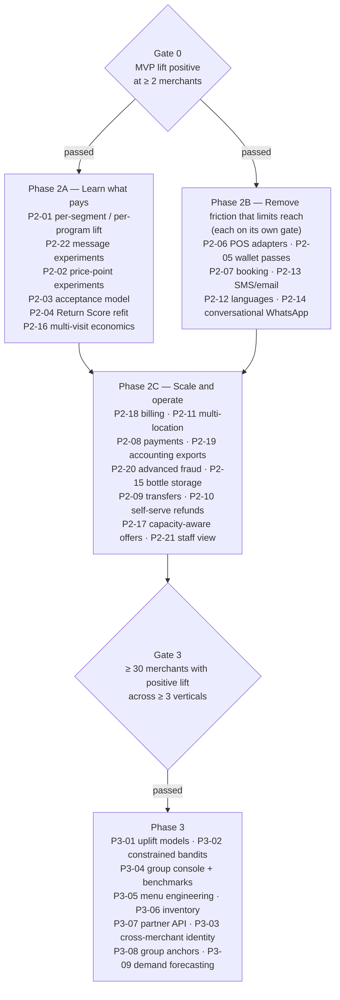

# Return Anchor: Roadmap (Phase 2 and Phase 3)

> **Deliverable 24** (Phase 2 features) and **Deliverable 25** (Phase 3 features) from
> [`00-brief.md`](00-brief.md) §18. The MVP is defined in
> [`01-product-spec.md`](01-product-spec.md) §11. Seams referenced here are real files in
> `src/`; the blueprint ([`../architecture/blueprint.md`](../architecture/blueprint.md) §2)
> lists wallet passes, POS vendor adapters, payments, bookings and ML models as "not in MVP
> (seams exist)".

## 0. Rules for this roadmap

1. **Nothing is built on a hunch.** Every item has an **evidence gate**: a metric, a
   threshold and a data source. Until the gate is met, the item stays on paper.
2. **The optimisation target is incremental profitable customer lifetime value.** A feature
   that raises offers sent, messages sent, redemptions or prepaid value without raising the
   holdout lift is a failure (brief §19).
3. **Gate 0 comes first.** No Phase 2 item starts until the MVP hypothesis has an answer,
   with one narrowly defined exception (P2-06, §2).
4. **Thresholds are Proposed.** None of the gate thresholds below exist in code; they are
   planning numbers to be confirmed with pilot data. Where a gate needs data the MVP does not
   capture yet, it says **needs instrumentation** and points to §6.
5. **Every shipped Phase 2/3 feature carries its own kill test.** If its gate metric does not
   move within 90 days of launch, it is switched off or removed.

---

## 1. Gate 0: the MVP verdict

From [`01-product-spec.md`](01-product-spec.md) §10.7. Primary metric: incremental
contribution per identified assigned customer over 60 days, treatment vs holdout
(`estimateLift()` in `src/modules/analytics/lift.ts`).

| Readout | Decision |
|---|---|
| `positive` at ≥ 2 pilot merchants, no merchant `negative`, counter-metrics within target (expiry share ≤ 30%, opt-out per reminder ≤ 3%, realised today margin ≥ 45%) | **Gate 0 passed.** Start Phase 2A. |
| `inconclusive` with ≥ 150 matured customers per arm | One more cycle with tuned pricing and timing. No Phase 2. |
| `insufficient_data` | Extend pilot, raise holdout to 0.3–0.5, add merchants. No Phase 2. |
| `negative` at 2+ merchants | Stop. Diagnose the funnel. Phase 2 is cancelled, not delayed. |

Pooling results across pilot merchants is analyst work (SQL over `experiment_assignments`,
`visits`, `visit_lines`), not a product feature.

---

## 2. Sequencing

**Why learning comes before reach.** Friction removers (wallet passes, POS adapters,
languages) increase the *volume* of anchors. If the economics are not yet tuned per segment
and price point, more volume can mean more unprofitable anchors faster. Phase 2A makes each
anchor more profitable; Phase 2B makes there be more of them.

**The one exception.** P2-06 (POS adapter for one vendor) may start before Gate 0 if pilot
merchants drop out citing double entry *and* POS-lite captures fewer than 50% of their bills
(needs instrumentation IN-7). Without it there may be no Gate 0 answer at all.

---

## 3. Phase 2 (deliverable 24)

Format per feature: the problem, the **evidence gate**, what it builds on in code, and a
compact devil's-advocate **Challenge**.

### Phase 2A: learn what pays

#### P2-01 Per-segment and per-program lift

- **Problem:** `measuredUplift()` replaces the uplift prior with one merchant-wide number.
  The prior gives likely regulars +11.8 points (spec §4.7, OI-2); if their true uplift is
  zero, the engine keeps offering anchors that do not pay.
- **Gate:** Gate 0 passed at the merchant **and** ≥ 100 matured customers per arm in at least
  two segments. Data exists: segment at decision time is stored in `offer_decisions.context.segment`.
- **Builds on:** `estimateLift()`, `measuredUplift()`, `DealInput.measuredUplift`,
  `PLAYBOOKS[segment].allowedOfferTypes`.
- **Challenge:**
  - Necessary for H? No (H is answered); necessary for profit at scale. First Phase 2 item.
  - Merchant may reject: fewer offers to regulars. Show the per-segment lift that justifies it.
  - Margin: directly protects margin by switching off negative segments.
  - Statistical risk: many segments × programs = many comparisons; small cells are noisy. Use the same shrinkage as `measuredUplift()` and report `insufficient_data` honestly.
  - Would happen anyway? No; the prior cannot learn on its own.
  - Prove it: re-run the overall holdout after switching; overall lift should rise or offer volume fall at equal lift.

#### P2-22 Message-level experiments (reminder timing, win-back, nudges)

- **Problem:** The checkout holdout measures anchor + reminders as one bundle. We do not know
  whether the reminder at `reminderFraction` 0.6 of the usual gap is right, or whether
  `bottle_low` nudges change anything (bottle keeping cannot be randomly withheld, spec §6).
- **Gate:** Gate 0 passed **and** ≥ 300 reminders per month at the merchant
  (`messages` with `template_key = anchor_reminder`, data exists).
- **Builds on:** `firstReminderAt()`, campaign holdouts (`campaign_recipients.arm`),
  `assignArm()` with a new experiment key.
- **Challenge:**
  - Necessary for H? No. Necessary to stop paying for messages that do nothing.
  - Customer may reject: none; holdout customers simply get one message fewer.
  - Merchant may reject: "Why skip reminders to some customers?" Show cost per message and lift.
  - Trust / regulatory: none beyond existing consent rules.
  - Prove it: return within 14 days of the scheduled reminder, message arm vs no-message arm.

#### P2-02 Price-point experiments within the ladder

- **Problem:** The engine picks the price point that maximises `pAccept × ΔE`, but `pAccept`
  is a prior (`baseAcceptance`, `acceptanceMidpointDepth` 0.5, `acceptanceSteepness` 0.12).
  The restaurant example shows +$10 and +$11 within 1 cent of expected value of each other
  (spec §4.5); the real optimum is unknown.
- **Gate:** P2-01 shipped **and** ≥ 300 shown anchor offers per month at the merchant
  (`offer_exposures`, data exists).
- **Builds on:** `priceLadder()`, deterministic `assignArm()`; every candidate is already
  logged in `offer_decisions.candidates`.
- **Challenge:**
  - Customer may reject: two customers at the same table could see different prices on different days. Randomise by customer, never within a party; all prices remain within program bounds.
  - Merchant may reject: inconsistent pitch for staff. Staff still see one price per bill.
  - Margin: every tested price must still pass all hard constraints; no unprofitable arm is possible.
  - Trust / regulatory: personalised pricing perception; keep price differences small (adjacent ladder rungs) and never based on protected attributes. Counsel to review in markets with price-discrimination rules.
  - Prove it: acceptance and 60-day contribution by price arm.

#### P2-03 Learned acceptance model

- **Problem:** Acceptance is modelled per segment only; no per-merchant or per-context learning.
- **Gate:** ≥ 500 anchor offers shown with outcome at the merchant **and** calibration gap
  ≥ 5 points between predicted `pAccept` and observed acceptance in any segment
  (`offer_exposures.status`, `offer_decisions.chosen.pAccept`, data exists).
- **Builds on:** `dealEngine.baseAcceptance`, `acceptanceMidpointDepth`,
  `acceptanceSteepness` (merchant-editable settings today). First version: fit these three
  settings per merchant, nothing more.
- **Challenge:**
  - Necessary? Only when the prior is shown to be wrong.
  - Margin: a model that overestimates acceptance pushes prices up and offers down, not losses; constraints still hold.
  - Ops complexity: a monthly batch fit writing settings overrides; no online model.
  - Prove it: calibration plot before and after; lift unchanged or better.

#### P2-04 Return Score refit per merchant

- **Problem:** `SCORE_WEIGHTS` are a hand-set logistic prior (intercept −1.6, `anchorValueLog`
  0.6, ...). The config file itself says they are to be refitted per merchant in Phase 2.
- **Gate:** ≥ 1,000 scored customers with ≥ 90 days of observation **and** the prior's
  calibration (predicted vs observed 60-day return by band) is off by ≥ 10 points in any band.
- **Builds on:** `computeReturnScore()`, `modelInputs()`, `ScoreFeatures`, `customers.score_factors`.
- **Challenge:**
  - Necessary? Only if `p0` is miscalibrated; `p0` drives `ΔE`.
  - Risk: overfitting small merchants. Shrink fitted weights toward the prior.
  - Trust: explanations must stay human-readable (top factors); no opaque model.
  - Regulatory: same features only (visit facts); no new personal data.
  - Prove it: out-of-time calibration; lift unchanged or better after switching.

#### P2-16 Multi-visit economics (CLV horizon)

- **Problem:** `ΔE = U − C + p1·Gnew − p0·G − perkCost` looks one visit ahead. For session
  businesses (spa, fitness, café) the profit is in renewal and the chain of anchors, so the
  anchor value cap blocks them at default settings (spec §6.3, OI-1). Brief §3 lists
  customer lifetime value as an input; it is not used yet.
- **Gate:** Gate 0 passed **and** ≥ 100 matured anchors with an observed "second anchor
  within 60 days" rate (renewal), data exists in `entitlements` and `offer_decisions`.
- **Builds on:** `evaluateDeals()`, `anchorValueCapRate`, `renewal_bonus` offers.
- **Challenge:**
  - Necessary for H? No; necessary to extend the product credibly to service verticals.
  - Margin: longer horizons compound optimistic assumptions. Use measured renewal rates only, never priors, beyond the first visit.
  - Cannibalisation: renewal packages may pull forward purchases that would have happened anyway; the holdout horizon must extend to 90–120 days for these programs.
  - Prove it: lift over a longer `horizonDays` (schema allows up to 180) for session verticals.

### Phase 2B: remove friction that limits reach

#### P2-06 POS vendor adapters

- **Problem:** Staff enter bills twice (real POS and POS-lite). Biggest adoption risk (spec §8.2).
- **Gate:** ≥ 3 live merchants on the same POS vendor **and** either POS-lite captures < 70% of
  their bills (needs instrumentation IN-7) or double entry is the top reason in churn
  interviews. Exception before Gate 0 in §2.
- **Builds on:** `PosAdapter` interface and `ADAPTERS` registry in
  `src/integrations/pos/adapter.ts`; `canonicalOrderSchema`; idempotency by `externalRef`;
  `visits.source = pos`. One file per vendor.
- **Challenge:**
  - Customer impact: faster till; offer appears where staff already look.
  - Merchant may reject: POS vendor fees or partner approval. Start with the vendor most pilots use.
  - Margin: POS lines often lack cost; unknown items get cost 0 and overstate margin. Require catalog matching by SKU and flag unmatched items.
  - Fraud: POS voids must flow through, or `voided-upgrade` misses cases.
  - Ops complexity: per-vendor maintenance forever. Build one, measure, then decide on the second.
  - Prove it: share of visits with `source = pos`, acceptance rate before and after, merchant retention.

#### P2-05 Apple Wallet and Google Wallet passes

- **Problem:** A web wallet link in WhatsApp is easier to lose than a lock-screen pass.
- **Gate:** Gate 0 passed **and** claim-to-return friction is shown:
  (a) ≥ 20% of redemptions are looked up by phone because the customer could not open the
  wallet (needs instrumentation IN-2), **or** (b) < 30% of claimed customers reopen the wallet
  before their first reminder (needs IN-1; `wallet_tokens.last_used_at` keeps only the latest
  use). Example of the rule in plain words: *only build Apple Wallet passes after claim-rate
  and wallet-reopen data show web wallet friction.*
- **Builds on:** `WalletPassProvider` (`createPass`, `updatePass`) and `WalletPassInput`
  (`merchantName`, `brandColor`, `customerRedeemCode`, `balances`, `walletUrl`) in
  `src/integrations/wallet-passes/provider.ts`; stubs throw `WalletPassesNotEnabled`.
- **Challenge:**
  - Customer may reject: another "add to wallet" prompt. Offer it after claim, never instead of the web wallet.
  - Merchant may reject: none; cost is ours (Apple Pass Type ID certificate, signing, pass update web service; Google issuer account and service account).
  - Ops complexity: pass updates on every ledger change; certificate rotation.
  - Trust: lock-screen presence can feel intrusive; no location-triggered passes (see "What not to build").
  - Would they return anyway? The question is whether passes change return rate. Randomise the "add to wallet" prompt (50/50) and compare return within 60 days.

#### P2-07 Booking integration

- **Problem:** "Reserve a table" opens a link (`business.bookingUrl`); no table is actually held,
  and no booking is attributed to the reminder.
- **Gate:** reserve-button clicks ≥ 5% of delivered reminders (needs IN-3) **and** ≥ 3 merchants
  using the same booking system.
- **Builds on:** button action `reserve` in `messaging/types.ts`, `buildButtons()`.
- **Challenge:**
  - Merchant may reject: already pay for a booking system; integrate, never replace.
  - Margin: bookings on peak nights for anchor redemptions displace full-price tables. Respect `redemption.offPeakOnly` and `allowedWeekdays`.
  - Ops complexity: two-way sync and no-shows.
  - Prove it: return rate of customers who clicked reserve vs not is confounded; use a randomised "reserve button shown" arm.

#### P2-13 SMS and email fallback

- **Problem:** `messages.channel` is WhatsApp only; customers without WhatsApp or who decline
  WhatsApp get nothing.
- **Gate:** ≥ 20% of claimed customers have no delivered WhatsApp message (status `failed`)
  or decline service messages, over 60 days (data exists: `messages`, `customer_consents`).
- **Builds on:** provider interface pattern (`WhatsAppProvider`), template registry.
- **Challenge:**
  - Customer may reject: SMS feels like spam in many markets.
  - Regulatory: separate consent and opt-out handling per channel; Do Not Call style registries for SMS in some markets.
  - Cost: SMS is dearer per message than the configured WhatsApp estimates ($0.02 utility, $0.08 marketing).
  - Prove it: return rate of SMS-reachable vs unreachable customers is confounded; randomise channel availability for a month.

#### P2-12 Multi-language templates and wallet

- **Problem:** Copy is English only (`messaging/templates.ts`, `anchors/terms.ts`);
  `WHATSAPP_TEMPLATE_LANGUAGE` defaults to `en`.
- **Gate:** ≥ 15% of claims from browsers preferring another language (needs IN-4) **or** a
  pilot market where English is not the default.
- **Builds on:** `merchants.locale`, template `metaName` per language in WhatsApp Manager.
- **Challenge:**
  - Ops complexity: every template needs Meta approval per language; terms translations need legal review.
  - Trust: mistranslated terms are a consumer-law risk. Translate terms professionally, not by machine, before launch.
  - Prove it: claim rate and opt-out rate by language.

#### P2-14 Conversational WhatsApp

- **Problem:** Customers reply "can I book Friday?" or "keep my next bottle"; today only
  STOP / START / BALANCE / WALLET are handled (`inbound-message.ts`).
- **Gate:** inbound messages ≥ 5% of delivered reminders (data exists: `messages.direction = inbound`)
  **and** merchants report staff time answering them.
- **Builds on:** `service_reply` category (free-form within 24 hours), `webhook_events`.
- **Challenge:**
  - Customer may reject: a bot pretending to be staff. Always disclose automation; hand over to staff.
  - Ops complexity: 24-hour window rules, staff inbox, response time expectations.
  - Regulatory: WhatsApp commerce and messaging policies change; keep to service replies.
  - Prove it: time-to-return after a reply vs before; merchant staff time.

### Phase 2C: scale and operate

#### P2-18 Merchant billing and plans (not in the brief)

- **Problem:** Pilots are free; a SaaS needs billing.
- **Gate:** first merchant past Gate 0 willing to pay; pricing interviews with ≥ 5 merchants.
- **Builds on:** nothing yet (Not yet built). **Proposed** pricing hypothesis to test: flat
  monthly fee with a performance component tied to measured incremental contribution, which
  aligns our incentive with the holdout and not with redemptions.
- **Challenge:**
  - Merchant may reject: performance fees need trusted measurement; the lift card must be auditable.
  - Trust: never price on redemptions or messages sent (that would reward the wrong target).
  - Prove it: conversion and churn by plan.

#### P2-11 Multi-location

- **Problem:** Chains want one program across outlets and redemption at any outlet.
- **Gate:** ≥ 2 merchants with 2+ outlets past Gate 0 at their first outlet.
- **Builds on:** `locations` table, `visits.location_id` (MVP uses one location per merchant);
  customers already per merchant, not per location.
- **Challenge:**
  - Margin: redemption at a busier outlet shifts cost; report by issuing vs redeeming outlet.
  - Fraud: cross-outlet staff collusion; fraud rules per outlet.
  - Ops complexity: per-outlet settings overrides (off-peak windows differ).
  - Prove it: lift per outlet; redemptions at a different outlet than issue.

#### P2-08 Payments: buy the next package, reserve the next bottle

- **Problem:** WhatsApp buttons `top_up` and `renew` and the `bottle_low` "Reserve next
  bottle" land on the wallet; purchase still happens in store.
- **Gate:** ≥ 10% of renewal and bottle-low messages get a `renew` / `top_up` click (needs IN-3)
  **and** fewer than half of those convert in store within 14 days **and** a legal review of
  selling prepaid items online in the market.
- **Builds on:** button actions `top_up`, `renew`; `stored_purchase` issue mode;
  `refundPolicy`.
- **Challenge:**
  - Customer may reject: prepaying online for alcohol or services; payment trust.
  - Merchant may reject: payment fees; reconciliation with their POS.
  - Regulatory: online prepaid sales and refunds are the area most likely to trigger stored-value, consumer-protection and (for alcohol) liquor-licence rules. Item-denominated, single merchant, no cash-out remains a hard rule.
  - Fraud: chargebacks after redemption; issue the anchor only on settled payment.
  - Prove it: renewals per 100 eligible customers, randomised payment-link availability.

#### P2-19 Accounting and liability exports

- **Problem:** Accountants need outstanding liability (retail and cost) and deferred revenue
  for paid upgrades.
- **Gate:** outstanding liability > $5,000 at a merchant or a request from the merchant's
  accountant.
- **Builds on:** `outstandingLiabilityCents()`, `remainingRetailCents()`, `remainingCostCents()`,
  `entitlement_events` ledger.
- **Challenge:**
  - Merchant may reject: none; low effort.
  - Regulatory: revenue recognition differs by market; export data, do not give accounting advice.
  - Prove it: not a lift feature; measured by merchant retention.

#### P2-20 Advanced fraud detection

- **Problem:** Five rules (`rapid-redemption`, `staff-redemption-volume`, `many-claims`,
  `voided-upgrade`, `positive-adjustment`) with fixed thresholds.
- **Gate:** confirmed fraud flags > 1 per 100 redemptions at any merchant, or one confirmed
  loss > $500 (data exists: `fraud_flags.status = confirmed`).
- **Builds on:** `FRAUD_RULES`, `FraudFacts`, `runFraudRules()`. Candidates: phone-number
  velocity across merchants, per-merchant staff baselines instead of the fixed 25 per day.
- **Challenge:**
  - Merchant may reject: false positives against staff.
  - Trust / regulatory: device fingerprinting has privacy implications; prefer behavioural rules.
  - Prove it: confirmed-flag rate and losses before and after.

#### P2-15 Bottle storage management

- **Problem:** Bars need shelf maps, level disputes and stock checks beyond
  `storage_location` text and level recording.
- **Gate:** ≥ 3 bar merchants with > 2 manual adjustments (`entitlement_events.type = adjusted`)
  or `positive-adjustment` flags per 100 kept bottles per month (data exists).
- **Builds on:** `applyLevel()` (levels only go down), `applyAdjust()` (reason required),
  `entitlements.storage_location`.
- **Challenge:**
  - Customer may reject: disputes; a photo of the bottle at each pour would help but adds staff work.
  - Regulatory: liquor-licence conditions on storing customer-owned alcohol.
  - Prove it: dispute and adjustment rates down; no change expected in lift.

#### P2-09 Transfers and gifting

- **Problem:** Brief §15 asks to show transfer rules; programs carry `transferable`, the
  ledger has a `transferred` event type, but there is no transfer flow.
- **Gate:** ≥ 5% of transferable anchors are redeemed by someone other than the owner
  (staff-reported) **or** ≥ 20 customer requests per month across merchants.
- **Builds on:** `entitlements.transferable`, `TermsSnapshot.transferable`, event type `transferred`.
- **Challenge:**
  - Merchant may reject: transfers turn anchors into a resale currency.
  - Fraud: farming anchors on one phone and transferring; rate-limit and log.
  - Growth upside: a transferred anchor brings a *new* customer, the best case for incremental value.
  - Prove it: new-customer acquisition via transfers, holdout on the transfer prompt.

#### P2-10 Customer self-serve refund requests

- **Problem:** Refunds are manager-initiated today (`refundAllowed()`, `applyRefund()`).
- **Gate:** a market's consumer law requires self-service, or staff-handled refund requests
  exceed 1% of anchors issued.
- **Builds on:** refund policy per program; ledger `refunded` event.
- **Challenge:**
  - Merchant may reject: refunds become easier; but transparent refunds raise trust and acceptance.
  - Prove it: acceptance rate before and after showing "refund in one tap" (randomised copy).

#### P2-17 Capacity- and time-aware offers

- **Problem:** Brief §3 lists time/day and merchant capacity as deal-engine inputs. Today
  off-peak windows only affect redemption rules and perks; capacity is not modelled.
- **Gate:** P2-07 (booking data) shipped **and** a merchant shows peak saturation (≥ 90% of
  tables or slots booked on ≥ 2 nights a week) with idle off-peak capacity.
- **Builds on:** `business.offPeak`, `redemption.offPeakOnly`, `off_peak_perk`.
- **Challenge:**
  - Customer may reject: "only redeemable Monday–Thursday" feels restrictive; must be in terms before purchase.
  - Margin: shifting redemptions off-peak lowers real marginal cost; the engine still charges full cost, so this is upside.
  - Prove it: share of redemptions off-peak and peak-night revenue, randomised by program.

#### P2-21 Staff performance view

- **Problem:** Acceptance probably varies by staff member; training needs data.
- **Gate:** Gate 0 passed **and** acceptance varies more than 2× between staff at a merchant
  (needs IN-5: offer exposures do not record the staff member; `visits.opened_by_user_id` and
  `entitlements.issued_by_user_id` are partial proxies).
- **Builds on:** `visits.opened_by_user_id`, `entitlements.issued_by_user_id`.
- **Challenge:**
  - Customer may reject: pushier staff. Report acceptance **and** 60-day value of their customers, never acceptance alone.
  - Merchant may reject: union or HR sensitivity in some markets.
  - Do not build: per-acceptance commissions (see §5).
  - Prove it: training on low-acceptance staff raises acceptance without lowering lift.

---

## 4. Phase 3 (deliverable 25)

Phase 3 starts only after **Gate 3**: ≥ 30 merchants with a `positive` verdict across at
least 3 verticals, and Phase 2A shipped. These items need pooled data or a network that
only exists at that scale.

#### P3-01 Uplift modelling (who to offer)

- **Gate:** ≥ 20,000 matured assignments pooled across merchants **and** P2-01 shows lift
  differs significantly between segments.
- **Builds on:** `experiment_assignments`, `offer_decisions.context`.
- **Challenge:** Opaque models undermine the merchant's "I stay in control" (brief §13); keep guardrails as hard constraints and show reasons. Prove with a holdout comparing model targeting vs playbook targeting.

#### P3-02 Constrained contextual bandit for offer type and price

- **Gate:** P2-02 shows the best price point varies by context **and** ≥ 50,000 offers per month platform-wide.
- **Challenge:** Bandits optimise the reward they are given; reward must be 60-day contribution, not acceptance. Guardrails (`evaluateGuardrails`) stay outside the learner as hard limits. Always keep a fixed holdout.

#### P3-03 Cross-merchant customer identity

- **Gate:** ≥ 20% of customers hold anchors at 2+ merchants on the platform (phone-match
  analysis under privacy review) **and** a legal review per market.
- **Builds on:** today customers are per merchant (`customers.merchant_id`, phone unique per merchant).
- **Challenge:** Privacy (merchants do not share customers today); trust ("why does this café know I drink at that bar?"); regulatory. A single wallet *view* is acceptable; shared balances are not (see §5).

#### P3-04 Group / franchise console and benchmarks

- **Gate:** ≥ 3 groups with ≥ 5 outlets each on P2-11; benchmarks need ≥ 30 merchants per vertical.
- **Challenge:** Benchmarks invite merchants to copy settings without understanding them; show lift, not just acceptance.

#### P3-05 Menu engineering recommendations

- **Gate:** ≥ 50 merchants with programs; enough variation in coverage and price ranges to learn which items make profitable anchors.
- **Builds on:** `anchor_programs`, deal decision logs.
- **Challenge:** Recommending what to anchor changes menus; keep it advisory, show expected `ΔE` and measured lift per program type.

#### P3-06 Inventory integration (bottles, kegs)

- **Gate:** P2-15 shipped and ≥ 10 bars or beer pubs request stock sync.
- **Challenge:** Vendor-specific; little effect on lift. Build only if it reduces disputes or stock loss measurably.

#### P3-07 Partner API and integrations marketplace

- **Gate:** ≥ 3 inbound partner integration requests with committed partners.
- **Builds on:** `canonicalOrderSchema`, API keys with `scopes`.
- **Challenge:** Support burden; versioning. Public API only for flows already stable for a year.

#### P3-08 Group anchors and keg allocation

- **Problem:** Brief §1 mentions keg allocation; groups and companies want a shared pool
  ("40 pints for the team").
- **Gate:** ≥ 10 merchants manually running group pools (stored-purchase programs shared via
  staff) **and** P2-09 transfers shipped.
- **Builds on:** `stored_purchase` item programs (a keg can already be modelled as N pints).
- **Challenge:** A pooled balance shared by many people drifts towards prepaid credit; keep it item-denominated, single merchant, with a named owner.

#### P3-09 Demand forecasting and capacity-aware pricing

- **Gate:** P2-17 shows measurable gains from off-peak steering at ≥ 10 merchants.
- **Challenge:** Dynamic pricing perception; keep within program price bounds and disclose rules.

---

## 5. What NOT to build

| Do not build | Why | Do this instead |
|---|---|---|
| Points, tiers, earn rates | Brief §16: not a loyalty points app. Points pay for visits that would happen anyway. | Item-denominated anchors and recognition perks (`priority_booking`). |
| A percentage-coupon engine or "deal of the day" | Brief §5: teaches customers to wait for discounts. | Paid anchors, perks, capped controlled offers via guardrails. |
| Money balances, cash top-ups, cash-out | Brief §16: not a prepaid credit wallet; likely stored-value regulation. | Sell items and packages (`stored_purchase`), never dollars. |
| Cross-merchant redeemable anchors (coalition) | Multi-merchant stored value and loyalty-coalition economics; regulatory exposure. | Separate anchors per merchant; at most a shared *view* (P3-03). |
| Native customer app | Brief §7: no native app initially; install friction kills claims. | Web wallet, later wallet passes (P2-05). |
| Streaks, badges, "come back in 30 days for a bigger reward" | Rewards inactivity and escalation (brief §5). | `no-inactivity-escalation`, one win-back per 90 days. |
| Breakage-based pricing or forecasts | Brief §15: do not rely on customers forgetting. | `ΔE` charges full cost; expiry warnings; expiry share as a counter-metric. |
| Hidden expiry, auto-renewal, dark-pattern opt-ins | Brief §15: no dark patterns. | Terms snapshot and transparency lines on every wallet; marketing consent never pre-ticked. |
| Location tracking or distance in the Return Score | Brief §10 says "where legally appropriate"; benefit unproven, privacy cost certain. | Visit facts only (`ScoreFeatures`). Revisit only with explicit opt-in, legal review and proven score gain. |
| Per-acceptance staff commissions | Rewards pushy selling and anchors that do not pay. | P2-21 view that pairs acceptance with 60-day customer value. |
| Selling or sharing customer data | Destroys trust; privacy law. | None. |
| Marketing blasts without holdout | Cannot tell if they make money. | Campaigns always launch with a holdout (`campaigns.holdout_bp`). |
| Unlabelled automated chat replies | Customers think they talk to staff. | P2-14 with disclosure and hand-over. |
| Optimising for redemptions, messages or prepaid value | Brief §19: the target is incremental profitable CLV. | Holdout lift on contribution as the north-star metric. |

---

## 6. Instrumentation needed by the gates (Not yet built)

| ID | Data | Needed by | Note |
|---|---|---|---|
| IN-1 | Wallet open events (per open, not just `wallet_tokens.last_used_at`) | P2-05 | Append-only event per wallet view. |
| IN-2 | Lookup method at redemption (code vs phone) | P2-05 | Record on the redemption audit entry. |
| IN-3 | Message button clicks (wallet `?action=` parameter, booking redirect) | P2-07, P2-08 | Log the action when the wallet opens with `?action=`. |
| IN-4 | Claim page language preference | P2-12 | Store with the claim consent record or audit entry. |
| IN-5 | Staff member on each offer exposure | P2-21 | Exposures do not record a user today. |
| IN-6 | Upsell panel shown / hidden arm | Spec §8.2 Challenge | Randomised hide on 20% of redemption visits for one month. |
| IN-7 | Merchant's total bill count per day (from POS or self-reported) | P2-06, §2 exception | Needed to compute POS-lite coverage. |

Data that already exists and serves gates: segment at decision time
(`offer_decisions.context.segment`), offer outcomes (`offer_exposures.status`), claim timing
(`entitlement_events` `issued` → `claimed`), message statuses and inbound messages
(`messages`), consents (`customer_consents`), adjustments (`entitlement_events.type = adjusted`),
fraud outcomes (`fraud_flags.status`), visit source (`visits.source`).

---

## 7. Review cadence

- **Monthly:** check every open gate against the data; move items whose gate passed into
  planning; record decisions in `decisions.md`.
- **Per shipped feature, 90 days after launch:** compare its gate metric and the overall
  holdout lift before and after. If neither moved, switch it off.
- **Quarterly:** re-run Gate 0 per merchant (lift can decay as novelty wears off); a merchant
  whose verdict turns `negative` gets its pricing and playbooks reviewed before any new feature.
