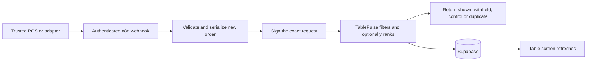

# TablePulse n8n deal workflow

The decision maker is the TablePulse backend. n8n delivers authenticated POS orders to it and returns the result. The backend reads Supabase, applies the non-negotiable rules and fixed profit goals, optionally asks an AI agent to rank the approved choices, records the decision and updates the table screen. No OpenAI key, Supabase service key or database node belongs in n8n.

Import **`tablepulse-pos-decision.json`**. It is inactive, contains no credentials, and uses built-in Webhook, Code, IF, Crypto, HTTP Request and Respond to Webhook nodes. It requires an n8n release that supports **Crypto node version 2 with Crypto credentials**. The node definitions were checked against n8n's current official source on 8 October 2026; an older installation may need an update. This package has not been imported into your n8n account or activated.



## Connect it

1. In n8n, import the JSON file from the workflow menu. See [n8n import instructions](https://docs.n8n.io/build/manage-workflows/export-and-import.md).
2. Create a **Header Auth** credential. Set Name to `x-tablepulse-pos-key` and Value to a new random secret of at least 32 characters. Select it on **POS order webhook**. Give that secret only to the trusted POS adapter, never the public screen or customer app. It is separate from the backend signing secret. [Webhook authentication](https://docs.n8n.io/integrations/builtin/core-nodes/n8n-nodes-base.webhook).
3. Create a **Crypto** credential with **Hmac Secret** equal to the backend's `TABLEPULSE_WEBHOOK_SECRET`. Select it on **Sign TablePulse request**. No secrets belong in Code nodes or workflow JSON. [Crypto credentials](https://docs.n8n.io/integrations/builtin/core-nodes/n8n-nodes-base.crypto).
4. In **Record order and evaluate**, replace `https://tablepulse.example.com/api/offers/evaluate` with the fixed URL of your backend. Keep the Raw body and both signature headers. Redirects are disabled so signed orders are not forwarded to another host. [Raw HTTP request bodies](https://docs.n8n.io/integrations/builtin/core-nodes/n8n-nodes-base.httprequest).
5. Use the webhook **Test URL** and **Listen for test event** first. After verifying authentication, duplicates, withholding, table display and errors, publish the workflow and configure the POS adapter with the **Production URL**.

Keep HTTPS enabled. n8n Cloud cannot reach `127.0.0.1` on your PC: the backend must have a reachable HTTPS deployment. When self-hosting n8n in Docker, use an explicitly configured reachable backend address; `localhost` inside the container means the container. For a loopback-only local test with n8n on the same host, the HTTP node can point to `http://127.0.0.1:3001/api/offers/evaluate`.

There is no Supabase key in this workflow. Supabase credentials remain server-side in TablePulse. Membership phone OTP and staff confirmation remain in the app. The workflow never verifies age, links an arbitrary customer, sets prices, redeems a code or writes inventory directly.

## Enable the constrained offer agent

The imported n8n flow already calls the correct agentic endpoint. The optional ranker runs inside TablePulse so the backend can build a safe candidate allowlist and transactionally recheck the selected offer. Set these only on the TablePulse server:

```env
TABLEPULSE_AGENT_ENABLED=true
TABLEPULSE_AGENT_MODEL=gpt-6-astra
OPENAI_API_KEY=your-server-side-key
```

The agent receives candidate IDs and commercial figures, current basket categories, and—only for an opted-in linked customer—explicit preferences and aggregated category counts from up to ten associated visits in the past 180 days. It does not receive phone numbers, names, customer IDs or raw line-by-line history. It returns one allowlisted offer ID or `NO_OFFER` through a strict JSON schema. `store:false` is set on the request.

If the agent is disabled, times out, fails or returns invalid output, the deterministic rules scorer is used and the fallback is audited. The request timeout is 4.5 seconds. Keep the model key in the backend environment and review supplier/privacy terms before enabling real customer personalisation. This repository tests the allowlist, schema parsing and fallback paths; a live provider call still needs verification with your own account and key.

## What the POS sends

```json
{
  "externalId": "your-pos:bill-482:order-event-17",
  "sessionId": "00000000-0000-4000-8000-000000000204",
  "items": [
    { "menuItemId": "00000000-0000-4000-8000-000000000009", "quantity": 2 }
  ],
  "discount": false
}
```

Send only **new order lines** for a paid/accepted organic order, never an entire cumulative bill snapshot on every update. Keep the same `externalId`, session and content on retries. Map POS bill IDs to the current TablePulse session UUID and vendor product IDs to TablePulse menu UUIDs in a trusted vendor adapter. Opening/closing visits and reconciling voids, corrections, splits and table moves require that adapter's lifecycle mapping; this webhook accepts new orders only.

`discount` is required explicitly; it must reflect happy hour, vouchers, membership discounts and other existing bill deals. The workflow must not infer `false` from a missing vendor field. A trusted optional `customerRef` can contain a verified POS loyalty reference or `member:TP-XXXXXXXXXX` when the POS independently confirms the account. Omit it when staff has already linked the phone-authenticated member. Never send phone numbers, names, purchase profiles, age flags or public-screen tokens. Unknown fields are rejected.

**Only one backend call is made.** `/api/offers/evaluate` already ingests the order and evaluates it atomically. Do not call `/api/pos/events` first: doing so would make the evaluation call a duplicate. Neither endpoint is a timer or “try for a deal” button.

## Results and failure handling

| Result                                            | HTTP status                  | Meaning                                                                                      |
| ------------------------------------------------- | ---------------------------- | -------------------------------------------------------------------------------------------- |
| `shown`                                           | 200                          | The backend allocated a deal; `selectionSource` shows `ai` or `rules`.                       |
| `withheld`                                        | 200                          | The order succeeded, but no deal was allocated. Reasons come from the backend.               |
| `control`                                         | 200                          | The order succeeded; this visit belongs to the comparison group.                             |
| `duplicate`                                       | 200                          | This order was already processed; no new eligibility attempt or stock deduction.             |
| Invalid canonical payload                         | 400                          | Correct the adapter payload; do not repeatedly resend malformed content.                     |
| Order conflict, closed visit or unavailable stock | 4xx                          | Inspect the POS mapping/current bill; do not manufacture a fresh ID to bypass the rejection. |
| Backend rate limit                                | 429                          | Retry later with the same ID and content.                                                    |
| Backend signature/permission error                | 502, `retryable:false`       | Fix integration credentials; no offer is invented.                                           |
| Backend/service/transport failure                 | 502 or 503, `retryable:true` | Keep the event in the POS adapter's durable outbox; retry with the same ID/content.          |

The HTTP node has a ten-second timeout and up to three attempts for transport/JSON parsing errors. HTTP status errors are returned for the adapter to handle; they do not use the node's automatic retries. The signed timestamp is fresh per workflow execution and remains within the backend's five-minute window during these short attempts. Set the caller timeout above 35 seconds. Later retries invoke the webhook again with the **original** order ID and content, generating a fresh timestamp/signature.

Do not interpret `withheld` as a technical failure or retry it to seek an offer. Do not add an independent n8n AI branch after TablePulse: it would no longer share the backend's allowlist and transaction. If n8n fails after a backend commit, the later duplicate acknowledgment safely confirms processing. n8n is not the durable order store: a real POS adapter must own an outbox/reconciliation process so a failed webhook cannot lose an order.

The import disables saving successful, failed, manual and progress execution payloads. Incoming headers may contain the POS credential, so keep this policy in production. During a fictional local test, the editor can still display live execution data. TablePulse keeps eligibility and audit records; n8n's execution metadata supports operational monitoring. Configure your existing n8n error workflow/monitoring for failed executions after selecting real notification credentials and recipients. This package does not send email or WhatsApp.

## Demo and verification

`demo-order.json` uses seeded T05 and Tiger draught IDs. It assumes a freshly seeded demo; it may legitimately return `withheld` if that visit has already used its opportunity. Change the test order ID only for a genuinely new order, not for a retry. Do not reset a shared demonstration that needs its membership data preserved.

To send it to your configured n8n test webhook, set `TABLEPULSE_N8N_WEBHOOK_URL` and `TABLEPULSE_POS_INGRESS_KEY` in your terminal environment, then run:

```sh
node scripts/send-n8n-order.cjs integrations/n8n/demo-order.json
```

The app's local demo signing secret, only when no custom secret is set, is `tablepulse-local-demo-TABLEPULSE_WEBHOOK_SECRET-not-for-production`. Use it only in the local demo Crypto credential. Set a separately generated production backend secret for live use.

`node scripts/generate-n8n.cjs` regenerates the export from `code/*.js`; generate again after editing those sources. `pnpm test` runs the workflow Code nodes and verifies validation, byte-identical signing, result classification and safe errors alongside the engine/database tests. `node scripts/n8n-contract-smoke.cjs` tests the exported signing/request contract against a running local demo using a disposable table visit. It does **not** execute a real n8n instance. Full import, selected credentials, provider authentication and node execution still need verification on your configured n8n instance before publishing.

The algorithm explanation and exact implemented scores are in [decision-process.md](decision-process.md).
